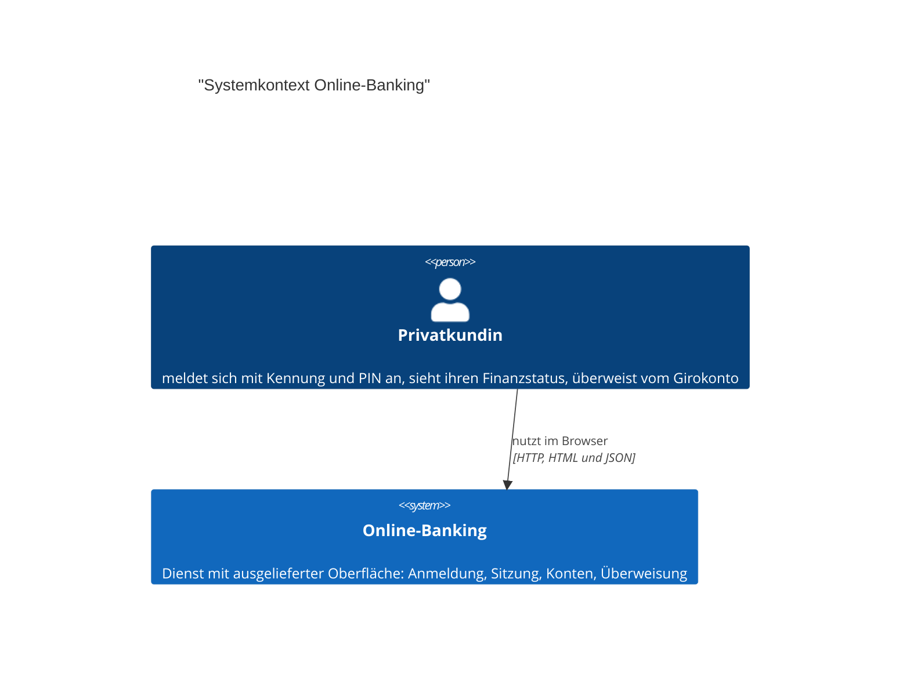
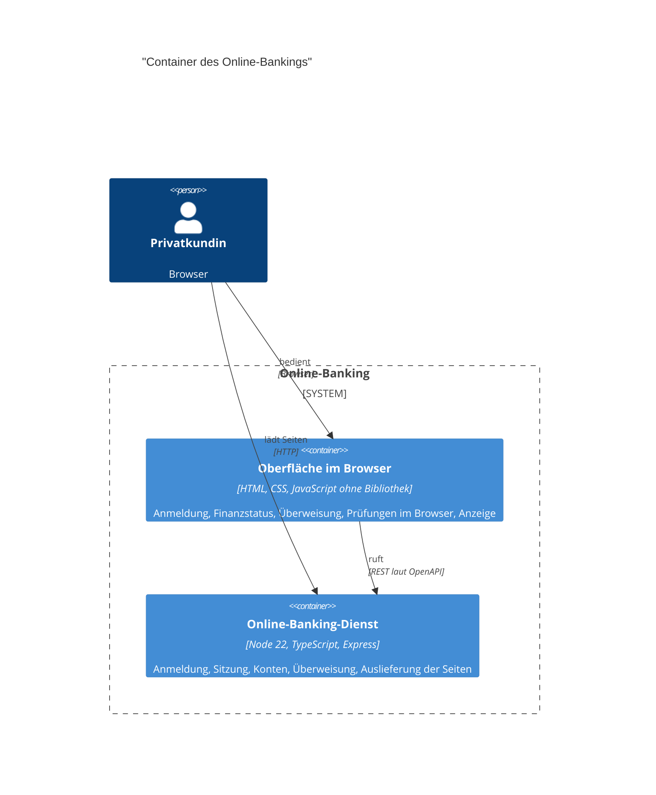
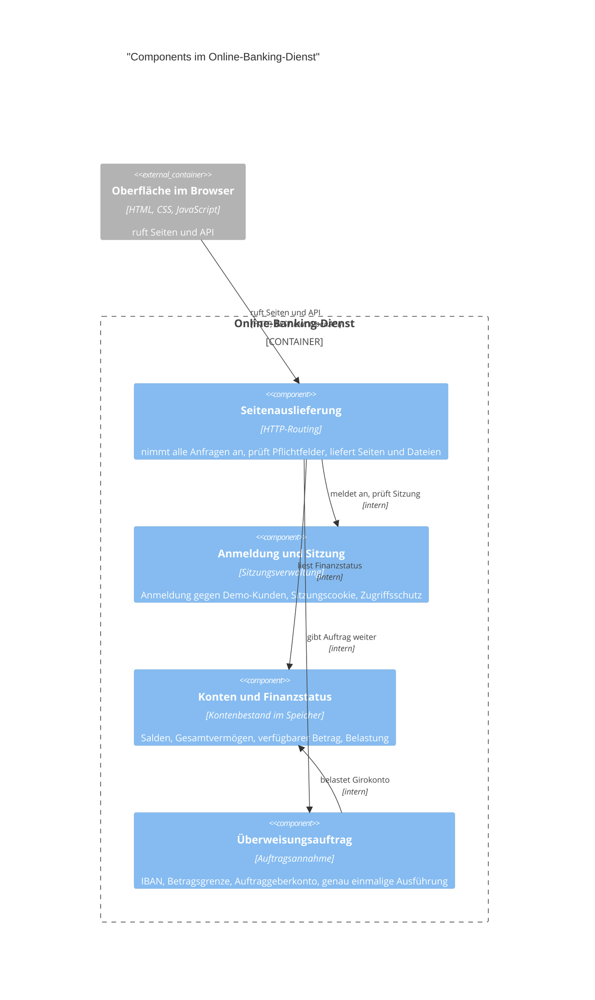
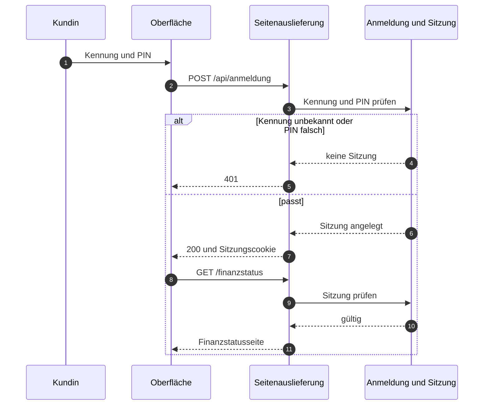
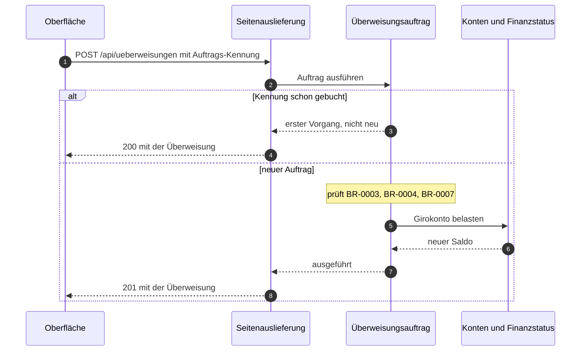
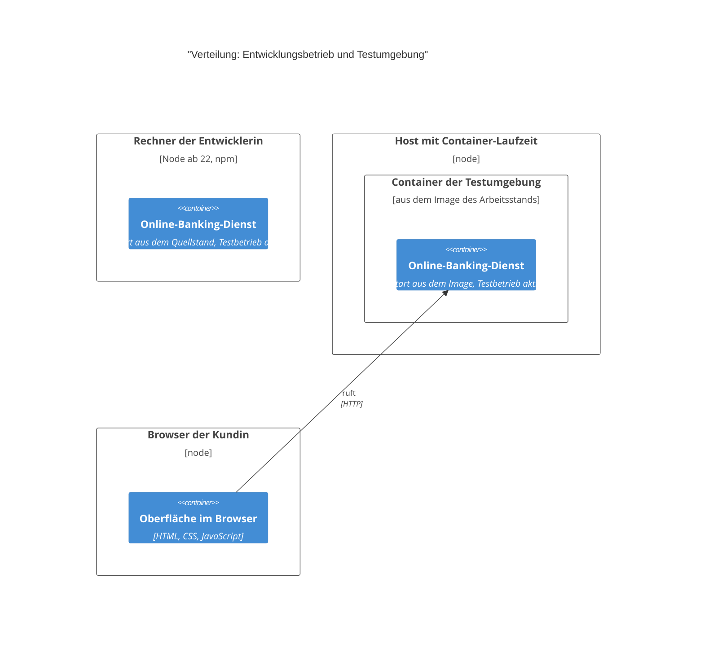

# Architektur: Online-Banking

## 1. Einführung und Ziele

Aufgabe, Ziele und Stakeholder stehen in `docs/vision.md`.

Das Online-Banking der Aventa Bank ist ein einzelner Dienst, der die Oberfläche für Privatkundinnen mit ausliefert: Anmeldung mit Kennung und PIN, Finanzstatus (UC-001) und einmalige Überweisung vom Girokonto (UC-002). Konten und Kunden sind Demo-Daten (C-001), ein Kernbanksystem gibt es nicht. Oberfläche und API liegen in einem Dienst, damit der Demo-Betrieb ohne getrenntes Frontend auskommt (ADR-001).

## 2. Randbedingungen

Die Leitplanken des Hauses stehen in `docs/leitplanken.md`, die Randbedingungen des Systems (C-…) in `docs/requirements.md`.

- **Auslieferung:** Der Dienst wird als Container ausgeliefert, spricht HTTP und beendet kein TLS; die Verschlüsselung endet vor dem Dienst.

## 3. Kontextabgrenzung

| Gegenüber | Richtung | Daten | Schnittstelle |
| --- | --- | --- | --- |
| Privatkundin | beide | Kennung und PIN; Konten, Salden, Gesamtvermögen; Überweisungsauftrag | Browser, HTML und JSON unter /api |

Es gibt kein Kernbanksystem, keine Marktdatenquelle, kein Messaging und keinen weiteren Dienst; der Dienst arbeitet allein und führt den Kontenbestand selbst.

## 4. Lösungsstrategie

| Schicht | Technik | Hauptversion |
| --- | --- | --- |
| Laufzeit | Node, LTS-Alpine-Image | 22 |
| Sprache | TypeScript, strict, ES2022, CommonJS | 5.9 |
| HTTP | Express | 4 |
| Oberfläche | HTML, CSS, JavaScript ohne Bibliothek und ohne Bundler | keine |
| Test | Gauge mit Playwright im Browser, node:test für die Module | Gauge 0.3 |
| Auslieferung | Mehrstufiges Container-Image, Laufzeit nur mit Produktionsabhängigkeiten | Node 22 |

Prägende Grundentscheidungen:

1. Ein Dienst liefert Oberfläche und API aus, kein getrenntes Frontend und kein Bundler (ADR-001).
2. Zustand liegt nur im Speicher, ein fester Ausgangsstand ist über den Testbetrieb wiederherstellbar (ADR-002).
3. Genau einmalige Ausführung bucht über die von der Oberfläche vergebene Auftrags-Kennung (ADR-003).
4. Fachliche Prüfungen stehen doppelt, im Browser und im Dienst; maßgeblich ist der Dienst (ADR-004).
5. Geldbeträge sind Zahlen in Euro, jede Rechnung wird auf Cent gerundet (ADR-005).
6. Akzeptanztests laufen mit Gauge und Playwright gegen eine laufende Testumgebung und prüfen den Stand über die Versionsantwort (ADR-006).

## 5. Bausteinsicht

| Baustein | Verantwortung | Schnittstellen | Ort |
| --- | --- | --- | --- |
| Online-Banking-Dienst | Führt Anmeldung, Sitzung, Konten und Überweisung und liefert die Oberfläche aus | REST laut OpenAPI als Server; HTTP für Seiten und Dateien | `src/` |
| Oberfläche im Browser | Baut die Seiten für Anmeldung, Finanzstatus und Überweisung zusammen, prüft Eingaben vorab und zeigt Ergebnisse an | REST laut OpenAPI als Client | `public/` |

Die Oberfläche kennt nur das JSON der API und keine Entität; der Dienst kennt kein Markup der Seiten; keine fachliche Component kennt HTTP.

### Online-Banking-Dienst

Der Dienst besteht aus vier Components; die fachlichen Teile kennen kein HTTP, die Seitenauslieferung enthält keine Regel.

| Component | Verantwortung | Regeln |
| --- | --- | --- |
| Seitenauslieferung | Nimmt jede Anfrage von außen an, prüft die Pflichtfelder eines Auftrags und liefert Seiten und Dateien aus | keine |
| Anmeldung und Sitzung | Prüft Kennung und PIN gegen die Demo-Kunden, legt Sitzungen an und schützt Seiten wie API | keine |
| Konten und Finanzstatus | Führt den Demo-Kontenbestand mit Salden und verfügbarem Betrag und bucht Belastungen | BR-0001, BR-0002, BR-0006 |
| Überweisungsauftrag | Nimmt Aufträge an, prüft Empfänger, Betrag und Auftraggeberkonto und führt sie genau einmal aus | BR-0003, BR-0004, BR-0005, BR-0007 |

Keine Component greift an der Seitenauslieferung vorbei; der Überweisungsauftrag kennt Konten und Finanzstatus, aber nicht umgekehrt.

## 6. Laufzeitsicht

### Anmeldung und Sitzung

Der Ablauf zeigt, dass die Sitzung im Dienst entsteht und jede angemeldete Seite sie erneut prüft; ohne gültige Sitzung sieht die Kundin nur die Anmeldung (NFR-001).

### Überweisung mit genau einmaliger Ausführung

Der Ablauf zeigt, dass eine wiederholte Bestätigung derselben Auftrags-Kennung keine zweite Belastung auslöst und das erste Ergebnis zurückkommt (BR-0005, NFR-002), während die maßgeblichen Prüfungen im Dienst liegen (ADR-004).

## 7. Verteilungssicht

- **Bauen:** Mehrstufig; die Baustufe übersetzt die Quellen und prüft die Typen, die Laufzeitstufe enthält nur die Produktionsabhängigkeiten, die Seiten kommen unverändert aus dem Arbeitsstand.
- **Ausliefern:** Ein Image, ein Container je Umgebung; Oberfläche und API kommen aus demselben Prozess.
- **Konfiguration:** Netz-Port, Betriebsart und Version kommen aus der Umgebung, sonst ist nichts einstellbar.
- **Skalierung:** Ein Container, der Zustand liegt im Prozess; eine zweite Instanz teilt nichts (siehe Risiken).
- Ein Produktivbetrieb ist im Repo nicht beschrieben.

## 8. Querschnittliche Konzepte

### Fehlerbehandlung

Der Dienst antwortet auf jeden erwarteten Fehlerfall mit einem HTTP-Status und einem deutschsprachigen Satz im Fehlerfeld. Unterschieden werden fehlende Sitzung, unvollständiger Auftrag, fachlich abgelehnter Auftrag mit Grund und ein Datenfehler des Kontenbestands. Zentral gefangen werden nur die beiden fachlichen Fehlerarten; ein unerwarteter Fehler erreicht die Kundin nicht als gestaltete Antwort. Die Oberfläche bildet den Status auf eine Feldmeldung oder die allgemeine Meldung ab und leitet bei fehlender Sitzung auf die Anmeldung (siehe Risiken).

### Sicherheit

Die Anmeldung prüft Kennung und PIN gegen die Demo-Kundenliste, ein Zähler und eine Sperre fehlen. Eine Sitzung ist eine Zufallskennung im Speicher des Dienstes, die über ein HttpOnly-Cookie mit SameSite Lax gefunden wird; das Cookie trägt kein Secure, weil der Dienst kein TLS beendet. Der Zugriffsschutz sitzt an einer Stelle: Seiten werden ohne Sitzung auf die Anmeldung umgeleitet, API-Aufrufe mit 401 beantwortet (NFR-001). Eine Autorisierung je Konto gibt es nicht (siehe Risiken).

### Persistenz und Transaktionen

Der Dienst hält keinen dauerhaften Zustand: Kontenbestand, Sitzungen und gebuchte Auftrags-Kennungen liegen im Speicher des Prozesses, ein Neustart setzt alles auf den Ausgangsstand zurück (ADR-002). Im Testbetrieb setzt eine zusätzliche Route den Ausgangsstand zurück und beendet alle Sitzungen; außerhalb des Testbetriebs ist sie nicht vorhanden. Belastung und Idempotenz-Ablage werden ohne Sperre nacheinander im selben Prozess verändert, mehrere Instanzen teilen nichts (siehe Risiken).

### Logging und Telemetrie

Der Dienst schreibt eine Startmeldung und protokolliert einen Datenfehler; eigene Metriken, Zugriffsprotokoll und Traces gibt es im Dienst nicht, und er bleibt dafür unverändert. Die Meldung eines Datenfehlers nennt die betroffene IBAN und verstößt damit gegen die Leitplanke zu Kontobezügen in Logs (siehe Risiken). In der Testumgebung läuft er als Image online-banking-otel: Ein Aufsatz außerhalb des Repos instrumentiert den Dienst mit der Autoinstrumentierung von OpenTelemetry für Node und exportiert per OTLP an den Collector der Umgebung; die Metrik http.server.request.duration trägt Route, Methode, Statuscode und service.version, und daraus misst der Betrieb Antwortzeit und 5xx-Anteil je Operation und Version (NFR-003, NFR-004). Ein Produktivbetrieb mit solcher Messung ist im Repo nicht beschrieben.

### Konfiguration

Der Dienst liest nur Netz-Port, Betriebsart und Version aus der Umgebung, alles andere steht im Image. Die Version kommt beim Bauen ins Image und wird über eine offene Route gemeldet, damit die Akzeptanztests den geprüften Stand erkennen. Der Testbetrieb schaltet die Reset-Route frei; sonst ist sie unbekannt.

### Formate

JSON in camelCase, Beträge als Zahl in Euro mit zwei Nachkommastellen, Zeitpunkte in UTC nach ISO 8601, die Währung nach ISO 4217 steht im Auftrag (ADR-005). Die IBAN wird vor Prüfung und Ablage normalisiert und in der Oberfläche in Vierergruppen gezeigt. Die Anzeige nutzt die Formatierung der Standardbibliothek für de-DE und EUR. Die Auftrags-Kennung ist eine Zufallskennung in Hexform, die die Oberfläche je Zusammenfassung vergibt.

### Testkonzept

Unit-Tests in `test/` prüfen die Geschäftsregeln am Modul ohne HTTP und setzen den Ausgangsstand je Test zurück; sie laufen als Teil des Baus. Akzeptanztests in `acceptance/` laufen als Gauge-Szenarien über Playwright im Browser gegen eine laufende Testumgebung; ein Szenario prüft ein Akzeptanzkriterium, je Szenario werden Cookies gelöscht und der Ausgangsstand über den Testbetrieb zurückgesetzt. Die Testumgebung entsteht aus dem Arbeitsstand: Image bauen, Container mit Testbetrieb starten, auf die Versionsantwort warten; die Tests starten den Dienst nicht selbst. Vor einem Lauf vergleichen sie die gemeldete Version mit einer freigegebenen Commit-Liste, sofern eine gesetzt ist.

## 9. Architekturentscheidungen

Die Entscheidungen stehen einzeln unter `docs/adr/`.

## 10. Qualitätsanforderungen

Die Qualitätsanforderungen (NFR-…) stehen in `docs/requirements.md`.

- **NFR-001 Zugriffsschutz des Finanzstatus:** Anmeldung und Sitzung tragen den Schutz zentral, die Seitenauslieferung wendet ihn auf jede Seite und jeden API-Aufruf an, ohne ihn in den Seiten zu wiederholen.
- **NFR-002 Genau einmalige Ausführung einer Überweisung:** Der Überweisungsauftrag bucht über die von der Oberfläche vergebene Auftrags-Kennung; eine Wiederholung liefert das erste Ergebnis, ohne erneut zu belasten.

## 11. Risiken und technische Schulden

| Risiko | Wirkung | Maßnahme |
| --- | --- | --- |
| Kein TLS im Dienst, kein Secure am Sitzungscookie, kein Zähler und keine Sperre bei der Anmeldung | Kennung, PIN und Sitzung sind im Netz abgreifbar, Anmeldeversuche sind unbegrenzt | TLS vor dem Dienst, Secure am Cookie, Zähler mit Sperre vor einer Öffnung nach außen |
| Ein Datenfehler wird mit der betroffenen IBAN protokolliert, gegen die Leitplanke zu Kontobezügen in Logs | Kontobezug in einer Ausgabe, die weitergegeben werden kann | Ausgabe ohne IBAN, nur Ort und Art des Fehlers |
| Zustand nur im Speicher (ADR-002) | Ein Neustart verliert Sitzungen, Salden und den Schutz nach BR-0005; eine zweite Instanz teilt nichts | Persistenz und gemeinsamer Speicher vor einem Produktivbetrieb |
| Geldbeträge als Gleitkommazahl, gegen die Leitplanke dezimal ohne Gleitkomma (ADR-005) | Rundungsdrift bei vielen Buchungen, Grenzfälle beim Vergleich mit dem verfügbaren Betrag | Dezimalbetrag mit Währung, Umstellung vor dem Anschluss einer Kernbank |
| Fehlerformat ohne Problem Details, gegen die Leitplanke REST | Clients brauchen eine Sonderbehandlung, ein späterer Wechsel ändert die Schnittstelle | Problem Details in der OpenAPI beschreiben, dann einführen |
| Die Auftrags-Kennung kommt vom Browser ohne Bindung an die Sitzung | Eine geratene Kennung liefert fremde Auftragsdaten zurück | Kennung im Dienst ausstellen oder an die Sitzung binden |
| Demo-PINs stehen im Klartext im Repo, gegen die Leitplanke zu Geheimnissen | Für den Demo-Betrieb nach C-001 hinnehmbar, für eine echte Anmeldung unzulässig | Anmeldung über eine Kernbank, PINs nur aus der Umgebung |
| Kein Bezug zwischen Konto und angemeldeter Kundin | Jede Kundin sieht denselben Demo-Bestand, fachlich falsch bei mehr als einer Kundin | Zuordnung von Konto zu Kundin mit der Kernbank einführen |

## 12. Glossar

| Begriff | Bedeutung |
| --- | --- |
| Sitzung | Zufallskennung im Speicher des Dienstes, über ein HttpOnly-Cookie gefunden; maßgeblich für den Zugriffsschutz |
| Testbetrieb | Betriebsart, in der eine zusätzliche Route den Ausgangsstand zurücksetzt |
| Ausgangsstand | Fester Anfangsbestand an Konten und Kunden, auf den Tests zurücksetzen |
| Auftrags-Kennung | Zufallskennung der Oberfläche je Zusammenfassung, Schlüssel der genau einmaligen Ausführung |
| Idempotenz-Ablage | Zuordnung einer Auftrags-Kennung zum ersten Ergebnis, im Speicher des Dienstes |
| Datenfehler | Fehlender Dispositionsrahmen im Kontenbestand, der den Finanzstatus als Ganzes scheitern lässt |
| Ablehnung | Fachlich abgelehnter Auftrag mit Grund, den der Dienst als Fehlerantwort meldet |
| Seitenauslieferung | Baustein, der jede Anfrage von außen annimmt und Seiten wie API bedient |
| Seitenstand | Version, die der Dienst meldet und gegen die die Akzeptanztests prüfen |
| Auslieferungsimage | Image mit übersetztem Dienst und Seiten, das je Umgebung als ein Container läuft |
