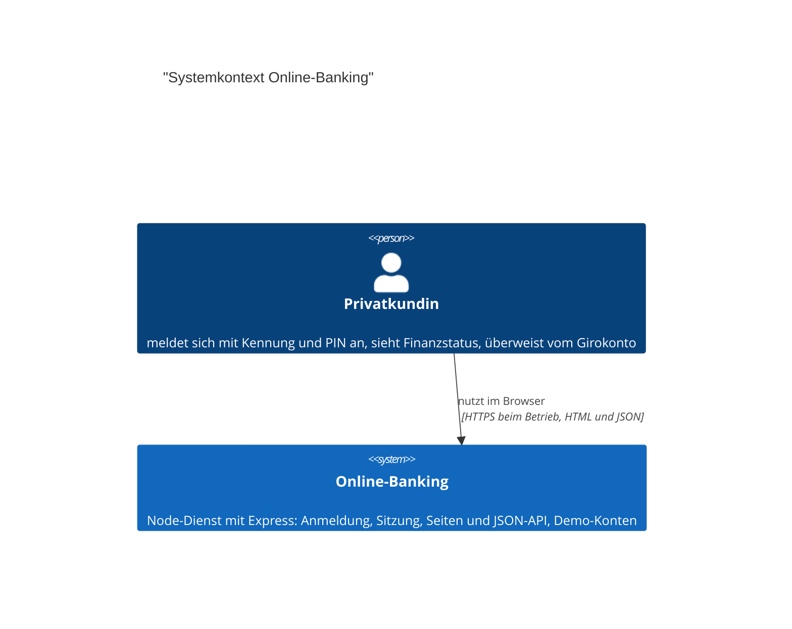
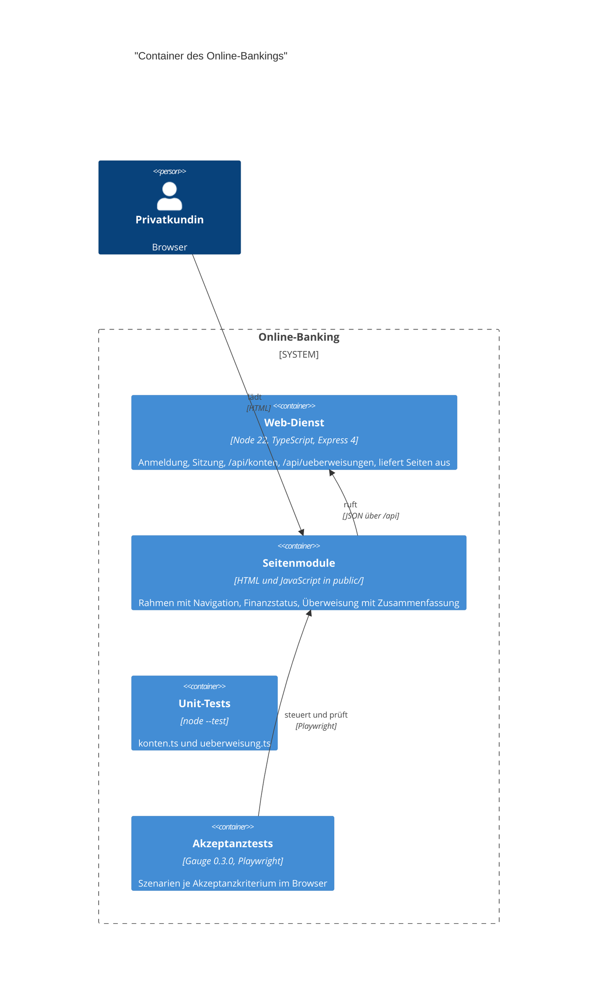
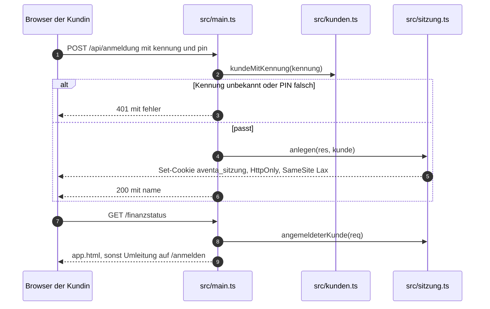
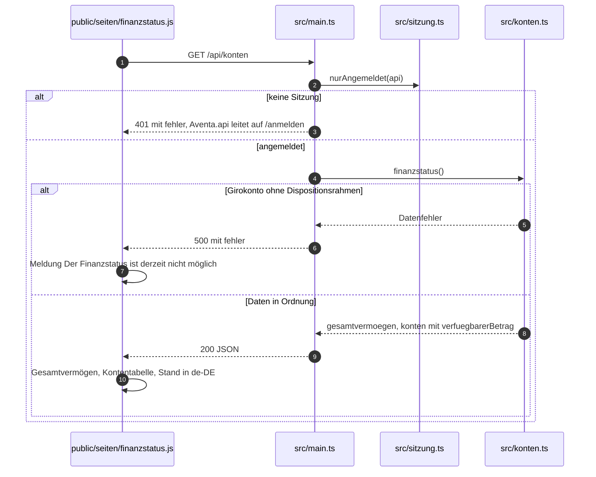
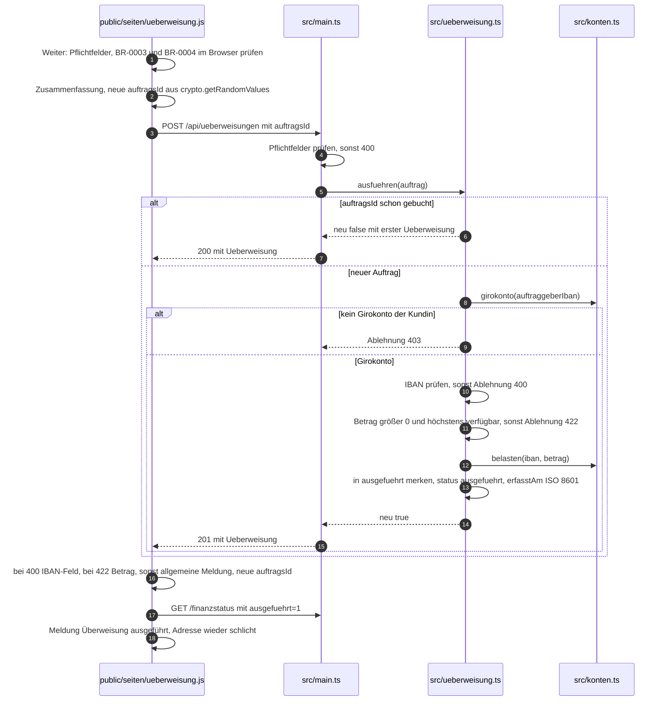
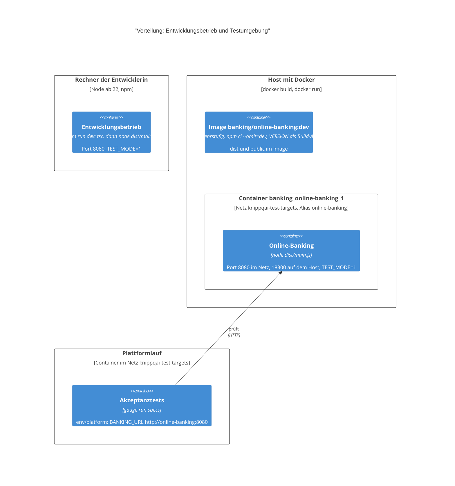

# Architektur: Online-Banking

## 1. Einführung und Ziele

Aufgabe, Ziele und Stakeholder stehen in `docs/vision.md`.

# Architektur Online-Banking

## 1. Einführung und Ziele

Das Online-Banking der Aventa Bank ist ein einzelner Node-Dienst (TypeScript, Express). Er stellt die Anmeldung mit Kennung und PIN, den Finanzstatus (UC-001) und die einmalige Überweisung vom Girokonto (UC-002) für Privatkundinnen bereit und liefert zugleich die Oberfläche aus: HTML-Seiten aus `public/` und JSON unter `/api`. Konten und Kunden sind Demo-Daten (C-001), ein Kernbanksystem gibt es nicht.

Zweck, Stakeholder und Ziele stehen in `docs/vision.md`, Qualitätsanforderungen und Randbedingungen in `docs/requirements.md`, die Leitplanken des Hauses in `docs/leitplanken.md`, die Entscheidungen unter `docs/adr/`. Dieses Dokument beschreibt, was der Code tatsächlich tut (Dateien in `src/`, `public/`, `acceptance/`, `test/`, `Dockerfile`, `scripts/testumgebung.sh`), nicht was üblich wäre.

Die Use Cases: UC-001 Finanzstatus anzeigen (Maske `finanzstatus`), UC-002 Überweisung vom Girokonto (Masken `ueberweisung`, `ueberweisung-bestaetigen`).

## 2. Randbedingungen

Die Leitplanken des Hauses stehen in `docs/leitplanken.md`, die Randbedingungen des Systems (C-…) in `docs/requirements.md`.

## 2. Randbedingungen

- **C-001:** Konten und Kunden sind feste Demo-Daten (`src/konten.ts`, `src/kunden.ts`); keine Kernbank, keine Datenbank, keine Persistenz.
- **Laufzeit:** Node ab 22 (`engines` in `package.json`, `node:22-alpine` im Dockerfile), TypeScript strict, target ES2022, module commonjs mit esModuleInterop.
- **Abhängigkeiten:** im Betrieb nur `express` (^4.22.1); zum Bauen `typescript` (~5.9.3) und die `@types`; die Oberfläche nutzt kein Framework und keinen Bundler.
- **Geheimnisse:** keine im Repo; der Dienst liest `PORT`, `TEST_MODE` und `VERSION` aus der Umgebung. Die Demo-PINs stehen im Klartext in `src/kunden.ts`.
- **Betrieb:** Der Dienst spricht HTTP auf Port 8080 (`EXPOSE 8080`); TLS endet nicht im Dienst.
- Die Leitplanken des Hauses gelten. Wo der Code abweicht, steht das unter Risiken statt in einer stillschweigenden Änderung der Leitplanke.

## 3. Kontextabgrenzung

## 3. Kontextabgrenzung

Der Code kennt genau eine Person und kein Nachbarsystem: Konten kommen aus dem eigenen Speicher, eine Kernbank fehlt (C-001).

| Gegenüber | Richtung | Daten | Schnittstelle |
| --- | --- | --- | --- |
| Privatkundin | beide | Kennung und PIN zur Anmeldung; Konten, Salden, Gesamtvermögen; Überweisungsauftrag | Browser, HTML-Seiten des Online-Bankings, JSON unter /api |

Es gibt kein Kernbanksystem, keine Marktdatenquelle und kein Messaging: der Dienst ist allein. Ein weiterer Dienst, der ihn aufruft, ist im Code nicht vorhanden; die Akzeptanztests sprechen ihn als Client an.

## 4. Lösungsstrategie

## 4. Lösungsstrategie

Stack, Versionen aus `package.json`, `tsconfig.json`, `Dockerfile` und `acceptance/package.json`:

| Schicht | Technik | Version |
| --- | --- | --- |
| Laufzeit | Node, LTS-Alpine-Image | ab 22, `node:22-alpine` |
| Sprache | TypeScript, strict, ES2022, commonjs | ~5.9.3 |
| HTTP | Express, JSON-Body über `express.json()` | ^4.22.1 |
| Oberfläche | HTML, CSS, JavaScript in `public/`, keine Bibliothek | ohne Bundler |
| Formatierung | `Intl.NumberFormat` de-DE mit EUR | ECMAScript-Standard |
| Zufall | `randomUUID`, `crypto.getRandomValues` | Node `node:crypto`, Browser |
| Unit-Tests | `node --test` auf `tsc`-Ausgabe in `build-test` | Node ab 22 |
| Akzeptanztests | Gauge mit gauge-ts, Playwright mit chromium | 0.3.0, ^1.62.1 |
| Auslieferung | mehrstufiger Docker-Build, `npm ci --omit=dev` | `node:22-alpine` |

Prägende Grundentscheidungen (je eine eigene ADR unter `docs/adr/`):

1. Ein Dienst, der die Oberfläche mit ausliefert, kein getrenntes Frontend und kein Bundler.
2. Zustand nur im Speicher, Ausgangsstand über `POST /api/test/reset` im Testbetrieb.
3. Genau einmalige Ausführung über die von der Oberfläche vergebene Auftrags-Kennung (BR-0005).
4. Fachliche Prüfungen doppelt: im Browser und im Dienst, maßgeblich ist der Dienst.
5. Geldbeträge als `number` in Euro, jede Rechnung auf Cent gerundet.
6. Akzeptanztests mit Gauge und Playwright gegen eine laufende Testumgebung, Stand über `GET /api/version`.

## 5. Bausteinsicht

## 5. Bausteine

| Baustein | Zuständig für | Ordner |
| --- | --- | --- |
| `main.ts` | HTTP-Routing, Anmeldung und Abmeldung, Pflichtfeldprüfung des Auftrags, Seitenauslieferung, Test-Reset, Start auf Port | `src/main.ts` |
| `sitzung.ts` | Sitzungen im Speicher, Cookie `aventa_sitzung`, `nurAngemeldet` für Seiten (Umleitung) und API (401) | `src/sitzung.ts` |
| `kunden.ts` | Demo-Kunden mit Kennung, PIN, Name, Kundennummer | `src/kunden.ts` |
| `konten.ts` | Demo-Konten, Gesamtvermögen (BR-0001), verfügbarer Betrag nur beim Girokonto (BR-0002), Belastung (BR-0006), `Datenfehler` | `src/konten.ts` |
| `ueberweisung.ts` | IBAN-Prüfung nach ISO 7064 MOD 97-10 mit SEPA-Liste (BR-0003), Betragsgrenze (BR-0004), genau einmalige Ausführung (BR-0005), Girokonto der Kundin (BR-0007), `Ablehnung` mit Status | `src/ueberweisung.ts` |
| `app.js` | Rahmen: Kunde im Kopf, Navigation, `Aventa.api` mit Umleitung bei 401, Euro-Format, Platzhalter | `public/app.js` |
| `finanzstatus.js` | Maske `finanzstatus`: Gesamtvermögen, Kontentabelle, Meldung nach Überweisung | `public/seiten/finanzstatus.js` |
| `ueberweisung.js` | Masken `ueberweisung` und `ueberweisung-bestaetigen`: Erfassen, Prüfen, Zusammenfassung, Absenden, Auftrags-Kennung | `public/seiten/ueberweisung.js` |
| `marke.js`, `styles.css`, `fonts/` | Zeichen, Guillochen-Muster, Gestaltung, Schrift Inter | `public/` |
| `anmelden.html`, `app.html` | Anmeldeseite und Rahmen der angemeldeten Seiten | `public/` |
| Szenarien | Ein Akzeptanzkriterium je Szenario, Tags mit Use-Case-Kennung | `acceptance/specs/` |
| Steps | Playwright-Steps, Seitenstand über `/api/version`, Cookies je Szenario löschen | `acceptance/tests/StepImplementation.ts` |
| Unit-Tests | BR-0001 bis BR-0007 am Modul, IBAN-Prüfziffer | `test/` |
| Bau und Start | Mehrstufiges Image, Testumgebung per Docker neu bauen und starten | `Dockerfile`, `scripts/testumgebung.sh` |

Die Modulgrenzen folgen den fachlichen Teilen, nicht dem HTTP: `main.ts` enthält keine Regel, `konten.ts` und `ueberweisung.ts` kennen kein HTTP. Die Oberfläche kennt keine Entität, nur das JSON der beiden Operationen.

## 6. Laufzeitsicht

## 6. Laufzeitverhalten

### Anmeldung

### Finanzstatus (UC-001)

### Überweisung (UC-002)

## 7. Verteilungssicht

## 7. Verteilung

Bauen und Ausliefern:

- `Dockerfile`: Stufe `build` mit `npm ci` und `npm run build`, Laufzeitstufe mit `npm ci --omit=dev`, `dist` aus der Baustufe, `public` aus dem Arbeitsstand, `EXPOSE 8080`, Start `node dist/main.js`. `VERSION` kommt als Build-Arg und wird zur Laufzeit von `GET /api/version` genannt.
- `scripts/testumgebung.sh`: setzt `VERSION` auf den kurzen Commit, ergänzt `+lokal` bei ungesicherten Änderungen an `src`, `public`, `package.json`, `package-lock.json`, `Dockerfile`, baut das Image, startet den Container im Netz `knippqai-test-targets` mit Alias `online-banking`, Port 18300 auf 8080 und `TEST_MODE=1`, wartet auf `GET /api/version`.
- `acceptance/env/default`: `BANKING_URL http://localhost:18300` für Läufe vom Rechner; `acceptance/env/platform`: `BANKING_URL http://online-banking:8080` für Läufe aus einem Container.
- Lokaler Entwicklungsbetrieb: `npm run dev` baut und startet mit `TEST_MODE=1` auf Port 8080, ohne Docker.
- Ein Umgebungsbetrieb ohne Docker ist im Repo nicht beschrieben; der Dienst ist zustandslos aus dem Image, aber nicht zustandsfrei im Sinne von mehreren Instanzen (siehe Risiken).

## 8. Querschnittliche Konzepte

## 8. Querschnittliche Konzepte

### Fehlerbehandlung

Der Dienst antwortet mit HTTP-Status und einem Feld `fehler` mit deutschsprachigem Satz (kein Problem Details nach RFC 9457, siehe Risiken): 401 ohne Sitzung (`sitzung.ts`), 400 bei unvollständigem Auftrag (`main.ts`) und bei ungültiger IBAN (`Ablehnung`), 403 bei fremdem Auftraggeberkonto, 422 bei unzulässigem Betrag, 500 bei `Datenfehler` im Finanzstatus, 204 bei Abmeldung und Test-Reset. `main.ts` fängt nur `Ablehnung` und `Datenfehler`; alles andere wird nicht gefangen und beendet die Antwort nicht als gestalteter Fehler. `Datenfehler` wird mit `console.error` protokolliert.

Im Browser übersetzt `Aventa.api` in `public/app.js`: 401 führt auf `/anmelden`, sonst wird `fehler` als Meldung geworfen. `public/seiten/ueberweisung.js` bildet 400 auf das IBAN-Feld, 422 auf das Betragsfeld und jeden anderen Status auf die allgemeine Meldung ab.

### Logging und Telemetrie

Nur zwei Ausgaben: `console.log` beim Start mit Port und Testbetrieb, `console.error` bei einem `Datenfehler`. Keine Traces, keine Metriken, kein Zugriffsprotokoll. Kontonummern, IBANs, Namen und Tokens erscheinen in keiner Ausgabe; die Fehlermeldung des `Datenfehler` nennt allerdings die IBAN des fehlerhaften Kontos und wird ausgegeben.

### Sicherheit

- Anmeldung gegen die Demo-Liste `KUNDEN` in `src/kunden.ts`, Vergleich der PIN als Zeichenkette, kein Zähler und keine Sperre.
- Sitzung: Zufalls-ID aus `randomUUID`, Ablage in einer Map im Speicher, Cookie `aventa_sitzung` mit `httpOnly`, `sameSite: 'lax'`, `path: '/'`, ohne `secure`; die Kennung der Kundin liegt neben der Sitzung.
- Zugriff: `nurAngemeldet('seite')` leitet auf `/anmelden`, `nurAngemeldet('api')` antwortet 401; angewandt auf `/api/sitzung`, `/api/konten`, `/api/ueberweisungen`, `/finanzstatus`, `/ueberweisung`. `/api/anmeldung`, `/api/abmeldung`, `/api/version` und die Dateien unter `/assets` sind offen.
- Keine Autorisierung je Konto: alle Kundinnen sehen denselben Demo-Bestand (`src/konten.ts`).
- Ausgabe im Browser über `html()` maskiert (`public/seiten/ueberweisung.js`).

### Persistenz

Keine. Konten als Modulvariable mit `AUSGANGSSTAND`, Sitzungen und ausgeführte Aufträge als `Map`. Ein Neustart setzt Sitzungen, Salden und die Idempotenz-Ablage zurück. `POST /api/test/reset` beendet alle Sitzungen und setzt Konten und Aufträge zurück, ist nur bei `TEST_MODE=1` registriert.

### Formate

- JSON in camelCase; Fehler als `{ "fehler": "…" }`.
- Beträge als Zahl in Euro, zwei Nachkommastellen nach Rundung; die Währung steht im Auftrag und in der Antwort als `waehrung: "EUR"`.
- Zeitpunkt `erfasstAm` als ISO 8601 in UTC über `new Date().toISOString()`.
- IBAN wird vor Prüfung und Ablage normalisiert (Leerzeichen entfernt, Großbuchstaben), in der Oberfläche in Vierergruppen gezeigt.
- Anzeige mit `Intl.NumberFormat('de-DE', { style: 'currency', currency: 'EUR' })`; Datum und Uhrzeit Stand mit `toLocaleString('de-DE')`.
- Der Auftrag trägt `auftragsId` als 32 Hexzeichen aus `crypto.getRandomValues`.

### Testkonzept

- **Unit-Tests** (`test/*.test.ts`, `npm test`): `tsc` nach `build-test`, dann `node --test`; BR-0001, BR-0002 und der Datenfehler in `konten.test.ts`, BR-0003 bis BR-0007 und die IBAN-Prüfziffer in `ueberweisung.test.ts`. Jeder Test setzt den Ausgangsstand selbst zurück.
- **Akzeptanztests** (`acceptance/`): Gauge mit gauge-ts, Steps in `acceptance/tests/StepImplementation.ts` über Playwright und chromium, eine Seite je Suite, Cookies je Szenario gelöscht, Ausgangsstand über den Step Testdaten sind zurückgesetzt gegen `POST /api/test/reset`.
- **Standprüfung:** vor der Suite vergleicht `standPruefen` die Antwort von `GET /api/version` mit `KNIPPQ_ACCEPTED_COMMITS`; ohne gesetzte Liste entfällt die Prüfung (lokaler Lauf).
- **Umgebungen:** `env/default` gegen den Docker-Container auf Port 18300, `env/platform` gegen den Alias `online-banking` im Netz `knippqai-test-targets`. Die Tests brauchen eine gebaute, laufende Testumgebung mit `TEST_MODE=1`; sie starten den Dienst nicht selbst.
- **Szenarien je Akzeptanzkriterium:** `acceptance/specs/anmeldung.spec`, `finanzstatus.spec`, `ueberweisung.spec`, je Szenario ein Kriterium, Tags mit Use-Case- und Story-Kennung.

## 9. Architekturentscheidungen

Die Entscheidungen stehen einzeln unter `docs/adr/`.

## 9. Architekturentscheidungen

Die Entscheidungen stehen einzeln unter `docs/adr/` (MADR):

| Entscheidung | Kern |
| --- | --- |
| Ein Dienst liefert Oberfläche und API | Ein Express-Prozess, HTML und JSON, kein Bundler, kein SPA-Framework; Seitenskripte melden sich mit `Aventa.seite` an |
| Zustand nur im Speicher | Modulvariablen und Maps, Ausgangsstand über `POST /api/test/reset` bei `TEST_MODE=1`, Grundlage ist C-001 |
| Genau einmalige Ausführung über die Auftrags-Kennung | `auftragsId` kommt aus der Oberfläche, der Dienst merkt sie in `ausgefuehrt`, 201 neu und 200 bei Wiederholung |
| Prüfungen doppelt, Dienst maßgeblich | IBAN und Betrag im Browser und in `src/ueberweisung.ts`, der Dienst prüft beim Bestätigen erneut |
| Geldbeträge als `number` in Euro | Rechnung in Cent mit `Math.round`, Rundung auf zwei Nachkommastellen, Währung EUR fest |
| Akzeptanztests gegen laufende Testumgebung | Gauge und Playwright, Basis-URL aus der Umgebung, Stand über `GET /api/version` |

## 10. Qualitätsanforderungen

Die Qualitätsanforderungen (NFR-…) stehen in `docs/requirements.md`.

## 10. Qualitätsanforderungen

Maß, Zielwert und Prüfung stehen in `docs/requirements.md`; hier steht, was der Code für die beiden Anforderungen tut.

| Kennung | Umsetzung im Code | Beleg |
| --- | --- | --- |
| NFR-001 Zugriffsschutz des Finanzstatus | `nurAngemeldet` in `src/sitzung.ts` schützt Seite (Umleitung auf /anmelden) und API (401); Sitzung als HttpOnly-Cookie `aventa_sitzung` mit `sameSite: 'lax'` | Szenario Der Finanzstatus ist ohne Anmeldung nicht erreichbar in `acceptance/specs/finanzstatus.spec` |
| NFR-002 Genau einmalige Ausführung einer Überweisung | Map `ausgefuehrt` nach `auftragsId` in `src/ueberweisung.ts` liefert bei Wiederholung dasselbe Ergebnis ohne zweite Belastung; Knopf wird während des Absendens gesperrt; je Zusammenfassung und nach jeder Ablehnung neue Kennung | Szenario Ein doppelter Klick auf Bestätigen bucht nur einmal in `acceptance/specs/ueberweisung.spec`, Unit-Test zu BR-0005 |

Weitere Eigenschaften, die der Code trägt, ohne dass eine NFR sie verlangt: schnelle Antwort, weil alles im Speicher liegt; Bedienbarkeit durch deutsche Texte und `aria`-Rollen in den Seitenmodulen; Wartbarkeit durch getrennte Module in `src/`.

## 11. Risiken und technische Schulden

## 11. Risiken und technische Schulden

| Risiko | Ort im Code | Wirkung |
| --- | --- | --- |
| Geldbeträge als Gleitkommazahl, gegen die Leitplanke dezimal ohne Gleitkommazahl | `runden` in `src/konten.ts`, `cent` in `src/ueberweisung.ts` | Rundungsdrift bei vielen Buchungen; der Vergleich genau der verfügbare Betrag geht nur über Cent-Rundung |
| Fehlerformat `{ fehler }` statt Problem Details nach RFC 9457, gegen die Leitplanke | `src/main.ts`, `src/sitzung.ts` | Clients brauchen eine Sonderbehandlung; ein späterer Wechsel ändert die Schnittstelle |
| Zustand nur im Speicher | `konten.ts`, `sitzung.ts`, `ausgefuehrt` in `ueberweisung.ts` | Neustart verliert Sitzungen, Salden und den Schutz nach BR-0005; keine zweite Instanz möglich |
| Idempotenz-Ablage wächst unbegrenzt und ist nicht dauerhaft | `const ausgefuehrt` in `src/ueberweisung.ts` | Speicher wächst; nach Neustart könnte dieselbe Kennung erneut buchen |
| Auftrags-Kennung kommt vom Client, ohne Signatur oder Bindung an die Sitzung | `public/seiten/ueberweisung.js`, `src/main.ts` | Eine geratene oder wiederverwendete Kennung liefert fremde Auftragsdaten zurück, weil die Ablage nur nach Kennung sucht |
| Regeln doppelt gepflegt: IBAN-Prüfung, SEPA-Länderliste, Fehlertexte | `src/ueberweisung.ts` und `public/seiten/ueberweisung.js` | Änderung an BR-0003 oder BR-0004 an zwei Stellen nötig, sonst weichen Browser und Dienst ab |
| Kein TLS, kein `secure` am Cookie, keine Sperre und kein Zähler bei der Anmeldung | `src/sitzung.ts`, `src/main.ts` | Sitzung und PIN sind im Netz abgreifbar; unbegrenzte Anmeldeversuche |
| Demo-PINs im Klartext und Anmeldung gegen eine feste Liste | `src/kunden.ts` | Nur für Demo zulässig (C-001), vor einer echten Anmeldung zu ersetzen |
| Alle Kundinnen sehen denselben Kontenbestand | `src/konten.ts` | Kein Bezug zwischen Sitzung und Konto; fachlich erst mit Kernbank zu lösen |
| Platzhalter für Finanzstatus und Überweisung bleiben in `app.js` stehen | `public/app.js` | Die Seitenskripte überschreiben sie; eine vergessene Anmeldung einer Seite zeigt still den Platzhalter |
| Seitenliste doppelt: `main.ts` kennt `/finanzstatus` und `/ueberweisung`, `app.js` ebenso | `src/main.ts`, `public/app.js` | Eine neue Seite braucht Einträge an beiden Stellen |
| Fängt der Dienst nur `Ablehnung` und `Datenfehler` | `src/main.ts` | Ein anderer Fehler endet ohne gestaltete Antwort; Express beantwortet ihn als HTML |
| Version nur aus dem Build-Arg | `Dockerfile`, `scripts/testumgebung.sh` | Ohne `VERSION` meldet `GET /api/version` unbekannt; die Standprüfung der Akzeptanztests greift dann nicht |
| Preload der Schrift, aber kein Cache-Konzept | `public/fonts/`, `/assets` über `express.static` | Jede Anfrage geht an den Dienst; im Betrieb ungemessen |

## 12. Glossar

## 12. Glossar

| Begriff | Bedeutung im Code |
| --- | --- |
| Auftrags-Kennung | `auftragsId`, 32 Hexzeichen, von der Oberfläche je Zusammenfassung erzeugt; Schlüssel der Idempotenz-Ablage |
| Verfügbarer Betrag | Saldo plus Dispositionsrahmen, nur beim Girokonto berechnet (BR-0002) |
| Dispositionsrahmen | Überziehungsspielraum des Girokontos, Pflicht beim Girokonto, sonst Datenfehler |
| Sitzung | Eintrag in der Map aus `src/sitzung.ts`, über das Cookie `aventa_sitzung` gefunden |
| Nur angemeldet | `nurAngemeldet`: Umleitung für Seiten, 401 für die API |
| Ablehnung | Fehlerklasse aus `src/ueberweisung.ts` mit Vertragsstatus 400, 403 oder 422 |
| Datenfehler | Fehlerklasse aus `src/konten.ts`, führt zu 500 im Finanzstatus |
| Seitenmodul | Skript in `public/seiten/`, meldet sich mit `Aventa.seite(pfad, definition)` am Rahmen an |
| Testbetrieb | `TEST_MODE=1`: zusätzliche Route `POST /api/test/reset`, Startmeldung mit Testbetrieb |
| Testumgebung | Container `banking_online-banking_1` aus `scripts/testumgebung.sh`, Port 18300 auf dem Host |
| SEPA-Raum | Länderliste in `src/ueberweisung.ts` und `public/seiten/ueberweisung.js`, Voraussetzung für die Empfänger-IBAN |
| Guilloche | Muster aus Hypotrochoiden als Hintergrund des Gesamtvermögens (`public/marke.js`) |
| Assets | Dateien aus `public/`, ausgeliefert unter `/assets` mit `index: false` |
