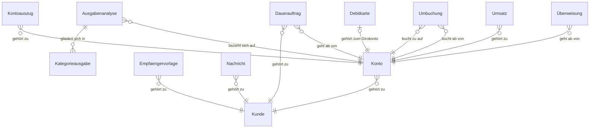

# Entitätenmodell

## ER-Diagramm

## Entitäten

### Kunde

**Bereich:** Finanzstatus  

Die angemeldete Privatkundin, deren Konten der Finanzstatus zeigt.

| Attribut | Beschreibung | Datentyp | Länge/Präzision | Validierungsregeln |
|---|---|---|---|---|
| kundennummer | Nummer der Kundin im Online-Banking | String | 1..20 | Pflicht; Eindeutig; Länge 1..20; Beispiel K-104 233 |
| vorname | Vorname der Kundin | String | 1..60 | Pflicht; Länge 1..60 |
| nachname | Nachname der Kundin | String | 1..60 | Pflicht; Länge 1..60 |
| tageslimit | Tageslimit der Kundin für Überweisungen je Kalendertag in Euro; anfangs das Standardlimit, von der Kundin senk- und bis zum Standardlimit anhebbar | Decimal |  | Pflicht; Wertebereich 0..5000; Standard 5000.00; Beispiel 1000.00; höchstens zwei Nachkommastellen |
| standardlimit | Standardlimit für das Tageslimit in Euro; für alle Kundinnen gleich, nicht änderbar | Decimal |  | Pflicht; Standard 5000.00; Beispiel 5000.00; für alle Kundinnen gleich |
| strasse | Straße mit Hausnummer der Anschrift der Kundin | String | 1..100 | Pflicht; Länge 1..100; Beispiel Lindenallee 12; führende und folgende Leerzeichen werden vor Prüfung, Speicherung und Vergleich entfernt, nur Leerzeichen gilt als leer |
| postleitzahl | Postleitzahl der Anschrift, nur Deutschland | String | 5..5 | Pflicht; Länge 5..5; Muster ^[0-9]{5}$; Beispiel 50667 |
| ort | Ort der Anschrift, nur Deutschland; ein Land wird nicht gespeichert | String | 1..60 | Pflicht; Länge 1..60; Beispiel Köln; führende und folgende Leerzeichen werden vor Prüfung, Speicherung und Vergleich entfernt, nur Leerzeichen gilt als leer |
| email | E-Mail-Adresse der Kundin | String | 3..254 | Pflicht; Länge 3..254; Muster ^[^@ ]+@[^@ ]+\.[^@ ]+$; Beispiel lena.hoffmann@example.org; führende und folgende Leerzeichen werden vor Prüfung, Speicherung und Vergleich entfernt, nur Leerzeichen gilt als leer |
| telefonnummer | Telefonnummer der Kundin | String | 6..20 | Pflicht; Länge 6..20; Muster ^\+?[0-9 /()-]+$; Beispiel +49 221 1234567; führende und folgende Leerzeichen werden vor Prüfung, Speicherung und Vergleich entfernt, nur Leerzeichen gilt als leer |
| tan | TAN (Mock) zur Bestätigung einer Änderung der persönlichen Daten; nur Eingabe im Auftrag, wird nicht gespeichert | String | 6..6 | Pflicht; Länge 6..6; Muster ^[0-9]{6}$; Beispiel 123456 |

**Einschränkungen:** Das Tageslimit gilt je Kundin, nicht je Konto, und liegt nur im Speicher (ADR-002). Anschrift, E-Mail-Adresse und Telefonnummer gelten je Kundin, liegen ebenfalls nur im Speicher (ADR-002) und gehören zum Ausgangsstand des Test-Resets; die Anschrift gilt nur für Deutschland. Bei Straße, Ort, E-Mail-Adresse und Telefonnummer entfernt der Dienst führende und folgende Leerzeichen vor Prüfung, Speicherung und Vergleich; verglichen wird danach genau, auch in der Groß-/Kleinschreibung. Die TAN ist keine gespeicherte Angabe der Kundin.

### Konto

**Bereich:** Finanzstatus  

Ein Konto der Kundin, wie es der Finanzstatus in einer Zeile zeigt. Eine Kreditkarte mit offenem Betrag führt einen negativen Saldo. Das Tagesgeldkonto hat keinen Dispositionsrahmen; die Demo-Kundinnen haben im Ausgangsstand eines mit Saldo 0,00 Euro, die Lastkunden keines.

| Attribut | Beschreibung | Datentyp | Länge/Präzision | Validierungsregeln |
|---|---|---|---|---|
| kontoname | Bezeichnung des Kontos in der Tabelle | String | 1..60 | Pflicht; Länge 1..60; Beispiel Girokonto |
| iban | IBAN des Kontos | String | 22..22 | Pflicht; Eindeutig; Länge 22..22; Beispiel DE02500105175407324911 (angezeigt in Vierergruppen) |
| art | Art des Kontos | String |  | Pflicht; Werte Girokonto, Kreditkarte, Tagesgeldkonto; Beispiel Girokonto |
| saldo | Aktueller Saldo in Euro; bei einer Kreditkarte mit offenem Betrag negativ | Decimal |  | Pflicht; Beispiel 2145.30; negativ bei Kreditkarte mit offenem Betrag |
| waehrung | Währung des Saldos | String |  | Pflicht; Werte EUR; Standard EUR |
| dispositionsrahmen | Eingeräumter Dispositionsrahmen in Euro; nur beim Girokonto belegt | Decimal |  | Pflicht bei Art Girokonto; Beispiel 1000.00; nur bei Art Girokonto |
| verfuegbarerBetrag | Verfügbarer Betrag in Euro: Saldo plus Dispositionsrahmen; nur beim Girokonto belegt | Decimal |  | Pflicht bei Art Girokonto; Beispiel 3145.30; nur bei Art Girokonto |

**Einschränkungen:** Ein Tagesgeldkonto trägt keinen Dispositionsrahmen und keinen verfügbaren Betrag; es wird nie unter 0 Euro geführt (BR-0089).
**Einschränkungen:** Ein Konto der Art Girokonto kann eine Debitkarte haben (Entität Debitkarte); eine Kreditkarte hat keine.

### Überweisung

**Bereich:** Überweisung  

Ein einmaliger Überweisungsauftrag von einem Girokonto, wie ihn die Überweisung erfasst und genau einmal ausführt. Ein Auftrag für einen späteren Ausführungstag (Terminüberweisung) ist bis zu seiner Ausführung oder Löschung vorgemerkt und bucht nichts.

| Attribut | Beschreibung | Datentyp | Länge/Präzision | Validierungsregeln |
|---|---|---|---|---|
| auftragsId | Kennung des Auftrags, von der Seite je Überweisung vergeben; Träger der Einmalbuchung | String | 1..36 | Pflicht; Eindeutig; Länge 1..36; Beispiel A-2026-00007 |
| empfaenger | Name des Empfängers | String | 1..70 | Pflicht; Länge 1..70; Beispiel Möbel Nord GmbH |
| empfaengerIban | IBAN des Empfängers im SEPA-Raum | String | 15..34 | Pflicht; Länge 15..34; Beispiel DE02 5001 0517 5407 3249 11 |
| betrag | Überweisungsbetrag in Euro, mindestens 0,10 | Decimal |  | Pflicht; Wertebereich 0.10..; Beispiel 50.00 |
| waehrung | Währung des Betrags | String |  | Pflicht; Werte EUR; Standard EUR |
| verwendungszweck | Verwendungszweck der Überweisung | String | 1..140 | Pflicht; Länge 1..140; Beispiel Rechnung 4711 |
| status | Stand des Auftrags: ausgefuehrt nach der Ausführung, vorgemerkt bei einer Terminüberweisung | String |  | Pflicht; Werte ausgefuehrt, vorgemerkt; Beispiel ausgefuehrt |
| erfasstAm | Zeitpunkt der Ausführung, bei einem vorgemerkten Auftrag der Zeitpunkt der Vormerkung | DateTime |  | Pflicht; Beispiel 2026-02-14T10:15:00Z |
| ausfuehrungstag | Kalendertag, an dem eine Terminüberweisung ausgeführt werden soll; nur bei einem vorgemerkten Auftrag belegt | Date |  | Pflicht bei Status vorgemerkt; nur bei Status vorgemerkt; Anzeigeformat TT.MM.JJJJ; Beispiel 2026-12-24 |

### Umsatz

**Bereich:** Finanzstatus  

Eine Buchung auf einem Konto der Kundin, wie sie die Umsätze mit Buchungstag, Gegenpartei, Verwendungszweck, Betrag und Saldo danach zeigen. Im Ausgangsstand trägt jedes Demo-Konto einige Demo-Umsätze mit festen Buchungstagen und festen Uhrzeiten, der jüngste mit dem Kontosaldo als Saldo danach (C-001); das Tagesgeldkonto hat im Ausgangsstand keine. Weitere Umsätze entstehen aus einer ausgeführten Überweisung (BR-0012), deren gebuchtAm der Ausführungszeitpunkt ist, und aus einer ausgeführten Umbuchung (BR-0090), die auf beiden Konten je einen Umsatz mit der Gegenpartei Kontoname des anderen Kontos und dem Verwendungszweck Umbuchung erzeugt, und aus der Rückgabe einer Lastschrift (BR-0095). Das Girokonto trägt im Ausgangsstand zwei SEPA-Lastschriften mit gebuchtAm 08:00:00 UTC und Buchungstag relativ zum Tag des Resets: Fitnessstudio Vital, Mitgliedsbeitrag, -29.90, Buchungstag der letzte Tag des Vormonats des Resettags (damit nie im Monat des Resets, höchstens 31 Tage davor und somit in der Rückgabefrist von 8 Wochen, BR-0093), Saldo danach 2145.30, und Zeitungsverlag Nord, Zeitungsabo, -14.90, 70 Tage davor, Saldo danach 2175.20; die Lastschrift Fitnessstudio Vital ist damit der jüngste Umsatz, der Kontosaldo bleibt 2145.30, die Salden danach der älteren Demo-Umsätze des Girokontos liegen um 44.80 über den bisherigen.

| Attribut | Beschreibung | Datentyp | Länge/Präzision | Validierungsregeln |
|---|---|---|---|---|
| buchungstag | Tag der Buchung | Date |  | Pflicht; Beispiel 2026-02-14; Anzeige in der Umsatzliste, in der CSV-Datei und im Kontoauszug als TT.MM.JJJJ, Beispiel 14.02.2026 |
| gegenpartei | Name der Gegenpartei | String | 1..70 | Pflicht; Länge 1..70; Beispiel Möbel Nord GmbH |
| verwendungszweck | Verwendungszweck der Buchung | String | 1..140 | Pflicht; Länge 1..140; Beispiel Rechnung 4711 |
| betrag | Betrag in Euro; beim Ausgang negativ. Anzeige in der Umsatzliste mit Dezimalkomma, Tausenderpunkt und Währungszeichen, Beispiel -1.250,00 €. In der CSV-Datei in Euro mit Dezimalkomma, ohne Tausenderpunkt und ohne Währungszeichen, Beispiel -50,00 | Decimal |  | Pflicht; Beispiel -50.00; Anzeige im Kontoauszug in Euro mit Tausenderpunkt und Komma, Beispiel -50,00 € |
| waehrung | Währung des Betrags | String |  | Pflicht; Werte EUR; Standard EUR |
| saldoDanach | Saldo des Kontos nach dieser Buchung in Euro. Anzeige in der Umsatzliste mit Dezimalkomma, Tausenderpunkt und Währungszeichen, Beispiel 2.095,30 €. In der CSV-Datei in Euro mit Dezimalkomma, ohne Tausenderpunkt und ohne Währungszeichen, Beispiel 2095,30 | Decimal |  | Pflicht; Beispiel 2095.30; Anzeige im Kontoauszug in Euro mit Tausenderpunkt und Komma, Beispiel 2.095,30 € |
| gebuchtAm | Zeitpunkt der Buchung in UTC; entscheidet bei gleichem Buchungstag über die Reihenfolge, der jüngere steht oben (BR-0008) | DateTime |  | Pflicht; Beispiel 2026-02-14T10:15:00Z |
| kategorie | Kategorie des Umsatzes aus der festen Werteliste, die die Validierungsspalte nennt; dieselbe Werteliste nutzen die Ausgabenanalyse (UC-019, BR-0083) und der Kategoriefilter der Umsatzliste (BR-0104). „Alle“ ist keine Kategorie, sondern die nicht einschränkende Auswahl der Maske Umsätze. Der Umsatz einer ausgeführten Überweisung trägt Sonstiges (BR-0012), die Gutschrift einer Lastschrift-Rückgabe die Kategorie der zurückgegebenen Lastschrift (BR-0095). Die Demo-Umsätze tragen ihre Kategorie fest: Girokonto Fitnessstudio Vital (SEPA-Lastschrift, -29,90 Euro) Freizeit, Zeitungsverlag Nord (SEPA-Lastschrift, -14,90 Euro) Freizeit, Bäckerei Krause (-12,00 Euro) Lebensmittel, Energieversorgung Nord (-86,00 Euro) Wohnen, Lindner Logistik GmbH (Gehalt, +2.640,00 Euro) Sonstiges, Hausverwaltung Berger (Buchungstag 28.01.2026, -950,00 Euro) Wohnen. Kreditkarte: Buchhandlung Seitenweise Freizeit, Reisebüro Fernweh Mobilität, Aventa Bank (Ausgleich, Eingang) Sonstiges | String |  | Pflicht; Werte Wohnen, Lebensmittel, Mobilität, Freizeit, Versicherungen, Gesundheit, Sonstiges; Beispiel Wohnen |
| umsatzId | Kennung des Umsatzes, vom Dienst vergeben; die Zeilenaktion „Zurückgeben“ der Umsätze führt sie mit | String | 1..36 | Pflicht; Eindeutig; Länge 1..36; Beispiel U-0007 |
| sepaLastschrift | Kennzeichen: der Umsatz ist eine SEPA-Lastschrift; nur das Girokonto trägt solche | Boolean |  | Pflicht; Standard false; Beispiel true |
| zurueckgegeben | Rückgabestatus der SEPA-Lastschrift (BR-0094). Die Spalte Rückgabe der Umsätze zeigt bei sepaLastschrift true und zurueckgegeben false „Zurückgeben“, bei zurueckgegeben true „Zurückgegeben“, sonst keinen Text | Boolean |  | Pflicht; Standard false; Beispiel false |

**Einschränkungen:** Ein Eingang hat einen positiven, ein Ausgang einen negativen Betrag; der Betrag 0 kommt nicht vor (BR-0009). Ein Umsatz mit zurueckgegeben true ist eine SEPA-Lastschrift (sepaLastschrift true).

### Empfaengervorlage

**Bereich:** Überweisung  

Ein gespeicherter Empfänger der Kundin mit Name, IBAN und optional Verwendungszweck, den sie bei der Überweisung auswählt, statt ihn neu einzutippen.

| Attribut | Beschreibung | Datentyp | Länge/Präzision | Validierungsregeln |
|---|---|---|---|---|
| vorlagenId | Kennung der Vorlage | String | 1..36 | Pflicht; Eindeutig; Länge 1..36; Beispiel V-2026-00001 |
| name | Name des Empfängers, der zugleich die Vorlage benennt | String | 1..70 | Pflicht; Länge 1..70; Beispiel Möbel Nord GmbH |
| empfaengerIban | IBAN des Empfängers im SEPA-Raum | String | 15..34 | Pflicht; Länge 15..34; Beispiel DE89 3704 0044 0532 0130 00 |
| verwendungszweck | Verwendungszweck der Vorlage; optional; leer oder nur Leerzeichen ergibt keinen Wert, dann fehlt das Feld | String | 0..140 | Länge 0..140; Beispiel Rechnung 4711; leer oder nur Leerzeichen = kein Wert, das Feld fehlt in Antwort und Liste |

**Einschränkungen:** Der Name ist je Kunde eindeutig, verglichen ohne führende und folgende Leerzeichen und ohne Beachtung der Groß-/Kleinschreibung; gespeichert wird die Eingabe der Kundin; höchstens 50 Empfängervorlagen je Kunde.

### Umbuchung

**Bereich:** Überweisung  

Eine sofortige Umbuchung zwischen dem Girokonto und dem Tagesgeldkonto der Kundin, wie sie die Umbuchung erfasst und genau einmal ausführt.

| Attribut | Beschreibung | Datentyp | Länge/Präzision | Validierungsregeln |
|---|---|---|---|---|
| auftragsId | Kennung der Umbuchung, von der Seite je Umbuchung vergeben; Träger der Einmalbuchung; eindeutig je Kundin, getrennt von der Kennung der Überweisung geführt | String | 1..36 | Pflicht; Eindeutig; Länge 1..36; Beispiel U-2026-00007 |
| quellIban | IBAN des Quellkontos, das belastet wird | String | 22..22 | Pflicht; Länge 22..22; Beispiel DE02500105175407324911 |
| zielIban | IBAN des Zielkontos, dem der Betrag gutgeschrieben wird | String | 22..22 | Pflicht; Länge 22..22; Beispiel DE97500105175407324947 |
| betrag | Umbuchungsbetrag in Euro, mindestens 0,10 | Decimal |  | Pflicht; Wertebereich 0.10..; Beispiel 500.00 |
| waehrung | Währung des Betrags | String |  | Pflicht; Werte EUR; Standard EUR |
| status | Stand der Umbuchung | String |  | Pflicht; Werte ausgefuehrt; Beispiel ausgefuehrt |
| erfasstAm | Zeitpunkt der Ausführung | DateTime |  | Pflicht; Beispiel 2026-02-14T10:15:00Z |

**Einschränkungen:** Quell- und Zielkonto gehören derselben Kundin und sind ein Girokonto und ein Tagesgeldkonto (BR-0088).

### Dauerauftrag

**Bereich:** Dauerauftrag  

Eine wiederkehrende Zahlung vom Girokonto der Kundin an einen Empfänger mit Betrag, Verwendungszweck, Turnus, erstem Ausführungstag und optionalem Enddatum; der Dienst verwaltet sie, führt sie aber nicht aus.

| Attribut | Beschreibung | Datentyp | Länge/Präzision | Validierungsregeln |
|---|---|---|---|---|
| dauerauftragId | Kennung des Dauerauftrags | String | 1..36 | Pflicht; Eindeutig; Länge 1..36; Beispiel D-2026-00001 |
| auftraggeberIban | IBAN des Girokontos der angemeldeten Kundin, von dem der Dauerauftrag abgeht; setzt der Dienst, die Kundin gibt sie nicht ein | String | 15..34 | Pflicht; Länge 15..34 |
| empfaenger | Name des Empfängers | String | 1..70 | Pflicht; Länge 1..70; Beispiel Möbel Nord GmbH |
| empfaengerIban | IBAN des Empfängers im SEPA-Raum | String | 15..34 | Pflicht; Länge 15..34; Beispiel DE89 3704 0044 0532 0130 00 |
| betrag | Betrag je Ausführung in Euro, mindestens 0,10, höchstens zwei Nachkommastellen; Anzeige mit Komma und Euro-Zeichen, z. B. 50,00 € | Decimal |  | Pflicht; Wertebereich 0.10..; Beispiel 50.00; höchstens zwei Nachkommastellen, Anzeige 50,00 € |
| waehrung | Währung des Betrags | String |  | Pflicht; Werte EUR; Standard EUR |
| verwendungszweck | Verwendungszweck der Zahlung | String | 1..140 | Pflicht; Länge 1..140; Beispiel Rechnung 4711 |
| turnus | Wie oft der Dauerauftrag ausgeführt werden soll | String |  | Pflicht; Werte monatlich, vierteljährlich, jährlich; Beispiel monatlich |
| ersterAusfuehrungstag | Tag der ersten Ausführung, ab dem der Turnus läuft; die Oberfläche zeigt ihn als TT.MM.JJJJ | Date |  | Pflicht; Beispiel 2026-12-01; Anzeige TT.MM.JJJJ, Austausch als JJJJ-MM-TT |
| enddatum | Letzter Tag, bis zu dem der Dauerauftrag laufen soll; optional, ohne Enddatum läuft er unbefristet; die Oberfläche zeigt es als TT.MM.JJJJ | Date |  | Beispiel 2027-12-01; Anzeige TT.MM.JJJJ, Austausch als JJJJ-MM-TT |

**Einschränkungen:** Ein Dauerauftrag gehört zum Girokonto der angemeldeten Kundin und ist nur für sie sichtbar. Eine Höchstzahl je Kundin gibt es nicht.

### Nachricht

**Bereich:** Postfach  

Eine Nachricht der Bank an die Kundin im Postfach mit Absender, Betreff, Text, Datum und Lesestatus. Die Kundin liest sie und löscht sie; sie ändert Absender, Betreff und Text nicht.

| Attribut | Beschreibung | Datentyp | Länge/Präzision | Validierungsregeln |
|---|---|---|---|---|
| nachrichtId | Kennung der Nachricht | String | 1..36 | Pflicht; Eindeutig; Länge 1..36; Beispiel N-2026-00001 |
| absender | Absender der Nachricht | String | 1..60 | Pflicht; Länge 1..60; Beispiel Aventa Bank |
| betreff | Betreff der Nachricht | String | 1..100 | Pflicht; Länge 1..100; Beispiel Ihr Kontoauszug für Oktober |
| text | Text der Nachricht | String | 1..2000 | Pflicht; Länge 1..2000; Beispiel Ihr Kontoauszug für Oktober liegt zum Abruf bereit. |
| versendetAm | Datum, an dem die Bank die Nachricht versendet hat; angezeigt als TT.MM.JJJJ | Date |  | Pflicht; Beispiel 2026-11-17 |
| gelesen | Lesestatus: false, solange die Kundin die Nachricht nicht geöffnet hat, true ab dem Öffnen | Boolean |  | Pflicht; Standard false; Beispiel false |

**Einschränkungen:** Eine Nachricht gehört genau einer Kundin und liegt nur im Speicher (ADR-002). Die Kundin setzt den Lesestatus nur durch Öffnen von false auf true und löscht Nachrichten endgültig; die Bank erzeugt die Nachrichten (hier als Demo-Daten, C-001). Außerdem entsteht eine Nachricht durch eine bestätigte Änderung der persönlichen Daten (UC-023): absender Aventa Bank, betreff z. B. Ihre persönlichen Daten wurden geändert, text nennt, welche Angaben geändert wurden, ohne Werte (Beispiel Ihre E-Mail-Adresse wurde geändert.), versendetAm der Tag der Änderung, gelesen false. Der Test-Reset stellt den Ausgangsstand der Nachrichten wieder her und entfernt damit auch solche Bestätigungsnachrichten.

### Ausgabenanalyse

**Bereich:** Finanzstatus  

Auswertung der Ausgaben eines Girokontos für einen Monat, gruppiert nach Kategorien (UC-019). Sie wird bei jeder Abfrage aus den Umsätzen berechnet und nicht gespeichert.

| Attribut | Beschreibung | Datentyp | Länge/Präzision | Validierungsregeln |
|---|---|---|---|---|
| monat | Monat der Auswertung im Format JJJJ-MM, Monat 01 bis 12 | String | 7..7 | Pflicht; Länge 7..7; Muster ^[0-9]{4}-(0[1-9]\|1[0-2])$; Beispiel 2026-02 |
| gesamtausgaben | Summe aller Ausgänge des Girokontos im Monat in Euro, nicht negativ (0 bei einem Monat ohne Ausgänge), gleich der Summe der Kategoriesummen | Decimal |  | Pflicht; Wertebereich 0..; Beispiel 98.00; Anzeige 98,00 € |

### Kategorieausgabe

**Bereich:** Finanzstatus  

Eine Zeile der Ausgabenanalyse: eine Kategorie mit ihrer Summe und ihrem Anteil an den Gesamtausgaben des Monats. Nur Kategorien mit mindestens einem Ausgang erscheinen.

| Attribut | Beschreibung | Datentyp | Länge/Präzision | Validierungsregeln |
|---|---|---|---|---|
| kategorie | Kategorie aus der festen Liste | String |  | Pflicht; Werte Wohnen, Lebensmittel, Mobilität, Freizeit, Versicherungen, Gesundheit, Sonstiges; Beispiel Wohnen |
| summe | Summe der Ausgänge dieser Kategorie im Monat in Euro als positive Zahl, auf Cent gerundet | Decimal |  | Pflicht; Beispiel 86.00; Anzeige 86,00 €; größer als 0 |
| anteil | Anteil der Summe an den Gesamtausgaben in Prozent, kaufmännisch auf eine Nachkommastelle gerundet, ohne Ausgleich auf 100 % | Decimal |  | Pflicht; Wertebereich 0..100; Beispiel 87.8; Anzeige als Prozent mit einer Nachkommastelle, Beispiel 87,8 % |

### Debitkarte

**Bereich:** Debitkarte  

Die Debitkarte zum Girokonto der Kundin mit ihrem Sperrstatus. Die Kundin erkennt sie an der maskierten Kartennummer.

| Attribut | Beschreibung | Datentyp | Länge/Präzision | Validierungsregeln |
|---|---|---|---|---|
| kartennummerMaskiert | Maskierte Kartennummer, vier Sterne und die letzten vier Stellen; daran erkennt die Kundin ihre Karte | String | 9..9 | Pflicht; Länge 9..9; Muster ^\*\*\*\* [0-9]{4}$; Beispiel **** 4821 |
| status | Sperrstatus der Karte; endgültig gesperrt bleibt gesperrt | String |  | Pflicht; Werte aktiv, vorübergehend gesperrt, endgültig gesperrt; Standard aktiv; Beispiel aktiv |
| sperrgrund | Grund der endgültigen Sperre, von der Kundin beim endgültigen Sperren gewählt; nur belegt, wenn der Status endgültig gesperrt ist | String |  | Werte Verlust, Diebstahl; Beispiel Verlust; Pflicht beim endgültigen Sperren, sonst nicht belegt; ein bei anderem Zielstatus mitgeschickter Sperrgrund wird ignoriert und nicht gespeichert |

**Einschränkungen:** Zu einem Girokonto gibt es höchstens eine Debitkarte, zu einer Kreditkarte keine. Die Debitkarte liegt nur im Speicher (ADR-002); im Ausgangsstand haben die Demo-Kundinnen je eine Debitkarte mit Status aktiv.

### Kontoauszug

**Bereich:** Finanzstatus  

Der Kontoauszug eines Kontos der Kundin für einen Kalendermonat mit Anfangssaldo, Endsaldo und den Umsätzen des Monats. Das Konto ist über die Beziehung bestimmt (Konto.iban). Er wird beim Abruf als PDF erzeugt und nicht gespeichert (ADR-002, ADR-008); die Umsätze sind die des Kontos (Entität Umsatz).

| Attribut | Beschreibung | Datentyp | Länge/Präzision | Validierungsregeln |
|---|---|---|---|---|
| monat | Kalendermonat des Auszugs im Format JJJJ-MM; vergangene Monate und der laufende Monat, ein zukünftiger Monat ist ungültig | String | 7..7 | Pflicht; Länge 7..7; Muster ^[0-9]{4}-(0[1-9]\|1[0-2])$; Beispiel 2026-02; höchstens der laufende Monat |
| anfangssaldo | Saldo des Kontos zu Beginn des Monats in Euro (BR-0098) | Decimal |  | Pflicht; Beispiel -396.70; Anzeige im PDF in Euro mit Tausenderpunkt und Komma, Beispiel -396,70 € |
| endsaldo | Saldo des Kontos am Ende des Monats in Euro, im laufenden Monat der Stand bis heute (BR-0098) | Decimal |  | Pflicht; Beispiel 2145.30; Anzeige im PDF in Euro mit Tausenderpunkt und Komma, Beispiel 2.145,30 € |
| waehrung | Währung der Salden | String |  | Pflicht; Werte EUR; Standard EUR |

**Einschränkungen:** Der Auszug gehört zu einem Konto der angemeldeten Kundin (BR-0011).
