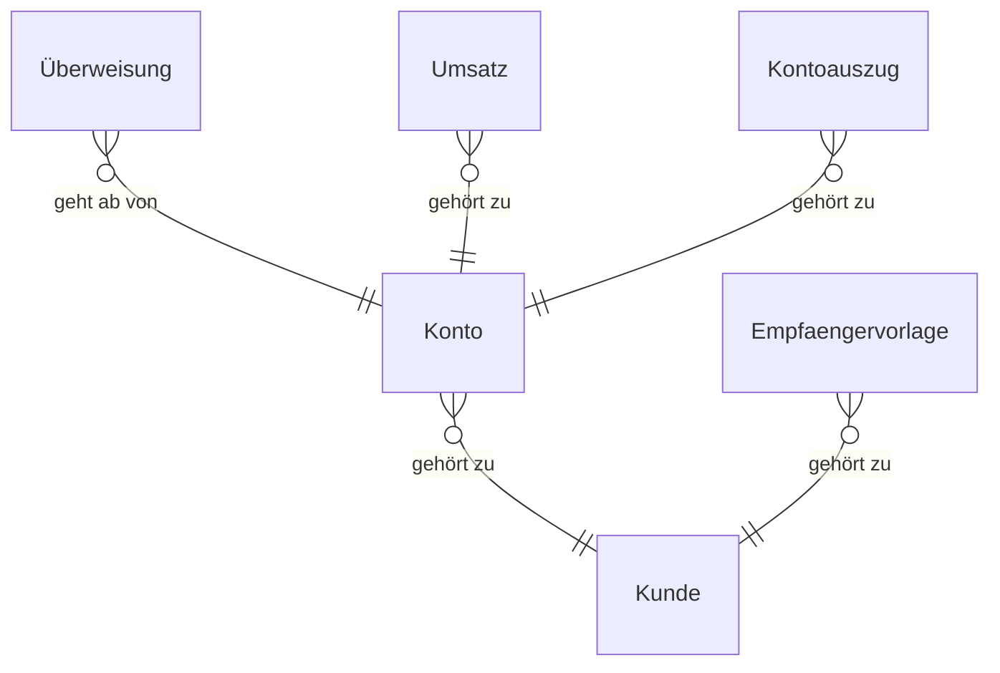

# Entitätenmodell

## ER-Diagramm

## Entitäten

### Kunde

**Bereich:** Finanzstatus  

Die angemeldete Privatkundin, deren Konten der Finanzstatus zeigt.

| Attribut | Beschreibung | Datentyp | Länge/Präzision | Validierungsregeln |
|---|---|---|---|---|
| kundennummer | Nummer der Kundin im Online-Banking | String | 1..20 | Pflicht; Eindeutig; Länge 1..20; Beispiel K-104 233 |
| vorname | Vorname der Kundin | String | 1..60 | Pflicht; Länge 1..60 |
| nachname | Nachname der Kundin | String | 1..60 | Pflicht; Länge 1..60 |
| tageslimit | Tageslimit der Kundin für Überweisungen je Kalendertag in Euro; anfangs das Standardlimit, von der Kundin senk- und bis zum Standardlimit anhebbar | Decimal |  | Pflicht; Wertebereich 0..5000; Standard 5000.00; Beispiel 1000.00; höchstens zwei Nachkommastellen |
| standardlimit | Standardlimit für das Tageslimit in Euro; für alle Kundinnen gleich, nicht änderbar | Decimal |  | Pflicht; Standard 5000.00; Beispiel 5000.00; für alle Kundinnen gleich |

**Einschränkungen:** Das Tageslimit gilt je Kundin, nicht je Konto, und liegt nur im Speicher (ADR-002).

### Konto

**Bereich:** Finanzstatus  

Ein Konto der Kundin, wie es der Finanzstatus in einer Zeile zeigt. Eine Kreditkarte mit offenem Betrag führt einen negativen Saldo.

| Attribut | Beschreibung | Datentyp | Länge/Präzision | Validierungsregeln |
|---|---|---|---|---|
| kontoname | Bezeichnung des Kontos in der Tabelle | String | 1..60 | Pflicht; Länge 1..60; Beispiel Girokonto |
| iban | IBAN des Kontos | String | 22..22 | Pflicht; Eindeutig; Länge 22..22; Beispiel DE02 5001 0517 5407 3249 31 |
| art | Art des Kontos | String |  | Pflicht; Werte Girokonto, Kreditkarte; Beispiel Girokonto |
| saldo | Aktueller Saldo in Euro; bei einer Kreditkarte mit offenem Betrag negativ | Decimal |  | Pflicht; Beispiel 2145.30; negativ bei Kreditkarte mit offenem Betrag |
| waehrung | Währung des Saldos | String |  | Pflicht; Werte EUR; Standard EUR |
| dispositionsrahmen | Eingeräumter Dispositionsrahmen in Euro; nur beim Girokonto belegt | Decimal |  | Pflicht bei Art Girokonto; Beispiel 1000.00; nur bei Art Girokonto |
| verfuegbarerBetrag | Verfügbarer Betrag in Euro: Saldo plus Dispositionsrahmen; nur beim Girokonto belegt | Decimal |  | Pflicht bei Art Girokonto; Beispiel 3145.30; nur bei Art Girokonto |

### Überweisung

**Bereich:** Überweisung  

Ein einmaliger Überweisungsauftrag von einem Girokonto, wie ihn die Überweisung erfasst und genau einmal ausführt.

| Attribut | Beschreibung | Datentyp | Länge/Präzision | Validierungsregeln |
|---|---|---|---|---|
| auftragsId | Kennung des Auftrags, von der Seite je Überweisung vergeben; Träger der Einmalbuchung | String | 1..36 | Pflicht; Eindeutig; Länge 1..36; Beispiel A-2026-00007 |
| empfaenger | Name des Empfängers | String | 1..70 | Pflicht; Länge 1..70; Beispiel Möbel Nord GmbH |
| empfaengerIban | IBAN des Empfängers im SEPA-Raum | String | 15..34 | Pflicht; Länge 15..34; Beispiel DE02 5001 0517 5407 3249 31 |
| betrag | Überweisungsbetrag in Euro, mindestens 0,10 | Decimal |  | Pflicht; Wertebereich 0.10..; Beispiel 50.00 |
| waehrung | Währung des Betrags | String |  | Pflicht; Werte EUR; Standard EUR |
| verwendungszweck | Verwendungszweck der Überweisung | String | 1..140 | Pflicht; Länge 1..140; Beispiel Rechnung 4711 |
| status | Stand des Auftrags | String |  | Pflicht; Werte ausgefuehrt; Beispiel ausgefuehrt |
| erfasstAm | Zeitpunkt der Ausführung | DateTime |  | Pflicht; Beispiel 2026-02-14T10:15:00Z |

### Umsatz

**Bereich:** Finanzstatus  

Eine Buchung auf einem Konto der Kundin, wie sie die Umsätze mit Buchungstag, Gegenpartei, Verwendungszweck, Betrag und Saldo danach zeigen. Im Ausgangsstand trägt jedes Demo-Konto einige Demo-Umsätze mit festen Buchungstagen und festen Uhrzeiten, der jüngste mit dem Kontosaldo als Saldo danach (C-001); weitere Umsätze entstehen aus einer ausgeführten Überweisung (BR-0012), deren gebuchtAm der Ausführungszeitpunkt ist.

| Attribut | Beschreibung | Datentyp | Länge/Präzision | Validierungsregeln |
|---|---|---|---|---|
| buchungstag | Tag der Buchung | Date |  | Pflicht; Beispiel 2026-02-14; Anzeige in der Umsatzliste und im Kontoauszug als TT.MM.JJJJ, Beispiel 14.02.2026 |
| gegenpartei | Name der Gegenpartei | String | 1..70 | Pflicht; Länge 1..70; Beispiel Möbel Nord GmbH |
| verwendungszweck | Verwendungszweck der Buchung | String | 1..140 | Pflicht; Länge 1..140; Beispiel Rechnung 4711 |
| betrag | Betrag in Euro; beim Ausgang negativ | Decimal |  | Pflicht; Beispiel -50.00; negativ beim Ausgang; Anzeige im Kontoauszug in Euro mit Tausenderpunkt und Komma, Beispiel -50,00 € |
| waehrung | Währung des Betrags | String |  | Pflicht; Werte EUR; Standard EUR |
| saldoDanach | Saldo des Kontos nach dieser Buchung in Euro | Decimal |  | Pflicht; Beispiel 2095.30; Anzeige im Kontoauszug in Euro mit Tausenderpunkt und Komma, Beispiel 2.095,30 € |
| gebuchtAm | Zeitpunkt der Buchung in UTC; entscheidet bei gleichem Buchungstag über die Reihenfolge, der jüngere steht oben (BR-0008) | DateTime |  | Pflicht; Beispiel 2026-02-14T10:15:00Z |

**Einschränkungen:** Ein Eingang hat einen positiven, ein Ausgang einen negativen Betrag; der Betrag 0 kommt nicht vor (BR-0009).

### Empfaengervorlage

**Bereich:** Überweisung  

Ein gespeicherter Empfänger der Kundin mit Name, IBAN und optional Verwendungszweck, den sie bei der Überweisung auswählt, statt ihn neu einzutippen.

| Attribut | Beschreibung | Datentyp | Länge/Präzision | Validierungsregeln |
|---|---|---|---|---|
| vorlagenId | Kennung der Vorlage | String | 1..36 | Pflicht; Eindeutig; Länge 1..36; Beispiel V-2026-00001 |
| name | Name des Empfängers, der zugleich die Vorlage benennt | String | 1..70 | Pflicht; Länge 1..70; Beispiel Möbel Nord GmbH |
| empfaengerIban | IBAN des Empfängers im SEPA-Raum | String | 15..34 | Pflicht; Länge 15..34; Beispiel DE89 3704 0044 0532 0130 00 |
| verwendungszweck | Verwendungszweck der Vorlage; optional; leer oder nur Leerzeichen ergibt keinen Wert, dann fehlt das Feld | String | 0..140 | Länge 0..140; Beispiel Rechnung 4711; leer oder nur Leerzeichen = kein Wert, das Feld fehlt in Antwort und Liste |

**Einschränkungen:** Der Name ist je Kunde eindeutig, verglichen ohne führende und folgende Leerzeichen und ohne Beachtung der Groß-/Kleinschreibung; gespeichert wird die Eingabe der Kundin; höchstens 50 Empfängervorlagen je Kunde.

### Kontoauszug

**Bereich:** Finanzstatus  

Der Kontoauszug eines Kontos der Kundin für einen Kalendermonat mit Anfangssaldo, Endsaldo und den Umsätzen des Monats. Das Konto ist über die Beziehung bestimmt (Konto.iban). Er wird beim Abruf als PDF erzeugt und nicht gespeichert (ADR-002, ADR-008); die Umsätze sind die des Kontos (Entität Umsatz).

| Attribut | Beschreibung | Datentyp | Länge/Präzision | Validierungsregeln |
|---|---|---|---|---|
| monat | Kalendermonat des Auszugs im Format JJJJ-MM; vergangene Monate und der laufende Monat, ein zukünftiger Monat ist ungültig | String | 7..7 | Pflicht; Länge 7..7; Muster ^[0-9]{4}-(0[1-9]\|1[0-2])$; Beispiel 2026-02; höchstens der laufende Monat |
| anfangssaldo | Saldo des Kontos zu Beginn des Monats in Euro (BR-0098) | Decimal |  | Pflicht; Beispiel -396.70; Anzeige im PDF in Euro mit Tausenderpunkt und Komma, Beispiel -396,70 € |
| endsaldo | Saldo des Kontos am Ende des Monats in Euro, im laufenden Monat der Stand bis heute (BR-0098) | Decimal |  | Pflicht; Beispiel 2145.30; Anzeige im PDF in Euro mit Tausenderpunkt und Komma, Beispiel 2.145,30 € |
| waehrung | Währung der Salden | String |  | Pflicht; Werte EUR; Standard EUR |

**Einschränkungen:** Der Auszug gehört zu einem Konto der angemeldeten Kundin (BR-0011).
