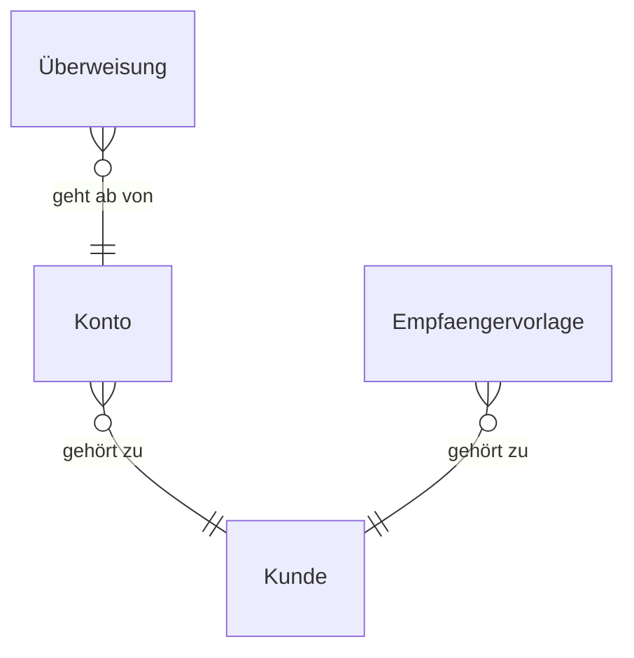

# Entitätenmodell

## ER-Diagramm

## Entitäten

### Kunde

**Bereich:** Finanzstatus  

Die angemeldete Privatkundin, deren Konten der Finanzstatus zeigt.

| Attribut | Beschreibung | Datentyp | Länge/Präzision | Validierungsregeln |
|---|---|---|---|---|
| kundennummer | Nummer der Kundin im Online-Banking | String | 1..20 | Pflicht; Eindeutig; Länge 1..20; Beispiel K-104 233 |
| vorname | Vorname der Kundin | String | 1..60 | Pflicht; Länge 1..60 |
| nachname | Nachname der Kundin | String | 1..60 | Pflicht; Länge 1..60 |

### Konto

**Bereich:** Finanzstatus  

Ein Konto der Kundin, wie es der Finanzstatus in einer Zeile zeigt. Eine Kreditkarte mit offenem Betrag führt einen negativen Saldo.

| Attribut | Beschreibung | Datentyp | Länge/Präzision | Validierungsregeln |
|---|---|---|---|---|
| kontoname | Bezeichnung des Kontos in der Tabelle | String | 1..60 | Pflicht; Länge 1..60; Beispiel Girokonto |
| iban | IBAN des Kontos | String | 22..22 | Pflicht; Eindeutig; Länge 22..22; Beispiel DE02 5001 0517 5407 3249 31 |
| art | Art des Kontos | String |  | Pflicht; Werte Girokonto, Kreditkarte; Beispiel Girokonto |
| saldo | Aktueller Saldo in Euro; bei einer Kreditkarte mit offenem Betrag negativ | Decimal |  | Pflicht; Beispiel 2145.30; negativ bei Kreditkarte mit offenem Betrag |
| waehrung | Währung des Saldos | String |  | Pflicht; Werte EUR; Standard EUR |
| dispositionsrahmen | Eingeräumter Dispositionsrahmen in Euro; nur beim Girokonto belegt | Decimal |  | Pflicht bei Art Girokonto; Beispiel 1000.00; nur bei Art Girokonto |
| verfuegbarerBetrag | Verfügbarer Betrag in Euro: Saldo plus Dispositionsrahmen; nur beim Girokonto belegt | Decimal |  | Pflicht bei Art Girokonto; Beispiel 3145.30; nur bei Art Girokonto |

### Überweisung

**Bereich:** Überweisung  

Ein einmaliger Überweisungsauftrag von einem Girokonto, wie ihn die Überweisung erfasst und genau einmal ausführt.

| Attribut | Beschreibung | Datentyp | Länge/Präzision | Validierungsregeln |
|---|---|---|---|---|
| auftragsId | Kennung des Auftrags, von der Seite je Überweisung vergeben; Träger der Einmalbuchung | String | 1..36 | Pflicht; Eindeutig; Länge 1..36; Beispiel A-2026-00007 |
| empfaenger | Name des Empfängers | String | 1..70 | Pflicht; Länge 1..70; Beispiel Möbel Nord GmbH |
| empfaengerIban | IBAN des Empfängers im SEPA-Raum | String | 15..34 | Pflicht; Länge 15..34; Beispiel DE02 5001 0517 5407 3249 31 |
| betrag | Überweisungsbetrag in Euro | Decimal |  | Pflicht; Wertebereich 0.01..; Beispiel 50.00 |
| waehrung | Währung des Betrags | String |  | Pflicht; Werte EUR; Standard EUR |
| verwendungszweck | Verwendungszweck der Überweisung | String | 1..140 | Pflicht; Länge 1..140; Beispiel Rechnung 4711 |
| status | Stand des Auftrags | String |  | Pflicht; Werte ausgefuehrt; Beispiel ausgefuehrt |
| erfasstAm | Zeitpunkt der Ausführung | DateTime |  | Pflicht; Beispiel 2026-02-14T10:15:00Z |

### Empfaengervorlage

**Bereich:** Überweisung  

Ein gespeicherter Empfänger der Kundin mit Name, IBAN und optional Verwendungszweck, den sie bei der Überweisung auswählt, statt ihn neu einzutippen.

| Attribut | Beschreibung | Datentyp | Länge/Präzision | Validierungsregeln |
|---|---|---|---|---|
| vorlagenId | Kennung der Vorlage | String | 1..36 | Pflicht; Eindeutig; Länge 1..36; Beispiel V-2026-00001 |
| name | Name des Empfängers, der zugleich die Vorlage benennt | String | 1..70 | Pflicht; Länge 1..70; Beispiel Möbel Nord GmbH |
| empfaengerIban | IBAN des Empfängers im SEPA-Raum | String | 15..34 | Pflicht; Länge 15..34; Beispiel DE89 3704 0044 0532 0130 00 |
| verwendungszweck | Verwendungszweck der Vorlage; optional, fehlt, wenn die Vorlage keinen hat | String | 0..140 | Länge 0..140; Beispiel Rechnung 4711 |

**Einschränkungen:** Der Name ist je Kunde eindeutig, verglichen ohne führende und folgende Leerzeichen und ohne Beachtung der Groß-/Kleinschreibung; gespeichert wird die Eingabe der Kundin; höchstens 50 Empfängervorlagen je Kunde.
