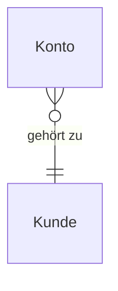

# Entitätenmodell

## ER-Diagramm

## Entitäten

### Kunde

**Bereich:** Finanzstatus  

Die angemeldete Privatkundin, deren Konten der Finanzstatus zeigt.

| Attribut | Beschreibung | Datentyp | Länge/Präzision | Validierungsregeln |
|---|---|---|---|---|
| kundennummer | Nummer der Kundin im Online-Banking | String | 1..20 | Pflicht; Eindeutig; Länge 1..20; Beispiel K-104 233 |
| vorname | Vorname der Kundin | String | 1..60 | Pflicht; Länge 1..60 |
| nachname | Nachname der Kundin | String | 1..60 | Pflicht; Länge 1..60 |

### Konto

**Bereich:** Finanzstatus  

Ein Konto der Kundin, wie es der Finanzstatus in einer Zeile zeigt. Eine Kreditkarte mit offenem Betrag führt einen negativen Saldo.

| Attribut | Beschreibung | Datentyp | Länge/Präzision | Validierungsregeln |
|---|---|---|---|---|
| kontoname | Bezeichnung des Kontos in der Tabelle | String | 1..60 | Pflicht; Länge 1..60; Beispiel Girokonto |
| iban | IBAN des Kontos | String | 22..22 | Pflicht; Eindeutig; Länge 22..22; Beispiel DE02 5001 0517 5407 3249 31 |
| art | Art des Kontos | String |  | Pflicht; Werte Girokonto, Kreditkarte; Beispiel Girokonto |
| saldo | Aktueller Saldo in Euro; bei einer Kreditkarte mit offenem Betrag negativ | Decimal |  | Pflicht; Beispiel 2145.30; negativ bei Kreditkarte mit offenem Betrag |
| waehrung | Währung des Saldos | String |  | Pflicht; Werte EUR; Standard EUR |
| dispositionsrahmen | Eingeräumter Dispositionsrahmen in Euro; nur beim Girokonto belegt | Decimal |  | Beispiel 1000.00; nur bei Art Girokonto |
| verfuegbarerBetrag | Verfügbarer Betrag in Euro: Saldo plus Dispositionsrahmen; nur beim Girokonto belegt | Decimal |  | Beispiel 3145.30; nur bei Art Girokonto |
