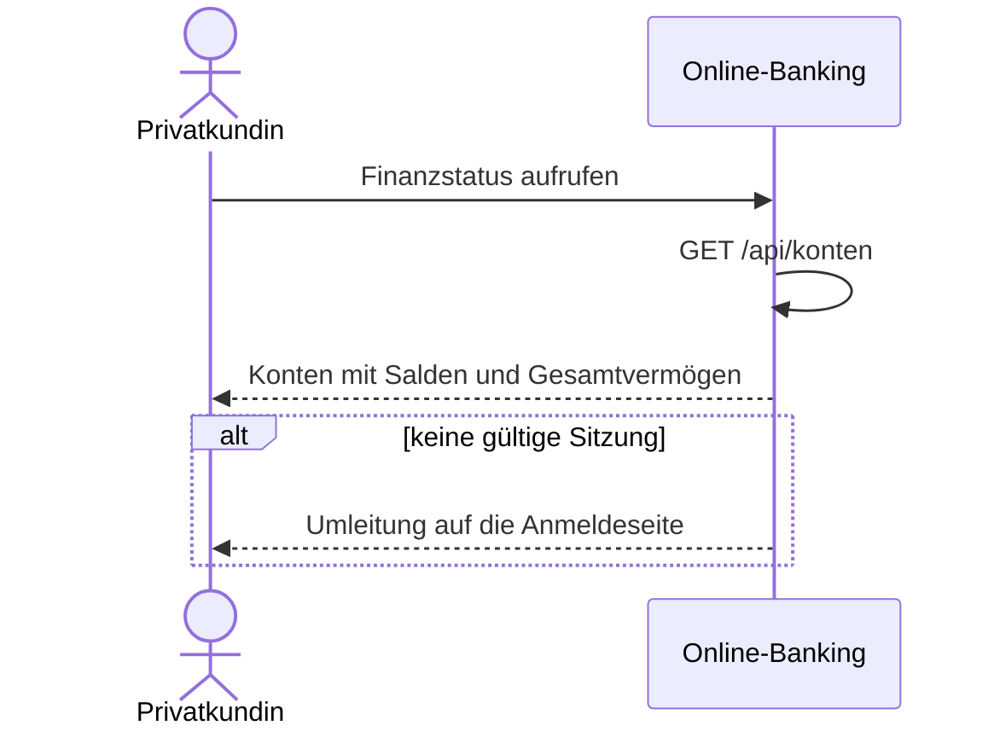

# Use Case: Finanzstatus anzeigen

## Überblick

**Use Case ID:** UC-001  
**Name:** Finanzstatus anzeigen  
**Bereich:** Finanzstatus  
**Primärakteur:** Privatkundin  
**Ziel:** Die Kundin sieht alle ihre Konten mit Kontoname, IBAN und Saldo sowie ihr Gesamtvermögen auf einen Blick.  
**Ziele:** Z-1, Z-2, Z-3, Z-4  
**Anforderungen:** NFR-001, C-001

## Vorbedingungen

- Die Kundin ist angemeldet, es gibt eine gültige Sitzung.

## Standardablauf

1. Die Kundin ruft den Finanzstatus auf.
2. Das System liest die Konten der angemeldeten Kundin (Demo-Daten, C-001).
3. Das System berechnet das Gesamtvermögen als Summe der Salden aller Konten.
4. Das System zeigt über der Tabelle das Gesamtvermögen in Euro.
5. Das System zeigt die Konten in einer Tabelle mit Kontoname, IBAN und Saldo in Euro.
6. Das System zeigt in der Zeile des Girokontos Dispositionsrahmen und verfügbaren Betrag (Saldo plus Rahmen).
7. Das System zeigt in der Zeile des Girokontos den Knopf „Überweisen“; er öffnet die Überweisung mit dem Girokonto als Auftraggeberkonto (UC-002).
8. Die Kundin liest Salden und Gesamtvermögen ab.

## Alternativabläufe

### A1: Nicht angemeldet

**Auslöser:** Es gibt keine gültige Sitzung. (Schritt 1).  
**Ablauf:**

1. Das System leitet auf die Anmeldeseite um.
2. Die Kundin meldet sich an; danach beginnt der Standardablauf erneut, oder sie bricht ab.

### A2: Finanzstatus nicht verfügbar

**Auslöser:** Der Dienst antwortet mit dem Datenfehler 500, etwa weil einem Girokonto Dispositionsrahmen oder verfügbarer Betrag fehlt. (Schritt 2).  
**Ablauf:**

1. Das System zeigt die Meldung „Der Finanzstatus ist derzeit nicht verfügbar.“.
2. Das System zeigt keine Zeile ohne Dispositionsrahmen und keinen Knopf „Überweisen“.

## Sequenzdiagramm

## Nachbedingungen

### Erfolg

- Der Finanzstatus ist mit Gesamtvermögen und allen Konten der Kundin sichtbar.

### Fehlschlag

- Ohne gültige Sitzung wurde der Finanzstatus nicht gezeigt; die Anmeldeseite ist zu sehen.

## Geschäftsregeln

### BR-0001: Gesamtvermögen

Das Gesamtvermögen ist die Summe der Salden aller Konten der Kundin. Ein negativer Saldo, etwa der offene Betrag einer Kreditkarte, mindert es.

### BR-0002: Dispositionsrahmen nur beim Girokonto

Nur das Girokonto hat einen Dispositionsrahmen. Sein verfügbarer Betrag ist der Saldo plus der Dispositionsrahmen.

## Notizen

Die Konten sind Demo-Daten (C-001). Der Knopf „Überweisen“ öffnet die Überweisung (UC-002).
