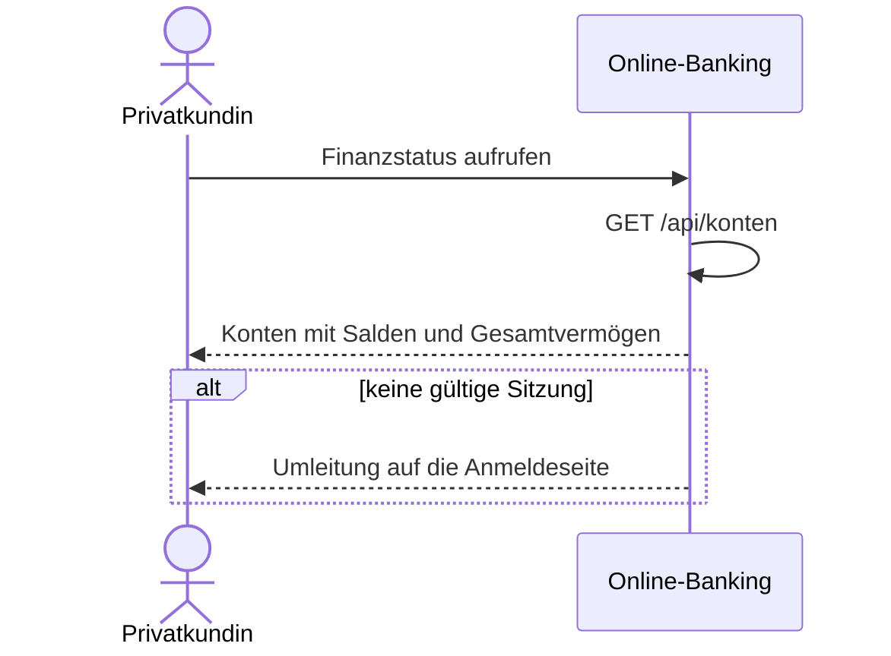

# Use Case: Finanzstatus anzeigen

## Überblick

**Use Case ID:** UC-001  
**Name:** Finanzstatus anzeigen  
**Bereich:** Finanzstatus  
**Primärakteur:** Privatkundin  
**Ziel:** Die Kundin sieht alle ihre Konten mit Kontoname, IBAN und Saldo sowie ihr Gesamtvermögen auf einen Blick.  
**Ziele:** Z-1, Z-2, Z-3, Z-4, Z-17  
**Anforderungen:** NFR-001, C-001

## Vorbedingungen

- Die Kundin ist angemeldet, es gibt eine gültige Sitzung.

## Standardablauf

1. Die Kundin ruft den Finanzstatus auf.
2. Das System liest die Konten der angemeldeten Kundin (Demo-Daten, C-001).
3. Das System berechnet das Gesamtvermögen als Summe der Salden aller Konten.
4. Das System zeigt über der Tabelle das Gesamtvermögen in Euro.
5. Das System zeigt die Konten in einer Tabelle mit Kontoname, eigenem Namen, IBAN und Saldo in Euro; die Spalte „Eigener Name“ bleibt leer, solange die Kundin keinen vergeben hat.
6. Das System zeigt in der Zeile des Girokontos Dispositionsrahmen und verfügbaren Betrag (Saldo plus Rahmen).
7. Das System zeigt in der Zeile des Girokontos den Knopf „Überweisen“; er öffnet die Überweisung mit dem Girokonto als Auftraggeberkonto (UC-002).
8. Das System zeigt in jeder Zeile den Knopf „Umsätze“; er öffnet die Umsätze des Kontos (UC-003).
9. Das System zeigt in jeder Zeile den Knopf „Name vergeben“; er öffnet das Blatt „Eigenen Namen vergeben“ für dieses Konto (A3).
10. Die Kundin liest Salden und Gesamtvermögen ab.
11. Das System zeigt im Kopf den Knopf „Umbuchen“; er öffnet die Umbuchung zwischen den eigenen Konten (UC-021).

## Alternativabläufe

### A1: Nicht angemeldet

**Auslöser:** Es gibt keine gültige Sitzung. (Schritt 1).  
**Ablauf:**

1. Das System leitet auf die Anmeldeseite um; der Dienst beantwortet GET /api/konten und PUT /api/konten/{iban}/name mit Status 401.
2. Die Kundin meldet sich an; danach beginnt der Standardablauf erneut, oder sie bricht ab.

### A2: Finanzstatus nicht verfügbar

**Auslöser:** Der Dienst antwortet mit dem Datenfehler 500, etwa weil einem Girokonto Dispositionsrahmen oder verfügbarer Betrag fehlt. (Schritt 2).  
**Ablauf:**

1. Das System zeigt die Meldung „Der Finanzstatus ist derzeit nicht verfügbar.“.
2. Das System zeigt keine Zeile ohne Dispositionsrahmen und keinen Knopf „Überweisen“.

### A3: Konto benennen

**Auslöser:** Die Kundin wählt in der Zeile eines Kontos „Name vergeben“ und will dem Konto einen eigenen Namen geben. (Schritt 9).  
**Ablauf:**

1. Das System zeigt das Blatt „Eigenen Namen vergeben“ mit dem Feld „Eigener Name“, gefüllt mit dem bisherigen eigenen Namen des Kontos, sonst leer; mit „Abbrechen“ schließt die Kundin das Blatt, ohne etwas zu ändern.
2. Die Kundin gibt den eigenen Namen ein, etwa „Urlaubskasse“, und wählt „Speichern“.
3. Das System entfernt führende und folgende Leerzeichen und prüft den Namen nach dem Datenmodell (Konto.eigenerName); verletzt er eine Feldregel, geht der Ablauf bei A4 weiter.
4. Das System speichert den Namen an dem Konto der angemeldeten Kundin (BR-0108) und schließt das Blatt. Speichert die Kundin den bisherigen eigenen Namen unverändert, ist das erlaubt und ändert nichts.
5. Das System zeigt in der Zeile dieses Kontos in der Spalte „Eigener Name“ den gespeicherten Namen und die Meldung „Eigener Name gespeichert.“; Kontoname, Art, IBAN und Saldo des Kontos bleiben unverändert.

### A4: Eingabe ungültig

**Auslöser:** Der eigene Name ist leer, besteht nur aus Leerzeichen oder ist länger als 60 Zeichen (Konto.eigenerName), die IBAN im Aufruf hat nicht 22 Zeichen (Konto.iban) oder der Rumpf ist kein gültiges JSON. (Schritt 9).  
**Ablauf:**

1. Der Dienst antwortet mit Status 400; das System speichert nichts, lässt den bisherigen eigenen Namen unverändert und zeigt die Meldung zum Feld im Blatt „Eigenen Namen vergeben“: „Bitte geben Sie den eigenen Namen an.“, wenn der Name nach dem Entfernen der Leerzeichen leer ist, „Der eigene Name darf höchstens 60 Zeichen lang sein.“, wenn er länger als 60 Zeichen ist, „Die IBAN muss 22 Zeichen lang sein.“ bei einer IBAN mit anderer Länge und „Die Anfrage ist ungültig.“ bei einem Rumpf ohne gültiges JSON.
2. Die Kundin korrigiert die Eingabe; der Ablauf geht bei A3 Schritt 2 weiter, oder sie wählt „Abbrechen“.

### A5: Konto nicht gefunden

**Auslöser:** Die IBAN im Aufruf gehört zu keinem Konto der angemeldeten Kundin (BR-0108). (Schritt 9).  
**Ablauf:**

1. Der Dienst antwortet mit Status 404; das System speichert nichts und zeigt „Das Konto wurde nicht gefunden.“.
2. Die Kundin ruft den Finanzstatus neu auf; der Ablauf beginnt bei Schritt 1, oder sie wechselt auf eine andere Seite.

## Sequenzdiagramm

## Nachbedingungen

### Erfolg

- Der Finanzstatus ist mit Gesamtvermögen und allen Konten der Kundin sichtbar.

### Fehlschlag

- Ohne gültige Sitzung wurde der Finanzstatus nicht gezeigt; die Anmeldeseite ist zu sehen.

## Geschäftsregeln

### BR-0001: Gesamtvermögen

Das Gesamtvermögen ist die Summe der Salden aller Konten der Kundin. Ein negativer Saldo, etwa der offene Betrag einer Kreditkarte, mindert es.

### BR-0002: Dispositionsrahmen nur beim Girokonto

Nur das Girokonto hat einen Dispositionsrahmen. Sein verfügbarer Betrag ist der Saldo plus der Dispositionsrahmen.

### BR-0108: Eigener Kontoname nur für Konten der angemeldeten Kundin

Der Dienst setzt und ändert einen eigenen Kontonamen nur an einem Konto der angemeldeten Kundin: Er sucht das Konto über die IBAN im Aufruf unter der Kennung der Sitzung. Gehört die IBAN zu keinem Konto der Kundin, ändert er nichts und antwortet mit Status 404 und „Das Konto wurde nicht gefunden.“. Zwei Konten derselben Kundin dürfen denselben eigenen Namen tragen; unterschieden werden sie über Art und IBAN. Der eigene Name ersetzt den Kontonamen nicht: Kontoname, Art, IBAN und Saldo des Kontos bleiben unverändert, und es gibt keine TAN-Bestätigung und keine Nachricht im Postfach.

## Notizen

Die Konten sind Demo-Daten (C-001). Der Knopf „Überweisen“ öffnet die Überweisung (UC-002). Der eigene Name liegt am Konto im Speicher (ADR-002) und gehört zum Ausgangsstand des Test-Resets: Nach jedem Reset trägt kein Konto einen eigenen Namen. Die Zeile eines Kontos bleibt über den Kontonamen erreichbar; der eigene Name steht in einer eigenen Spalte daneben.
