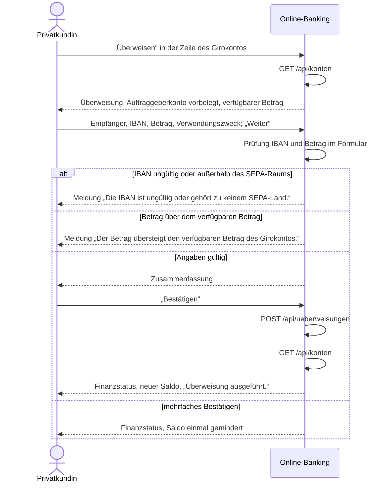

# Use Case: Überweisung vom Girokonto

## Überblick

**Use Case ID:** UC-002  
**Name:** Überweisung vom Girokonto  
**Bereich:** Überweisung  
**Primärakteur:** Privatkundin  
**Ziel:** Die Kundin überweist als einmaligen Auftrag einen Betrag von ihrem Girokonto an einen Empfänger im SEPA-Raum und sieht danach den neuen Saldo und die Meldung „Überweisung ausgeführt.“.  
**Ziele:** Z-5, Z-1  
**Anforderungen:** NFR-001, NFR-002, C-001

## Vorbedingungen

- Die Kundin ist angemeldet, es gibt eine gültige Sitzung (NFR-001).
- Die Kundin hat im Finanzstatus in der Zeile des Girokontos „Überweisen“ gewählt.

## Standardablauf

1. Das System zeigt die Überweisung mit dem Auftraggeberkonto vorbelegt: Kontoname, IBAN und verfügbarer Betrag des Girokontos.
2. Die Kundin gibt Empfänger, IBAN des Empfängers, Betrag in Euro und Verwendungszweck ein.
3. Die Kundin wählt „Weiter“.
4. Das System prüft die IBAN (BR-0003) und den Betrag (BR-0004) und zeigt bei einer Abweichung die Meldung im Formular der Überweisung.
5. Das System zeigt die Zusammenfassung mit Auftraggeberkonto, Empfänger, IBAN, Betrag in Euro und Verwendungszweck.
6. Die Kundin bestätigt.
7. Der Dienst prüft beim Bestätigen die IBAN (BR-0003) und den Betrag gegen den aktuellen verfügbaren Betrag des Girokontos (BR-0004).
8. Das System führt den Auftrag genau einmal aus und mindert den Saldo des Girokontos um den Betrag (BR-0005, BR-0006).
9. Das System zeigt den Finanzstatus mit dem neuen Saldo und der Meldung „Überweisung ausgeführt.“.

## Alternativabläufe

### A1: IBAN ungültig oder außerhalb des SEPA-Raums

**Auslöser:** Die IBAN des Empfängers hat keine gültige Prüfziffer, weniger als 15 oder mehr als 34 Stellen oder ihr Länderkennzeichen steht nicht in der SEPA-Länderliste (BR-0003). (Schritt 4).  
**Ablauf:**

1. Das System führt den Auftrag nicht aus, zeigt die Meldung „Die IBAN ist ungültig oder gehört zu keinem SEPA-Land.“ und zeigt keine Zusammenfassung.
2. Lehnt der Dienst die IBAN beim Bestätigen ab (Schritt 7), springt das System auf die Überweisung zurück, zeigt die Meldung im Formular mit den bisherigen Eingaben und gibt den Knopf „Bestätigen“ wieder frei.
3. Die Kundin korrigiert die IBAN; der Ablauf geht bei Schritt 2 weiter, oder sie bricht ab.

### A2: Betrag über dem verfügbaren Betrag

**Auslöser:** Der Betrag ist nicht größer als 0 oder übersteigt den verfügbaren Betrag des Girokontos (BR-0004). (Schritt 4).  
**Ablauf:**

1. Das System führt den Auftrag nicht aus und zeigt die Meldung „Der Betrag übersteigt den verfügbaren Betrag des Girokontos.“.
2. Lehnt der Dienst den Betrag beim Bestätigen ab (Schritt 7), springt das System auf die Überweisung zurück, zeigt die Meldung im Formular mit den bisherigen Eingaben und gibt den Knopf „Bestätigen“ wieder frei.
3. Die Kundin ändert den Betrag; der Ablauf geht bei Schritt 2 weiter, oder sie bricht ab.

### A3: Mehrfaches Bestätigen

**Auslöser:** Die Kundin bestätigt denselben Auftrag mehrfach, etwa durch einen Doppelklick. (Schritt 6).  
**Ablauf:**

1. Das System führt den Auftrag nur einmal aus; weitere Bestätigungen mit derselben Auftrags-Kennung buchen nicht erneut (BR-0005).
2. Die Kundin sieht den Finanzstatus mit dem einmal geminderten Saldo und der Meldung „Überweisung ausgeführt.“.

### A4: Abbrechen

**Auslöser:** Die Kundin wählt in der Überweisung oder in der Zusammenfassung „Abbrechen“. (Schritt 3).  
**Ablauf:**

1. Das System führt keinen Auftrag aus und zeigt den Finanzstatus mit unverändertem Saldo.

### A5: Keine gültige Sitzung

**Auslöser:** Es gibt keine gültige Sitzung. (Schritt 1).  
**Ablauf:**

1. Das System leitet auf die Anmeldeseite um.
2. Die Kundin meldet sich an; danach beginnt der Standardablauf erneut, oder sie bricht ab.

### A6: Bestätigung abgelehnt

**Auslöser:** Der Dienst lehnt das Auftraggeberkonto ab (403) oder antwortet mit einem Fehler außerhalb von 400, 401 und 422. (Schritt 7).  
**Ablauf:**

1. Das System führt den Auftrag nicht aus und springt auf die Überweisung zurück; die bisherigen Eingaben bleiben stehen.
2. Das System zeigt die Meldung „Die Überweisung konnte nicht ausgeführt werden.“ und gibt den Knopf „Bestätigen“ wieder frei.
3. Antwortet der Dienst mit 401, leitet das System auf die Anmeldeseite um (A5); es wird nichts gebucht.

## Sequenzdiagramm

## Nachbedingungen

### Erfolg

- Der Auftrag ist genau einmal ausgeführt; der Saldo des Girokontos ist um den Betrag gemindert.
- Der Finanzstatus zeigt den neuen Saldo und die Meldung „Überweisung ausgeführt.“.

### Fehlschlag

- Kein Auftrag ausgeführt, der Saldo unverändert; die Kundin sieht die Meldung zum Grund und bleibt bei der Überweisung.

## Geschäftsregeln

### BR-0003: IBAN des Empfängers

Die IBAN des Empfängers ist gültig: 15 bis 34 Stellen, gültige Prüfziffer nach ISO 7064 MOD 97-10, und ihr Länderkennzeichen steht in der SEPA-Länderliste. Maßgeblich ist die im Code hinterlegte SEPA-Länderliste (Referenz: src/ueberweisung.ts und public/seiten/ueberweisung.js) mit den Länderkennzeichen AD, AT, BE, BG, CH, CY, CZ, DE, DK, EE, ES, FI, FR, GB, GI, GR, HR, HU, IE, IS, IT, LI, LT, LU, LV, MC, MT, NL, NO, PL, PT, RO, SE, SI, SK, SM, VA. Sonst führt das System den Auftrag nicht aus und zeigt „Die IBAN ist ungültig oder gehört zu keinem SEPA-Land.“.

### BR-0004: Betragsgrenze des Girokontos

Der Betrag ist größer als 0 und übersteigt den verfügbaren Betrag des Girokontos (Saldo plus Dispositionsrahmen nach BR-0002) nicht. Sonst führt das System den Auftrag nicht aus und zeigt „Der Betrag übersteigt den verfügbaren Betrag des Girokontos.“.

### BR-0005: Genau einmalige Ausführung

Ein Auftrag wird genau einmal ausgeführt. Die Seite sperrt den Knopf „Bestätigen“ während des Absendens, gibt je Überweisung eine Auftrags-Kennung mit und vergibt nach jeder Ablehnung eine neue Auftrags-Kennung; eine wiederholte Bestätigung derselben Kennung ändert den Saldo nicht erneut.

### BR-0006: Saldo nach der Überweisung

Nach der Ausführung ist der Saldo des Girokontos um den Betrag gemindert; das Gesamtvermögen des Finanzstatus folgt daraus nach BR-0001.

### BR-0007: Auftraggeberkonto der Kundin

Die auftraggeberIban im Auftrag gehört zu einem Girokonto der angemeldeten Kundin. Sonst führt das System den Auftrag nicht aus.

## Weitere Prüfungen

- **WP-1** (Unit-Test): IBAN-Prüfziffer nach ISO 7064 MOD 97-10 und Zugehörigkeit des Länderkennzeichens zur SEPA-Länderliste.

## Notizen

Einmalige Überweisung vom Girokonto; Termin- und Daueraufträge sind nicht Teil dieser Story. Die Konten und Salden sind Demo-Daten (C-001), der Dienst schreibt den Saldo selbst fort.
