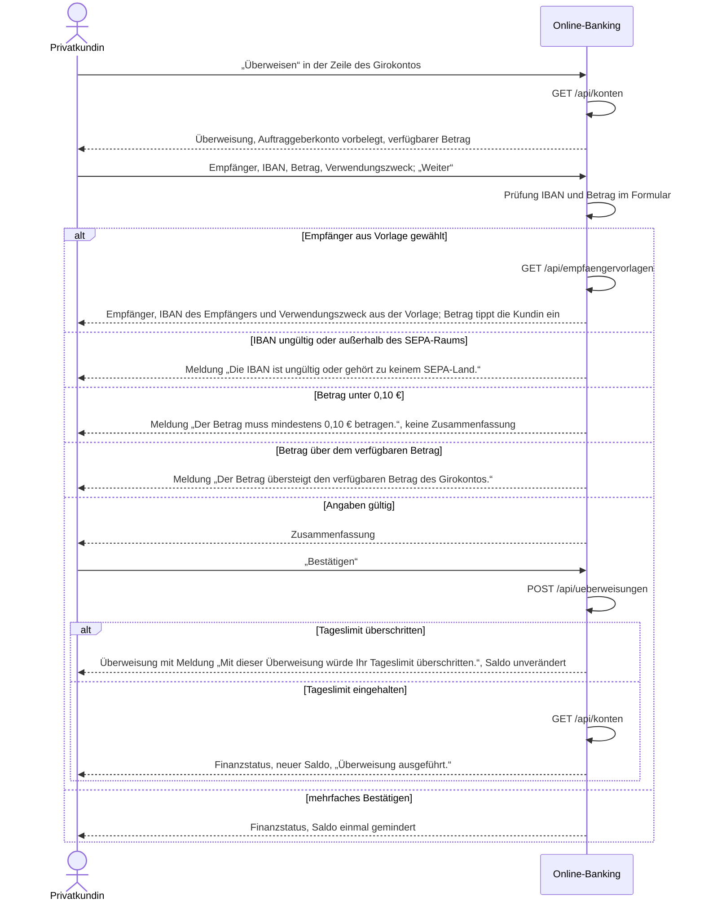

# Use Case: Überweisung vom Girokonto

## Überblick

**Use Case ID:** UC-002  
**Name:** Überweisung vom Girokonto  
**Bereich:** Überweisung  
**Primärakteur:** Privatkundin  
**Ziel:** Die Kundin überweist als einmaligen Auftrag einen Betrag von ihrem Girokonto an einen Empfänger im SEPA-Raum und sieht danach den neuen Saldo und die Meldung „Überweisung ausgeführt.“.  
**Ziele:** Z-5, Z-1  
**Anforderungen:** NFR-001, NFR-002, C-001

## Vorbedingungen

- Die Kundin ist angemeldet, es gibt eine gültige Sitzung (NFR-001).
- Die Kundin hat im Finanzstatus in der Zeile des Girokontos „Überweisen“ gewählt.

## Standardablauf

1. Das System zeigt die Überweisung mit dem Auftraggeberkonto vorbelegt: Kontoname, IBAN und verfügbarer Betrag des Girokontos.
2. Die Kundin gibt Empfänger, IBAN des Empfängers, Betrag in Euro und Verwendungszweck ein oder wählt im Feld „Vorlage“ eine gespeicherte Empfängervorlage (A7).
3. Die Kundin wählt „Weiter“.
4. Das System prüft die IBAN (BR-0003) und den Betrag (BR-0004) und zeigt bei einer Abweichung die Meldung im Formular der Überweisung.
5. Das System zeigt die Zusammenfassung mit Auftraggeberkonto, Empfänger, IBAN, Betrag in Euro und Verwendungszweck.
6. Die Kundin bestätigt.
7. Der Dienst prüft beim Bestätigen die IBAN (BR-0003), den Betrag gegen den aktuellen verfügbaren Betrag des Girokontos (BR-0004) und den Betrag zusammen mit den heutigen Überweisungen der Kundin gegen ihr Tageslimit (BR-0070).
8. Das System führt den Auftrag genau einmal aus und mindert den Saldo des Girokontos um den Betrag (BR-0005, BR-0006).
9. Das System zeigt den Finanzstatus mit dem neuen Saldo und der Meldung „Überweisung ausgeführt.“.
10. Die Kundin sieht den Auftrag als neuesten Umsatz in den Umsätzen des Girokontos (BR-0012).

## Alternativabläufe

### A1: IBAN ungültig oder außerhalb des SEPA-Raums

**Auslöser:** Die IBAN des Empfängers hat keine gültige Prüfziffer, weniger als 15 oder mehr als 34 Stellen oder ihr Länderkennzeichen steht nicht in der SEPA-Länderliste (BR-0003). (Schritt 4).  
**Ablauf:**

1. Das System führt den Auftrag nicht aus, zeigt die Meldung „Die IBAN ist ungültig oder gehört zu keinem SEPA-Land.“ und zeigt keine Zusammenfassung.
2. Lehnt der Dienst die IBAN beim Bestätigen ab (Schritt 7), springt das System auf die Überweisung zurück, zeigt die Meldung im Formular mit den bisherigen Eingaben und gibt den Knopf „Bestätigen“ wieder frei.
3. Die Kundin korrigiert die IBAN; der Ablauf geht bei Schritt 2 weiter, oder sie bricht ab.

### A2: Betrag über dem verfügbaren Betrag

**Auslöser:** Der Betrag übersteigt den verfügbaren Betrag des Girokontos (BR-0004). (Schritt 4).  
**Ablauf:**

1. Das System führt den Auftrag nicht aus und zeigt die Meldung „Der Betrag übersteigt den verfügbaren Betrag des Girokontos.“.
2. Lehnt der Dienst den Betrag beim Bestätigen ab (Schritt 7), springt das System auf die Überweisung zurück, zeigt die Meldung im Formular mit den bisherigen Eingaben und gibt den Knopf „Bestätigen“ wieder frei.
2a. Übersteigt der Betrag zugleich das Tageslimit (BR-0070), gilt allein diese Ablehnung: Der Dienst antwortet mit 422 und der Meldung zu BR-0004, die Oberfläche zeigt sie am Betragsfeld, und die Tageslimit-Prüfung (A12) läuft erst, wenn der Betrag den verfügbaren Betrag nicht übersteigt.
3. Die Kundin ändert den Betrag; der Ablauf geht bei Schritt 2 weiter, oder sie bricht ab.

### A3: Mehrfaches Bestätigen

**Auslöser:** Die Kundin bestätigt denselben Auftrag mehrfach, etwa durch einen Doppelklick. (Schritt 6).  
**Ablauf:**

1. Das System führt den Auftrag nur einmal aus; weitere Bestätigungen mit derselben Auftrags-Kennung buchen nicht erneut (BR-0005).
2. Die Kundin sieht den Finanzstatus mit dem einmal geminderten Saldo und der Meldung „Überweisung ausgeführt.“.

### A4: Abbrechen

**Auslöser:** Die Kundin wählt in der Überweisung oder in der Zusammenfassung „Abbrechen“. (Schritt 3).  
**Ablauf:**

1. Das System führt keinen Auftrag aus und zeigt den Finanzstatus mit unverändertem Saldo.

### A5: Keine gültige Sitzung

**Auslöser:** Es gibt keine gültige Sitzung. (Schritt 1).  
**Ablauf:**

1. Das System leitet auf die Anmeldeseite um.
2. Die Kundin meldet sich an; danach beginnt der Standardablauf erneut, oder sie bricht ab.

### A6: Bestätigung abgelehnt

**Auslöser:** Der Dienst lehnt das Auftraggeberkonto ab (403) oder antwortet mit einem Fehler außerhalb von 400, 401 und 422. (Schritt 7).  
**Ablauf:**

1. Das System führt den Auftrag nicht aus und springt auf die Überweisung zurück; die bisherigen Eingaben bleiben stehen.
2. Das System zeigt die Meldung „Die Überweisung konnte nicht ausgeführt werden.“ und gibt den Knopf „Bestätigen“ wieder frei.
3. Antwortet der Dienst mit 401, leitet das System auf die Anmeldeseite um (A5); es wird nichts gebucht.

### A7: Empfänger aus Vorlage wählen

**Auslöser:** Die Kundin wählt im Feld „Vorlage“ eine gespeicherte Empfängervorlage. (Schritt 2).  
**Ablauf:**

1. Das System belegt Empfänger und IBAN des Empfängers aus der Vorlage und, wenn die Vorlage einen Verwendungszweck hat, auch den Verwendungszweck; den Betrag übernimmt es nicht (BR-0017).
2. Hat die Vorlage keinen Verwendungszweck, bleibt das Feld Verwendungszweck leer; er bleibt Pflicht und die Kundin füllt ihn.
3. Die Kundin ergänzt den Betrag, ändert bei Bedarf Angaben und wählt „Weiter“; der Ablauf geht bei Schritt 3 weiter.

### A8: Betrag unter dem Mindestbetrag

**Auslöser:** Der Betrag verletzt die Feldregel von Überweisung.betrag im Datenmodell (mindestens 0,10 €). (Schritt 4).  
**Ablauf:**

1. Das System führt den Auftrag nicht aus, zeigt die Meldung „Der Betrag muss mindestens 0,10 € betragen.“ im Formular und zeigt keine Zusammenfassung.
2. Lehnt der Dienst den Betrag beim Bestätigen mit 400 ab (Schritt 7), springt das System auf die Überweisung zurück, zeigt die Meldung im Formular mit den bisherigen Eingaben und gibt den Knopf „Bestätigen“ wieder frei.
3. Die Kundin ändert den Betrag; der Ablauf geht bei Schritt 2 weiter, oder sie bricht ab.

### A9: Terminüberweisung vormerken

**Auslöser:** Die Kundin trägt im Feld „Ausführungstag“ einen Tag ein; ohne Ausführungstag führt das System die Überweisung sofort aus. (Schritt 2).  
**Ablauf:**

1. Das System prüft bei „Weiter“ die IBAN (BR-0003), den Betrag (BR-0004) und den Ausführungstag (BR-0079) und zeigt bei einer Abweichung die Meldung im Formular (A1, A2, A8, A10); die Zusammenfassung zeigt die Zeile „Ausführungstag“ nur bei einer Terminüberweisung, bei einer sofortigen Überweisung entfällt sie.
2. Bestätigt die Kundin, ruft die Oberfläche bei einem Ausführungstag POST /api/terminueberweisungen statt POST /api/ueberweisungen auf; der Dienst prüft dieselben Angaben und das Auftraggeberkonto (BR-0007) erneut und legt den Auftrag mit Status vorgemerkt und dem Ausführungstag an. Er bucht nichts: der Saldo des Girokontos bleibt unverändert und es entsteht kein Umsatz; BR-0006 und BR-0012 gelten erst bei der Ausführung.
3. Das Tageslimit (BR-0070) prüft das System beim Vormerken nicht; es gilt erst bei der Ausführung.
4. Bestätigt die Kundin denselben Auftrag mehrfach, legt das System ihn nur einmal an; weitere Bestätigungen mit derselben Auftrags-Kennung ändern nichts (BR-0005).
5. Lehnt der Dienst das Auftraggeberkonto ab (403) oder antwortet mit einem anderen Fehler außerhalb von 400, 401 und 422, führt das System A6 aus, zeigt aber statt der dortigen Meldung „Die Terminüberweisung konnte nicht vorgemerkt werden.“; bei 401 gilt A6 unverändert.
6. Das System zeigt den Finanzstatus mit unverändertem Saldo und der Meldung „Überweisung vorgemerkt.“; den Auftrag sieht die Kundin unter „Vorgemerkte Überweisungen“ (Use Case Vorgemerkte Überweisungen verwalten).

### A10: Ausführungstag nicht zulässig

**Auslöser:** Der Ausführungstag liegt heute, in der Vergangenheit oder mehr als 365 Tage nach heute (BR-0079). (Schritt 4).  
**Ablauf:**

1. Das System legt den Auftrag nicht an, zeigt die Meldung „Der Ausführungstag muss zwischen morgen und 365 Tagen ab heute liegen.“ im Formular und zeigt keine Zusammenfassung.
2. Lehnt der Dienst den Ausführungstag beim Bestätigen mit 422 ab (Schritt 7), springt das System auf die Überweisung zurück, zeigt die Meldung im Formular mit den bisherigen Eingaben und gibt den Knopf „Bestätigen“ wieder frei.
3. Ist der Ausführungstag kein gültiges Datum (Feldregel von Überweisung.ausfuehrungstag im Datenmodell), lehnt der Dienst mit 400 ab; die Datumseingabe der Maske lässt nur gültige Tage zu.
4. Die Kundin wählt einen anderen Tag; der Ablauf geht bei Schritt 2 weiter, oder sie bricht ab.

### A11: Auftrags-Kennung bereits verwendet

**Auslöser:** Der Dienst lehnt den Auftrag beim Bestätigen mit 422 und dem Text „Diese Auftrags-Kennung wurde bereits verwendet.“ ab, weil die Kennung für eine andere Überweisung der Kundin verbraucht ist (BR-0005). (Schritt 7).  
**Ablauf:**

1. Das System legt keinen Auftrag an und bucht nichts, springt auf die Überweisung zurück, zeigt den Text des Dienstes im Formular mit den bisherigen Eingaben und gibt den Knopf „Bestätigen“ wieder frei; für die nächste Bestätigung vergibt die Seite eine neue Auftrags-Kennung (BR-0005).
2. Die Wiederholung derselben Überweisung am selben Endpunkt beantwortet der Dienst wie bisher mit 200 ohne weitere Buchung oder weiteren Auftrag (A3, A9 Schritt 4). 422 gilt nur, wenn die Kennung für eine andere Überweisung verbraucht ist: bei einer Terminüberweisung durch eine sofortige Überweisung oder einen gelöschten Auftrag, bei einer sofortigen Überweisung durch einen Terminauftrag (vorgemerkt oder gelöscht).
3. Die Kundin bestätigt erneut oder bricht ab; die Seite vergibt je Überweisung eine neue Kennung, deshalb tritt dieser Fall über die Oberfläche nicht auf.

### A12: Tageslimit überschritten

**Auslöser:** Der Betrag zusammen mit den am laufenden Kalendertag ausgeführten Überweisungen der Kundin übersteigt ihr Tageslimit (BR-0070), auch bei einem Tageslimit von 0,00 EUR, und der Betrag übersteigt den verfügbaren Betrag des Girokontos nicht (sonst gilt A2). (Schritt 7).  
**Ablauf:**

1. Der Dienst führt den Auftrag nicht aus, bucht keinen Umsatz, lässt den Saldo des Girokontos unverändert und antwortet mit Status 422 und der Meldung „Mit dieser Überweisung würde Ihr Tageslimit überschritten.“.
2. Das System springt auf die Überweisung zurück, zeigt die Meldung im Formular mit den bisherigen Eingaben und gibt den Knopf „Bestätigen“ wieder frei; die nächste Bestätigung trägt eine neue Auftrags-Kennung (BR-0005).
3. Die Kundin ändert den Betrag; der Ablauf geht bei Schritt 2 weiter, oder sie bricht ab.

## Sequenzdiagramm

## Nachbedingungen

### Erfolg

- Der Auftrag ist genau einmal ausgeführt; der Saldo des Girokontos ist um den Betrag gemindert.
- Der Finanzstatus zeigt den neuen Saldo und die Meldung „Überweisung ausgeführt.“.
- Der Auftrag steht als neuester Umsatz in den Umsätzen des Girokontos.
- Bei einer Terminüberweisung (A9) gilt stattdessen: Der Auftrag ist genau einmal mit Status vorgemerkt und Ausführungstag angelegt, der Saldo des Girokontos ist unverändert, es entsteht kein Umsatz, und der Finanzstatus zeigt die Meldung „Überweisung vorgemerkt.“.

### Fehlschlag

- Kein Auftrag ausgeführt, der Saldo unverändert; die Kundin sieht die Meldung zum Grund und bleibt bei der Überweisung.

## Geschäftsregeln

### BR-0003: IBAN des Empfängers

Die IBAN des Empfängers ist gültig: 15 bis 34 Stellen, gültige Prüfziffer nach ISO 7064 MOD 97-10, und ihr Länderkennzeichen steht in der SEPA-Länderliste. Maßgeblich ist die im Dienst hinterlegte SEPA-Länderliste (src/ueberweisung.ts) mit den Länderkennzeichen AD, AT, BE, BG, CH, CY, CZ, DE, DK, EE, ES, FI, FR, GB, GI, GR, HR, HU, IE, IS, IT, LI, LT, LU, LV, MC, MT, NL, NO, PL, PT, RO, SE, SI, SK, SM, VA; die Oberfläche führt dieselbe Liste für die Feldmeldung mit (public/seiten/ueberweisung.js, ADR-004). Sonst führt das System den Auftrag nicht aus und zeigt „Die IBAN ist ungültig oder gehört zu keinem SEPA-Land.“.

### BR-0004: Betragsgrenze des Girokontos

Der Betrag übersteigt den verfügbaren Betrag des Girokontos (Saldo plus Dispositionsrahmen nach BR-0002) nicht. Sonst führt das System den Auftrag nicht aus und zeigt „Der Betrag übersteigt den verfügbaren Betrag des Girokontos.“.

### BR-0005: Genau einmalige Ausführung

Ein Auftrag wird genau einmal ausgeführt. Die Seite sperrt den Knopf „Bestätigen“ während des Absendens, gibt je Überweisung eine Auftrags-Kennung mit und vergibt nach jeder Ablehnung eine neue Auftrags-Kennung; eine wiederholte Bestätigung derselben Kennung ändert den Saldo nicht erneut. Die Auftrags-Kennung gilt je Kundin für sofortige Überweisungen und Terminüberweisungen und bleibt dauerhaft verbraucht, auch nach dem Löschen eines vorgemerkten Auftrags. Die Wiederholung derselben Überweisung am selben Endpunkt bleibt 200 ohne weitere Buchung und ohne weiteren Auftrag: bei POST /api/ueberweisungen die Wiederholung der Kennung einer ausgeführten sofortigen Überweisung, bei POST /api/terminueberweisungen die Wiederholung der Kennung eines noch vorgemerkten Auftrags. Jede Verwendung einer verbrauchten Kennung für eine andere Überweisung lehnt der Dienst mit 422 und dem Text „Diese Auftrags-Kennung wurde bereits verwendet.“ ab, es entsteht kein Auftrag und es wird nichts gebucht. Das gilt an beiden Endpunkten: bei POST /api/terminueberweisungen für die Kennung einer sofortigen Überweisung oder eines gelöschten Auftrags, bei POST /api/ueberweisungen für die Kennung eines Terminauftrags (vorgemerkt oder gelöscht).

### BR-0006: Saldo nach der Überweisung

Nach der Ausführung ist der Saldo des Girokontos um den Betrag gemindert; das Gesamtvermögen des Finanzstatus folgt daraus nach BR-0001.

### BR-0007: Auftraggeberkonto der Kundin

Die auftraggeberIban im Auftrag gehört zu einem Girokonto der angemeldeten Kundin. Sonst führt das System den Auftrag nicht aus.

### BR-0012: Umsatz einer ausgeführten Überweisung

Mit der Ausführung entsteht genau ein Umsatz auf dem Auftraggeberkonto: Buchungstag ist der Tag der Ausführung, gebuchtAm der Ausführungszeitpunkt als Zeitpunkt in UTC (erfasstAm des Auftrags), Gegenpartei der eingegebene Empfänger, Verwendungszweck der eingegebene Verwendungszweck, Betrag der Betrag als Ausgang (negativ), Kategorie „Sonstiges“ und Saldo danach der nach BR-0006 geminderte Saldo des Girokontos. Eine weitere Bestätigung derselben Auftrags-Kennung erzeugt keinen weiteren Umsatz (BR-0005).

### BR-0017: Empfänger aus Vorlage übernehmen

Wählt die Kundin eine Empfängervorlage, übernimmt das System den Namen der Vorlage als Empfänger, ihre IBAN als IBAN des Empfängers und, wenn sie einen Verwendungszweck hat, diesen; den Betrag übernimmt es nicht. Alle Felder bleiben änderbar, der Verwendungszweck bleibt Pflicht, und die Überweisung ändert die Vorlage nicht.

### BR-0079: Ausführungstag der Terminüberweisung

Der Ausführungstag einer Terminüberweisung liegt frühestens am Kalendertag nach heute und höchstens 365 Tage nach heute; heute ist der aktuelle Kalendertag in Europe/Berlin. Jeder Kalendertag in diesem Bereich ist erlaubt, auch ein Wochenende oder Feiertag. Sonst legt das System den Auftrag nicht an, der Dienst antwortet mit 422 und das System zeigt „Der Ausführungstag muss zwischen morgen und 365 Tagen ab heute liegen.“. Die Grenzen werden gegen den heutigen Tag gemessen, nie gegen ein festes Datum.

## Weitere Prüfungen

- **WP-1** (Unit-Test): IBAN-Prüfziffer nach ISO 7064 MOD 97-10 und Zugehörigkeit des Länderkennzeichens zur SEPA-Länderliste.
- **WP-2** (Unit-Test): Tageslimit (BR-0070): Überweisungen kurz vor und nach Mitternacht UTC (erfasstAm) zählen zu verschiedenen Kalendertagen; die Überweisung des Vortags zählt nicht zu den heutigen Ausgängen.
- **WP-3** (Unit-Test): Tageslimit (BR-0070): Summen werden in Cent verglichen; 0,10 € und 0,20 € bei Limit 0,30 € sind zulässig, weitere 0,01 € werden abgelehnt; ein Limit von 0,00 € lehnt jede Überweisung ab.
- **WP-4** (Unit-Test): Tageslimit (BR-0070): Umbuchungen, Lastschriften, Kartenzahlungen und Daueraufträge zählen nicht zu den heutigen Ausgängen.

## Notizen

Einmalige Überweisung vom Girokonto, sofort oder als Terminüberweisung für einen späteren Ausführungstag (A9, A10); die Ausführung einer Terminüberweisung am Ausführungstag und Daueraufträge sind nicht Teil dieser Story. Die Konten und Salden sind Demo-Daten (C-001), der Dienst schreibt den Saldo selbst fort. Die Grenze der Tageslimit-Prüfung ist das Tageslimit der Kundin, das sie in UC-015 festlegt. Gegen das Tageslimit zählen nur ausgeführte Überweisungen nach diesem Use Case; andere Ausgänge wie Umbuchungen, Lastschriften, Kartenzahlungen und Daueraufträge zählen nicht (BR-0070). Die Grenze der Tageslimit-Prüfung ist das Tageslimit der Kundin, das sie in UC-015 festlegt.
