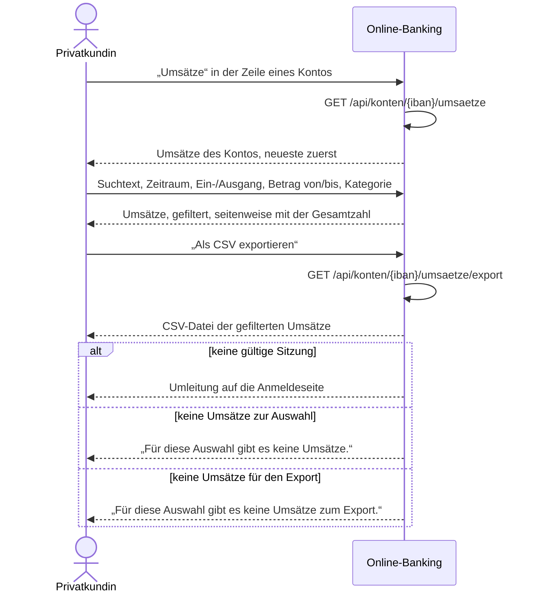

# Use Case: Umsätze eines Kontos anzeigen

## Überblick

**Use Case ID:** UC-003  
**Name:** Umsätze eines Kontos anzeigen  
**Bereich:** Finanzstatus  
**Primärakteur:** Privatkundin  
**Ziel:** Die Kundin sieht zu einem ihrer Konten die Umsätze mit Buchungstag, Gegenpartei, Verwendungszweck, Kategorie, Betrag und Saldo danach, den neuesten zuerst, und schränkt sie über die Textsuche sowie die Filter nach Zeitraum, Ein-/Ausgang, Betrag von/bis und Kategorie ein; sie blättert die Treffer seitenweise mit 20 Umsätzen je Seite und sieht die Gesamtzahl der Treffer, und sie lädt die Umsätze als CSV-Datei herunter.  
**Ziele:** Z-6  
**Anforderungen:** NFR-001, C-001

## Vorbedingungen

- Die Kundin ist angemeldet, es gibt eine gültige Sitzung (NFR-001).
- Die Kundin hat im Finanzstatus in der Zeile eines Kontos „Umsätze“ gewählt.

## Standardablauf

1. Die Kundin wählt im Finanzstatus in der Zeile eines Kontos „Umsätze“.
2. Das System liest die Umsätze des Kontos (Demo-Daten, C-001).
3. Das System ordnet die Umsätze mit dem neuesten Buchungstag zuerst (BR-0008).
4. Das System zeigt Kontoname und IBAN des Kontos sowie die Felder für die Textsuche und die Filter nach Zeitraum, Ein-/Ausgang, Betrag von, Betrag bis und Kategorie.
5. Das System zeigt die Umsätze in einer Tabelle mit Buchungstag, Gegenpartei, Verwendungszweck, Kategorie, Betrag in Euro, Saldo danach in Euro und Rückgabe; bei einer SEPA-Lastschrift steht dort „Zurückgeben“, bei einer zurückgegebenen „Zurückgegeben“ (UC-022).
6. Die Kundin gibt einen Suchtext ein und wählt einen Zeitraum, eine Richtung, Betrag von und Betrag bis sowie eine Kategorie.
7. Das System zeigt nur die Umsätze, deren Gegenpartei oder Verwendungszweck den Suchtext enthält, deren Buchungstag im Zeitraum liegt, deren Betrag zur gewählten Richtung passt, deren Betragshöhe zwischen Betrag von und Betrag bis liegt und deren Kategorie der gewählten entspricht (BR-0009, BR-0010, BR-0104).
8. Die Kundin blättert mit „Seite vor“ und „Seite zurück“; das System zeigt die Treffer seitenweise mit 20 Umsätzen je Seite, nennt die Gesamtzahl der Treffer und behält die Reihenfolge nach BR-0008 über alle Seiten bei (BR-0105).
9. Die Kundin wählt „Als CSV exportieren“.
10. Das System liefert die Umsätze, die zu den eingestellten Werten für Suchtext, Zeitraum, Ein-/Ausgang, Betrag von und Betrag bis sowie Kategorie passen, über alle Seiten und ohne Seitenparameter, mit derselben Reihenfolge und demselben Saldo danach als CSV-Datei, die der Browser herunterlädt; es speichert die Datei nicht (BR-0075, BR-0104).
11. Die Kundin wählt „Kontoauszug“; das System öffnet die Maske Kontoauszug für das Konto mit der IBAN der angezeigten Umsätze, weiter mit UC-024.

## Alternativabläufe

### A1: Nicht angemeldet

**Auslöser:** Es gibt keine gültige Sitzung, beim Öffnen der Seite (Schritt 1) oder weil sie bis zum Export abgelaufen ist (Schritt 10, Antwort 401). (Schritt 1).  
**Ablauf:**

1. Das System leitet auf die Anmeldeseite um und liefert beim Export keine Datei.
2. Die Kundin meldet sich an; danach beginnt der Standardablauf erneut, oder sie bricht ab.

### A2: Keine Umsätze zur Auswahl

**Auslöser:** Das Konto hat keine Umsätze, oder zu Suchtext, Zeitraum, Richtung, Betrag von/bis und Kategorie passt kein Umsatz. (Schritt 7).  
**Ablauf:**

1. Das System zeigt den Hinweis „Für diese Auswahl gibt es keine Umsätze.“ und keine Zeile.

### A3: Konto nicht gefunden

**Auslöser:** Die IBAN gehört zu keinem Konto der angemeldeten Kundin (BR-0011). (Schritt 2).  
**Ablauf:**

1. Das System zeigt den Hinweis „Das Konto wurde nicht gefunden.“ und keine Umsätze.

### A4: Zeitraum ungültig

**Auslöser:** Das Von-Datum liegt nach dem Bis-Datum (BR-0010). (Schritt 7).  
**Ablauf:**

1. Das System zeigt die Meldung „Der Zeitraum ist ungültig: von liegt nach bis.“ statt der Tabelle und keine Umsätze.
2. Einen Hinweis nach A2 zeigt das System nicht.

### A5: Keine Umsätze zum Export

**Auslöser:** Zu Suchtext, Zeitraum, Richtung, Betrag von/bis und Kategorie passt kein Umsatz, oder das Konto hat keine Umsätze; der Dienst antwortet mit 422 (BR-0076). (Schritt 10).  
**Ablauf:**

1. Das System liefert keine Datei und zeigt die Meldung „Für diese Auswahl gibt es keine Umsätze zum Export.“.

### A6: Konto nicht gefunden beim Export

**Auslöser:** Die IBAN gehört zu keinem Konto der angemeldeten Kundin; der Dienst antwortet mit 404 (BR-0011). (Schritt 10).  
**Ablauf:**

1. Das System liefert keine Datei und zeigt die Meldung „Das Konto wurde nicht gefunden.“.

### A7: Zeitraum ungültig beim Export

**Auslöser:** Das Von-Datum liegt nach dem Bis-Datum; der Dienst antwortet mit 400 (BR-0010). (Schritt 10).  
**Ablauf:**

1. Das System liefert keine Datei und zeigt die Meldung „Der Zeitraum ist ungültig: von liegt nach bis.“.

### A8: Export fehlgeschlagen

**Auslöser:** Der Dienst antwortet mit einem anderen Fehler als in A1, A5 bis A7 und A11 oder ist nicht erreichbar. (Schritt 10).  
**Ablauf:**

1. Das System liefert keine Datei und zeigt die Meldung „Der Export ist fehlgeschlagen. Bitte versuchen Sie es später erneut.“.

### A9: Betragsbereich ungültig

**Auslöser:** Betrag von liegt über Betrag bis (BR-0104). (Schritt 7).  
**Ablauf:**

1. Das System zeigt die Meldung „Der Betragsbereich ist ungültig: von liegt über bis.“ statt der Tabelle und keine Umsätze.
2. Einen Hinweis nach A2 zeigt das System nicht.

### A10: Seite hinter der letzten Trefferseite

**Auslöser:** Die Kundin wählt „Seite vor“, und die angefragte Seite liegt hinter der letzten Trefferseite (BR-0105). (Schritt 8).  
**Ablauf:**

1. Das System zeigt keine Zeile und die Gesamtzahl der Treffer.
2. Eine Meldung zeigt das System nicht.

### A11: Betragsbereich ungültig beim Export

**Auslöser:** Betrag von liegt über Betrag bis; der Dienst antwortet mit 400 (BR-0104). (Schritt 10).  
**Ablauf:**

1. Das System liefert keine Datei und zeigt die Meldung „Der Betragsbereich ist ungültig: von liegt über bis.“.

### A12: Filterwechsel

**Auslöser:** Die Kundin ändert Suchtext, Zeitraum, Ein-/Ausgang, Betrag von, Betrag bis oder Kategorie, während die Liste eine Seite ab 2 zeigt (BR-0105). (Schritt 6).  
**Ablauf:**

1. Das System zeigt die Treffer der neuen Auswahl ab Seite 1 und nennt die Gesamtzahl der Treffer über alle Seiten (BR-0105).
2. Einen Hinweis nach A2 zeigt das System nur, wenn die neue Auswahl keinen Treffer hat.

## Sequenzdiagramm

## Nachbedingungen

### Erfolg

- Die Umsätze des gewählten Kontos sind mit Buchungstag, Gegenpartei, Verwendungszweck, Kategorie, Betrag und Saldo danach sichtbar, den neuesten zuerst.
- Suchtext, Zeitraum, Richtung, Betrag von/bis und Kategorie sind auf die angezeigten Umsätze angewendet.
- Nach einem Export liegt die CSV-Datei mit den Umsätzen der eingestellten Filter beim Browser der Kundin; im System ist nichts gespeichert.

### Fehlschlag

- Ohne gültige Sitzung wurden keine Umsätze gezeigt; die Anmeldeseite ist zu sehen.

## Geschäftsregeln

### BR-0008: Reihenfolge der Umsätze und Saldo danach

Die Umsätze eines Kontos stehen mit dem neuesten Buchungstag zuerst; sortiert wird nach Buchungstag absteigend und bei gleichem Buchungstag nach gebuchtAm absteigend, sodass der zuletzt gebuchte Umsatz oben steht. Der Saldo danach eines Umsatzes ist der Saldo des Kontos unmittelbar nach dieser Buchung; der jüngste Umsatz eines Kontos trägt daher den aktuellen Saldo des Kontos.

### BR-0009: Ein- und Ausgang

Ein Eingang hat einen positiven Betrag, ein Ausgang einen negativen Betrag; der Betrag 0 kommt nicht vor. Die Richtung „Alle“ schränkt nicht ein, „Eingang“ zeigt nur Umsätze mit positivem Betrag, „Ausgang“ nur Umsätze mit negativem Betrag.

### BR-0010: Zeitraum und Textsuche

Der Zeitraumfilter zeigt die Umsätze, deren Buchungstag zwischen dem gewählten Von- und Bis-Datum liegt, beide Grenzen eingeschlossen; fehlt eine Grenze, gilt sie als offen. Liegt das Von-Datum nach dem Bis-Datum, antwortet der Dienst mit 400 und dem Feld fehler „Der Zeitraum ist ungültig: von liegt nach bis.“ und liefert keine Umsätze; die Seite zeigt diese Meldung statt der Tabelle und keinen Hinweis nach A2. Die Textsuche zeigt die Umsätze, deren Gegenpartei oder Verwendungszweck den Suchtext enthält, ohne Rücksicht auf Groß- und Kleinschreibung. Ohne Eingabe schränkt ein Filter nicht ein.

### BR-0011: Umsätze und Rückgaben nur für Konten der Kundin

Umsätze liefert der Dienst und eine Rückgabe (UC-022) bucht er nur zu einer IBAN, die zu einem Konto der angemeldeten Kundin gehört; sonst antwortet er mit 404 und die Seite zeigt „Das Konto wurde nicht gefunden.“. Dasselbe gilt für den Kontoauszug (UC-024): Ihn liefert der Dienst nur zu einer IBAN eines Kontos der angemeldeten Kundin; sonst antwortet er mit 404 und die Maske Kontoauszug zeigt „Das Konto wurde nicht gefunden.“.

### BR-0075: Export mit den Umsätzen der Liste

Der Export enthält genau die Umsätze, die die Umsatzliste zu denselben Werten für Suchtext, Zeitraum, Ein-/Ausgang, Betrag von/bis und Kategorie zeigt (BR-0009, BR-0010, BR-0104), über alle Seiten der Liste hinweg; Seitenparameter führt er nicht und die Seitengröße (BR-0105) wendet er nicht an, je Umsatz eine Zeile, in der Reihenfolge der Liste und mit demselben Saldo danach (BR-0008). Der Dienst erzeugt die Datei bei jedem Aufruf neu und speichert sie nicht.

### BR-0076: Export nur mit Umsätzen

Der Export liefert nur dann eine Datei, wenn mindestens ein Umsatz zu den gesetzten Filtern passt, also zu Suchtext, Zeitraum und Richtung (BR-0009, BR-0010) sowie Betrag von/bis und Kategorie (BR-0104); sonst antwortet der Dienst mit 422 und dem Feld fehler „Für diese Auswahl gibt es keine Umsätze zum Export.“ und liefert keine Datei. Vorher gelten in dieser Reihenfolge BR-0011 (404) und die Prüfung von Zeitraum und Betragsbereich nach BR-0010 und BR-0104 (400); bei fremder IBAN und ungültigem Zeitraum antwortet der Dienst daher mit 404.

### BR-0104: Betragsfilter und Kategoriefilter der Umsatzliste

Der Betragsfilter zeigt die Umsätze, deren Betragshöhe ohne Vorzeichen zwischen Betrag von und Betrag bis liegt, beide Grenzen eingeschlossen; ein Ausgang von -950,00 Euro liegt damit zwischen 100,00 und 1.000,00, und Ein-/Ausgang bleibt der eigene Filter (BR-0009). Fehlt eine Grenze, gilt sie als offen. Der Kategoriefilter zeigt die Umsätze, deren Kategorie der gewählten aus der Werteliste von Umsatz.kategorie entspricht; „Alle“ ist keine Kategorie, sondern die nicht einschränkende Auswahl der Maske, die den Parameter kategorie dann nicht mitschickt, und ohne Parameter schränkt der Filter nicht ein. Zusammen mit Zeitraum und Textsuche (BR-0010) zeigt die Liste nur Umsätze, die alle gesetzten Filter erfüllen. Liegt Betrag von über Betrag bis, antwortet der Dienst mit 400 und dem Feld fehler „Der Betragsbereich ist ungültig: von liegt über bis.“ und liefert keine Umsätze; die Seite zeigt diese Meldung statt der Tabelle und keinen Hinweis nach A2.

### BR-0105: Seitenweise Ausgabe der Umsatzliste mit Gesamtzahl

Die Umsatzliste zeigt 20 Umsätze je Seite; die Maske schickt diese Seitengröße fest mit. Die Treffer stehen über alle Seiten hinweg in der Reihenfolge nach BR-0008, Seite 1 enthält die ersten 20 Treffer. Die Maske fragt nur Seiten ab 1 an, springt bei jedem Filterwechsel auf Seite 1 (A12) und zeigt als Kennzahl „Seite“ die Seitenzahl, die sie zuletzt angefragt hat, also den Wert des Parameters seite; einen eigenen Wert für die angezeigte Seite liefert der Dienst nicht, der Vertrag bleibt unverändert. Die Maske nennt die Gesamtzahl der Treffer über alle Seiten; sie zählt dieselben Umsätze wie die Liste, auch wenn der Testbetrieb je Konto nur die jüngsten 200 Umsätze hält. Eine Seite hinter der letzten Trefferseite liefert eine leere Trefferseite mit der Gesamtzahl und ohne Meldung; den Hinweis nach A2 zeigt die Seite nur, wenn es keinen Treffer gibt.

## Notizen

Der Ausgangsstand führt je Konto einige Demo-Umsätze mit festen Buchungstagen; das Girokonto trägt dazu zwei SEPA-Lastschriften mit Buchungstag relativ zum Tag des Resets (UC-022); der jüngste Umsatz eines Kontos trägt als Saldo danach den aktuellen Kontosaldo (C-001, BR-0008). Weitere Umsätze entstehen aus einer ausgeführten Überweisung (UC-002, BR-0012) und aus der Rückgabe einer Lastschrift (UC-022). Die Umsatzliste ist eine eigene Seite, die der Knopf „Umsätze“ in der Zeile des Finanzstatus öffnet.

Export (Schritte 9 und 10): Die Datei hat Semikolon als Trennzeichen und UTF-8 mit BOM, damit Excel in Deutschland sie direkt richtig öffnet. Sie beginnt mit der Kopfzeile Buchungstag;Gegenpartei;Verwendungszweck;Betrag;Saldo danach, danach folgt je Umsatz eine Zeile. Der Buchungstag steht als TT.MM.JJJJ, Betrag und Saldo danach in Euro mit Dezimalkomma, ohne Tausenderpunkt und ohne Währungszeichen, ein Ausgang negativ (Beispiel -50,00). Ein Text mit Semikolon, Anführungszeichen oder Zeilenumbruch steht in Anführungszeichen, ein Anführungszeichen darin doppelt; sonst werden Texte unverändert geschrieben. Der Dateiname lautet umsaetze-<IBAN ohne Leerzeichen>.csv. Ohne gültige Sitzung gilt A1.
