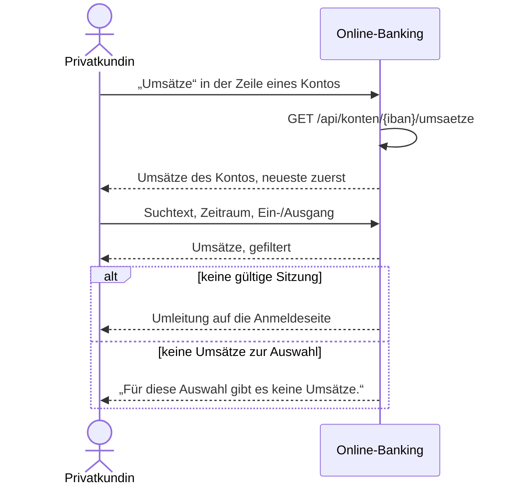

# Use Case: Umsätze eines Kontos anzeigen

## Überblick

**Use Case ID:** UC-003  
**Name:** Umsätze eines Kontos anzeigen  
**Bereich:** Finanzstatus  
**Primärakteur:** Privatkundin  
**Ziel:** Die Kundin sieht zu einem ihrer Konten die Umsätze mit Buchungstag, Gegenpartei, Verwendungszweck, Betrag und Saldo danach, den neuesten zuerst, und schränkt sie über die Textsuche sowie die Filter nach Zeitraum und Ein-/Ausgang ein.  
**Ziele:** Z-6  
**Anforderungen:** NFR-001, C-001

## Vorbedingungen

- Die Kundin ist angemeldet, es gibt eine gültige Sitzung (NFR-001).
- Die Kundin hat im Finanzstatus in der Zeile eines Kontos „Umsätze“ gewählt.

## Standardablauf

1. Die Kundin wählt im Finanzstatus in der Zeile eines Kontos „Umsätze“.
2. Das System liest die Umsätze des Kontos (Demo-Daten, C-001).
3. Das System ordnet die Umsätze mit dem neuesten Buchungstag zuerst (BR-0008).
4. Das System zeigt Kontoname und IBAN des Kontos sowie die Felder für die Textsuche und die Filter nach Zeitraum und Ein-/Ausgang.
5. Das System zeigt die Umsätze in einer Tabelle mit Buchungstag, Gegenpartei, Verwendungszweck, Betrag in Euro und Saldo danach in Euro.
6. Die Kundin gibt einen Suchtext ein, wählt einen Zeitraum oder eine Richtung.
7. Das System zeigt nur die Umsätze, deren Gegenpartei oder Verwendungszweck den Suchtext enthält, deren Buchungstag im Zeitraum liegt und deren Betrag zur gewählten Richtung passt (BR-0009, BR-0010).
8. Die Kundin liest Betrag und Saldo danach der Umsätze ab.

## Alternativabläufe

### A1: Nicht angemeldet

**Auslöser:** Es gibt keine gültige Sitzung. (Schritt 1).  
**Ablauf:**

1. Das System leitet auf die Anmeldeseite um.
2. Die Kundin meldet sich an; danach beginnt der Standardablauf erneut, oder sie bricht ab.

### A2: Keine Umsätze zur Auswahl

**Auslöser:** Das Konto hat keine Umsätze, oder zu Suchtext, Zeitraum und Richtung passt kein Umsatz. (Schritt 7).  
**Ablauf:**

1. Das System zeigt den Hinweis „Für diese Auswahl gibt es keine Umsätze.“ und keine Zeile.

### A3: Konto nicht gefunden

**Auslöser:** Die IBAN gehört zu keinem Konto der angemeldeten Kundin (BR-0011). (Schritt 2).  
**Ablauf:**

1. Das System zeigt den Hinweis „Das Konto wurde nicht gefunden.“ und keine Umsätze.

## Sequenzdiagramm

## Nachbedingungen

### Erfolg

- Die Umsätze des gewählten Kontos sind mit Buchungstag, Gegenpartei, Verwendungszweck, Betrag und Saldo danach sichtbar, den neuesten zuerst.
- Suchtext, Zeitraum und Richtung sind auf die angezeigten Umsätze angewendet.

### Fehlschlag

- Ohne gültige Sitzung wurden keine Umsätze gezeigt; die Anmeldeseite ist zu sehen.

## Geschäftsregeln

### BR-0008: Reihenfolge der Umsätze und Saldo danach

Die Umsätze eines Kontos stehen mit dem neuesten Buchungstag zuerst; bei gleichem Buchungstag steht der zuletzt gebuchte Umsatz oben. Der Saldo danach eines Umsatzes ist der Saldo des Kontos unmittelbar nach dieser Buchung; der jüngste Umsatz eines Kontos trägt daher den aktuellen Saldo des Kontos.

### BR-0009: Ein- und Ausgang

Ein Eingang hat einen positiven Betrag, ein Ausgang einen negativen Betrag; der Betrag 0 kommt nicht vor. Die Richtung „Alle“ schränkt nicht ein, „Eingang“ zeigt nur Umsätze mit positivem Betrag, „Ausgang“ nur Umsätze mit negativem Betrag.

### BR-0010: Zeitraum und Textsuche

Der Zeitraumfilter zeigt die Umsätze, deren Buchungstag zwischen dem gewählten Von- und Bis-Datum liegt, beide Grenzen eingeschlossen; fehlt eine Grenze, gilt sie als offen. Die Textsuche zeigt die Umsätze, deren Gegenpartei oder Verwendungszweck den Suchtext enthält, ohne Rücksicht auf Groß- und Kleinschreibung. Ohne Eingabe schränkt ein Filter nicht ein.

### BR-0011: Umsätze nur für Konten der Kundin

Umsätze liefert der Dienst nur zu einer IBAN, die zu einem Konto der angemeldeten Kundin gehört; sonst antwortet er mit 404 und die Seite zeigt „Das Konto wurde nicht gefunden.“.

## Notizen

Der Ausgangsstand führt keine Umsätze (C-001): Jeder Umsatz entsteht aus einer ausgeführten Überweisung (UC-002, BR-0012). Die Umsatzliste ist eine eigene Seite, die der Knopf „Umsätze“ in der Zeile des Finanzstatus öffnet.
