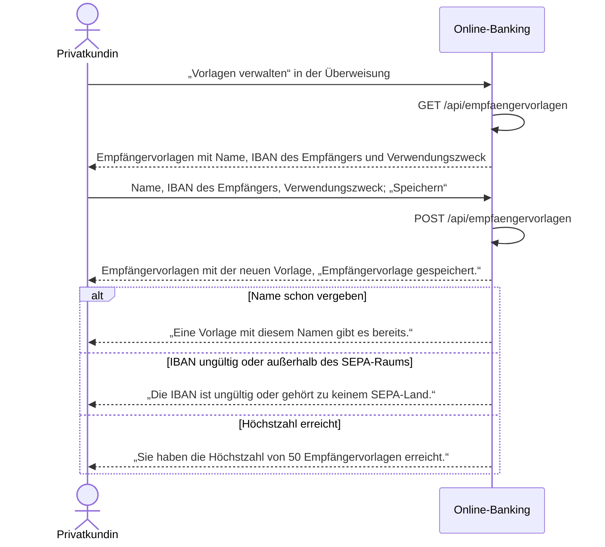

# Use Case: Empfängervorlagen verwalten

## Überblick

**Use Case ID:** UC-004  
**Name:** Empfängervorlagen verwalten  
**Bereich:** Überweisung  
**Primärakteur:** Privatkundin  
**Ziel:** Die Kundin legt Empfänger als Vorlage mit Name, IBAN und optional Verwendungszweck an, benennt sie um und löscht sie, damit sie sie bei der Überweisung auswählen kann, statt sie neu einzutippen.  
**Ziele:** Z-6  
**Anforderungen:** NFR-001

## Vorbedingungen

- Die Kundin ist angemeldet, es gibt eine gültige Sitzung (NFR-001).

## Standardablauf

1. Die Kundin wählt in der Überweisung „Vorlagen verwalten“.
2. Das System zeigt die Empfängervorlagen der Kundin (BR-0016) mit Name, IBAN des Empfängers und Verwendungszweck, nach Name aufsteigend, und die Zahl der belegten Vorlagen („3 von 50“).
3. Die Kundin gibt Name, IBAN des Empfängers und bei Bedarf einen Verwendungszweck ein und wählt „Speichern“.
4. Das System prüft in dieser Reihenfolge: zuerst Pflicht und Format von Name, IBAN und Verwendungszweck (BR-0013, BR-0003, BR-0014, BR-0018; 400), dann die Eindeutigkeit des Namens bei der Kundin (BR-0013; 409) und zuletzt die Höchstzahl (BR-0015; 422); bei einer Abweichung speichert es die Vorlage nicht, lässt die bestehenden unverändert und zeigt die Meldung im Formular.
5. Das System speichert die Vorlage und zeigt die Empfängervorlagen mit der neuen Vorlage und der Meldung „Empfängervorlage gespeichert.“.

## Alternativabläufe

### A1: Name fehlt oder ist schon vergeben

**Auslöser:** Der Name der Vorlage ist leer oder bei dieser Kundin schon vergeben, auch wenn er sich nur in der Groß-/Kleinschreibung oder in führenden oder folgenden Leerzeichen unterscheidet. (Schritt 4).  
**Ablauf:**

1. Das System speichert die Vorlage nicht, lässt die bestehende Vorlage unverändert und zeigt „Der Name der Vorlage fehlt.“, wenn der Name leer ist, sonst „Eine Vorlage mit diesem Namen gibt es bereits.“; die bisherigen Eingaben bleiben stehen.
2. Die Kundin ändert den Namen; der Ablauf geht bei Schritt 3 weiter, oder sie bricht ab.

### A2: IBAN ungültig oder außerhalb des SEPA-Raums

**Auslöser:** Die IBAN der Vorlage hat keine gültige Prüfziffer, weniger als 15 oder mehr als 34 Stellen oder ihr Länderkennzeichen steht nicht in der SEPA-Länderliste (BR-0003). (Schritt 4).  
**Ablauf:**

1. Das System speichert die Vorlage nicht und zeigt „Die IBAN ist ungültig oder gehört zu keinem SEPA-Land.“.
2. Die Kundin korrigiert die IBAN; der Ablauf geht bei Schritt 3 weiter, oder sie bricht ab.

### A3: Höchstzahl erreicht

**Auslöser:** Die Kundin hat bereits 50 Empfängervorlagen und der Name der neuen Vorlage ist bei ihr noch nicht vergeben; die Höchstzahl prüft das System erst nach Pflicht, Format und Eindeutigkeit (BR-0015). (Schritt 4).  
**Ablauf:**

1. Das System legt keine weitere Vorlage an, lässt die bestehenden unverändert und zeigt „Sie haben die Höchstzahl von 50 Empfängervorlagen erreicht.“.
2. Die Kundin löscht eine Vorlage (A5); danach geht der Ablauf bei Schritt 3 weiter, oder sie bricht ab.

### A4: Vorlage umbenennen

**Auslöser:** Die Kundin wählt in der Liste eine Vorlage, trägt unter „Vorlage umbenennen“ einen neuen Namen ein und wählt „Umbenennen“. (Schritt 5).  
**Ablauf:**

1. Das System prüft den neuen Namen nach BR-0013 (Pflicht, 1 bis 70 Zeichen, je Kundin eindeutig auch ohne Beachtung der Groß-/Kleinschreibung und ohne führende und folgende Leerzeichen; die eigene Vorlage zählt dabei nicht mit); ist er bei einer anderen Vorlage der Kundin schon vergeben, bleibt die Vorlage unverändert und das System zeigt „Eine Vorlage mit diesem Namen gibt es bereits.“.
2. Trägt die Vorlage den eingegebenen Namen nach diesem Vergleich schon, entsteht kein Konflikt und der Dienst antwortet mit 200; sonst ändert das System nur den Namen. IBAN des Empfängers und Verwendungszweck bleiben in beiden Fällen unverändert, gespeichert und angezeigt wird die Eingabe der Kundin, und das System zeigt die Vorlagen mit diesem Namen und der Meldung „Empfängervorlage umbenannt.“.

### A5: Vorlage löschen

**Auslöser:** Die Kundin wählt unter „Vorlage löschen“ eine Vorlage und wählt „Löschen“. (Schritt 5).  
**Ablauf:**

1. Das System löscht die Vorlage nicht sofort, sondern fragt mit „Vorlage löschen?“ nach.
2. Bestätigt die Kundin die Abfrage, löscht das System die Vorlage endgültig; eine bereits bestätigte Überweisung bleibt unberührt, und das System zeigt die verbleibenden Vorlagen mit der Meldung „Empfängervorlage gelöscht.“.
3. Bricht die Kundin die Abfrage ab, bleibt die Vorlage unverändert und das System zeigt die Empfängervorlagen ohne Meldung.

### A6: Keine gültige Sitzung

**Auslöser:** Es gibt keine gültige Sitzung. (Schritt 1).  
**Ablauf:**

1. Das System leitet auf die Anmeldeseite um.
2. Die Kundin meldet sich an; danach beginnt der Standardablauf erneut, oder sie bricht ab.

## Sequenzdiagramm

## Nachbedingungen

### Erfolg

- Die Empfängervorlage ist gespeichert, umbenannt oder gelöscht und steht in der Überweisung zur Auswahl.

### Fehlschlag

- Keine Vorlage gespeichert, umbenannt oder gelöscht; die Kundin sieht die Meldung zum Grund und bleibt bei den Empfängervorlagen.

## Geschäftsregeln

### BR-0013: Name der Empfängervorlage

Der Name der Vorlage ist Pflicht, 1 bis 70 Zeichen lang und je Kundin eindeutig, auch nach dem Umbenennen. Für die Eindeutigkeit vergleicht das System den Namen ohne führende und folgende Leerzeichen und ohne Beachtung der Groß-/Kleinschreibung; gespeichert und angezeigt wird die Eingabe der Kundin. Beim Umbenennen schließt die Eindeutigkeitsprüfung die umbenannte Vorlage selbst aus: ein Konflikt besteht nur mit einer anderen Vorlage der Kundin. Trägt die Vorlage den eingegebenen Namen nach diesem Vergleich schon, entsteht kein Konflikt, der Dienst antwortet mit 200 und speichert die Eingabe der Kundin, sodass angezeigt wird, was sie eingegeben hat. Ist der Name leer, speichert das System die Vorlage nicht und zeigt „Der Name der Vorlage fehlt.“; ist er bei einer anderen Vorlage der Kundin schon vergeben, antwortet der Dienst mit 409 und zeigt „Eine Vorlage mit diesem Namen gibt es bereits.“, die bestehende Vorlage bleibt unverändert.

### BR-0014: IBAN der Empfängervorlage

Die IBAN der Vorlage erfüllt BR-0003. Sonst speichert das System die Vorlage nicht und zeigt „Die IBAN ist ungültig oder gehört zu keinem SEPA-Land.“.

### BR-0015: Höchstzahl von 50 Empfängervorlagen

Eine Kundin hat höchstens 50 Empfängervorlagen. Ist die Höchstzahl erreicht, legt das System keine weitere an, lässt die bestehenden unverändert, antwortet mit 422 und zeigt „Sie haben die Höchstzahl von 50 Empfängervorlagen erreicht.“; nach dem Löschen einer Vorlage ist wieder Platz. Beim Anlegen prüft das System in dieser Reihenfolge: Pflicht und Format (400), dann die Eindeutigkeit des Namens je Kundin (409, BR-0013), zuletzt die Höchstzahl (422). Ein vergebener Name ergibt daher auch bei 50 Vorlagen 409 mit „Eine Vorlage mit diesem Namen gibt es bereits.“; die bestehende Vorlage bleibt unverändert und die Höchstzahl wird nicht mehr geprüft.

### BR-0016: Vorlagen der angemeldeten Kundin

Der Dienst liefert, ändert und löscht nur Empfängervorlagen der angemeldeten Kundin. Eine fremde oder unbekannte Vorlagen-Kennung beantwortet er mit 404, ohne gültige Sitzung mit 401.

### BR-0018: Verwendungszweck der Empfängervorlage

Der Verwendungszweck der Vorlage ist optional und höchstens 140 Zeichen lang. Ist er leer oder enthält er nur Leerzeichen, gilt er als nicht angegeben: der Dienst speichert keinen Wert, das Feld verwendungszweck fehlt in der Antwort und in der Liste, und es entsteht kein Fehler. Wird die Vorlage in der Überweisung gewählt, bleibt das Feld Verwendungszweck leer; dort bleibt er Pflicht und die Kundin füllt ihn (BR-0017).

## Weitere Prüfungen

- **WP-1** (Unit-Test): Länge und Eindeutigkeit des Namens je Kundin sowie die Höchstzahl von 50 Vorlagen je Kundin.
- **WP-2** (Unit-Test): Der Dienst liefert, ändert und löscht nur Vorlagen der angemeldeten Kundin; eine fremde oder unbekannte Vorlagen-Kennung beantwortet er mit 404, ohne gültige Sitzung mit 401 (BR-0016).

## Notizen

Umbenennen ändert nur den Namen; IBAN und Verwendungszweck bleiben. Gelöscht wird erst nach der Sicherheitsabfrage „Vorlage löschen?“; eine bereits bestätigte Überweisung bleibt unberührt. Die Vorlagen liegen wie die Konten nur im Speicher und gehören zum Ausgangsstand von POST /api/test/reset (ADR-002); der Ausgangsstand führt für jonas.weber die Vorlagen „Vorlage 1“ bis „Vorlage 50“, damit Höchstzahl und Namenskonflikt prüfbar sind, und für lena.hoffmann keine.
