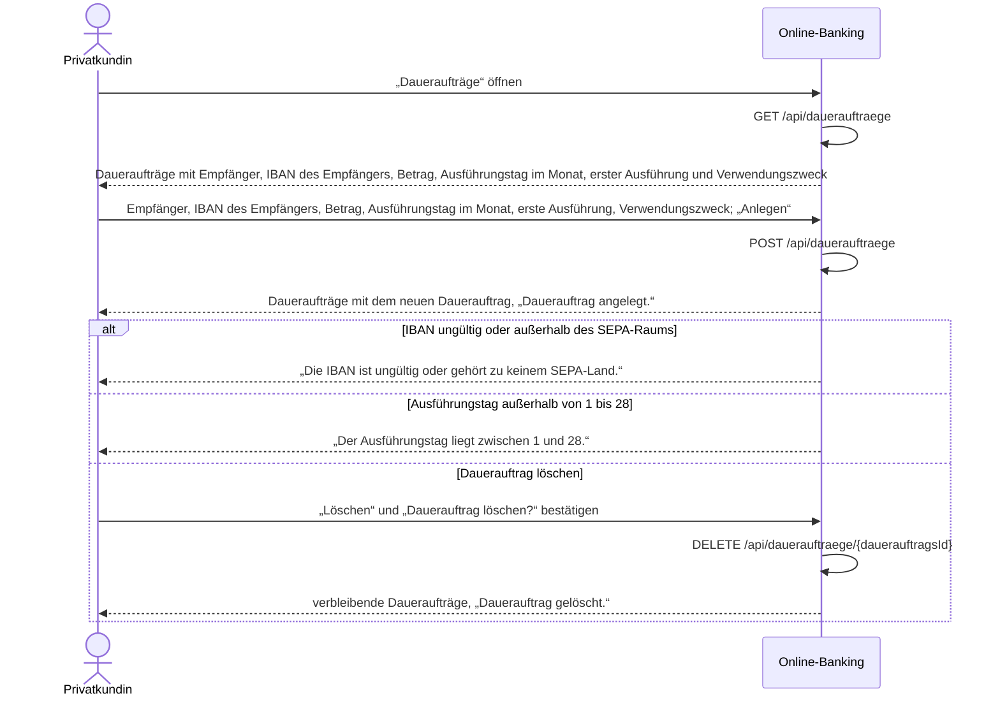

# Use Case: Dauerauftrag einrichten, ansehen und löschen

## Überblick

**Use Case ID:** UC-005  
**Name:** Dauerauftrag einrichten, ansehen und löschen  
**Bereich:** Dauerauftrag  
**Primärakteur:** Privatkundin  
**Ziel:** Die Kundin richtet vom Girokonto einen monatlichen Dauerauftrag an einen Empfänger im SEPA-Raum mit Betrag, Ausführungstag im Monat, erster Ausführung und Verwendungszweck ein, sieht ihre Daueraufträge in einer Liste und löscht einen Dauerauftrag, den sie nicht mehr braucht.  
**Ziele:** Z-8  
**Anforderungen:** NFR-001, C-001

## Vorbedingungen

- Die Kundin ist angemeldet, es gibt eine gültige Sitzung (NFR-001).
- Die Kundin hat ein Girokonto.

## Standardablauf

1. Die Kundin wählt im Finanzstatus in der Zeile des Girokontos den Knopf „Daueraufträge“.
2. Das System zeigt die Daueraufträge der Kundin (BR-0024) mit Empfänger, IBAN des Empfängers, Betrag in Euro, Ausführungstag im Monat, erster Ausführung und Verwendungszweck, geordnet nach erster Ausführung aufsteigend; hat sie noch keinen, zeigt es den Hinweis „Sie haben noch keinen Dauerauftrag.“ (A2).
3. Die Kundin gibt Empfänger, IBAN des Empfängers, Betrag in Euro, Ausführungstag im Monat, erste Ausführung und Verwendungszweck ein und wählt „Anlegen“.
4. Das System prüft in dieser Reihenfolge: IBAN des Empfängers (BR-0020, BR-0003), Betrag (BR-0021), Ausführungstag im Monat (BR-0022) und erste Ausführung (BR-0023); bei einer Abweichung legt es keinen Dauerauftrag an, lässt die bestehenden unverändert und zeigt die Meldung im Formular.
5. Der Dienst prüft, dass das Auftraggeberkonto ein Girokonto der angemeldeten Kundin ist (BR-0007, BR-0024, A8).
6. Das System speichert den Dauerauftrag und zeigt die Daueraufträge mit dem neuen Dauerauftrag und der Meldung „Dauerauftrag angelegt.“.
7. Die Kundin sieht den Dauerauftrag mit Empfänger, IBAN des Empfängers, Betrag, Ausführungstag im Monat, erster Ausführung und Verwendungszweck in der Liste.

## Alternativabläufe

### A1: Keine gültige Sitzung

**Auslöser:** Es gibt keine gültige Sitzung. (Schritt 1).  
**Ablauf:**

1. Das System leitet auf die Anmeldeseite um.
2. Die Kundin meldet sich an; danach beginnt der Standardablauf erneut, oder sie bricht ab.

### A2: Noch kein Dauerauftrag

**Auslöser:** Die Kundin hat noch keinen Dauerauftrag. (Schritt 2).  
**Ablauf:**

1. Das System zeigt an Stelle der Tabelle den Hinweis „Sie haben noch keinen Dauerauftrag.“ und das Formular für einen neuen Dauerauftrag.
2. Die Kundin legt einen Dauerauftrag an; der Ablauf geht bei Schritt 3 weiter, oder sie bricht ab.

### A3: IBAN ungültig oder außerhalb des SEPA-Raums

**Auslöser:** Die IBAN des Empfängers hat keine gültige Prüfziffer, weniger als 15 oder mehr als 34 Stellen oder ihr Länderkennzeichen steht nicht in der SEPA-Länderliste (BR-0003). (Schritt 4).  
**Ablauf:**

1. Das System legt keinen Dauerauftrag an, lässt die bestehenden unverändert und zeigt „Die IBAN ist ungültig oder gehört zu keinem SEPA-Land.“; die bisherigen Eingaben bleiben stehen.
2. Die Kundin korrigiert die IBAN; der Ablauf geht bei Schritt 3 weiter, oder sie bricht ab.

### A4: Betrag nicht größer als 0

**Auslöser:** Der Betrag ist nicht größer als 0 (BR-0021). (Schritt 4).  
**Ablauf:**

1. Das System legt keinen Dauerauftrag an und zeigt „Der Betrag muss größer als 0 sein.“.
2. Die Kundin ändert den Betrag; der Ablauf geht bei Schritt 3 weiter, oder sie bricht ab.

### A5: Ausführungstag außerhalb von 1 bis 28

**Auslöser:** Der Ausführungstag im Monat ist keine ganze Zahl von 1 bis 28 (BR-0022). (Schritt 4).  
**Ablauf:**

1. Das System legt keinen Dauerauftrag an und zeigt „Der Ausführungstag liegt zwischen 1 und 28.“.
2. Die Kundin ändert den Ausführungstag; der Ablauf geht bei Schritt 3 weiter, oder sie bricht ab.

### A6: Erste Ausführung in der Vergangenheit

**Auslöser:** Die erste Ausführung liegt vor dem heutigen Tag (BR-0023). (Schritt 4).  
**Ablauf:**

1. Das System legt keinen Dauerauftrag an und zeigt „Die erste Ausführung darf nicht in der Vergangenheit liegen.“.
2. Die Kundin ändert die erste Ausführung; der Ablauf geht bei Schritt 3 weiter, oder sie bricht ab.

### A7: Dauerauftrag löschen

**Auslöser:** Die Kundin wählt in der Liste oder im Feld „Dauerauftrag zum Löschen“ einen Dauerauftrag und wählt „Löschen“. (Schritt 6).  
**Ablauf:**

1. Das System löscht den Dauerauftrag nicht sofort, sondern fragt mit „Dauerauftrag löschen?“ nach.
2. Bestätigt die Kundin die Abfrage, löscht das System den Dauerauftrag endgültig; bestehende Umsätze des Girokontos bleiben unberührt, und das System zeigt die verbleibenden Daueraufträge mit der Meldung „Dauerauftrag gelöscht.“.
3. Bricht die Kundin die Abfrage ab, bleibt der Dauerauftrag unverändert und das System zeigt die Daueraufträge ohne Meldung.
4. Ist die Dauerauftrags-Kennung fremd oder unbekannt, antwortet der Dienst mit 404 und das System zeigt „Der Dauerauftrag wurde nicht gefunden.“ (BR-0024).

### A8: Anlegen abgelehnt

**Auslöser:** Der Dienst lehnt das Auftraggeberkonto beim Anlegen ab (403), weil es kein Girokonto der angemeldeten Kundin ist. (Schritt 5).  
**Ablauf:**

1. In der Oberfläche tritt der Fall nicht auf, weil das Auftraggeberkonto fest das Girokonto der Kundin ist.
2. Antwortet der Dienst dennoch mit 403, legt das System keinen Dauerauftrag an, lässt die bestehenden unverändert und zeigt die allgemeine Fehlermeldung „Der Dauerauftrag konnte nicht angelegt werden.“; die bisherigen Eingaben bleiben stehen.
3. Antwortet der Dienst mit 401, leitet das System auf die Anmeldeseite um (A1); es wird nichts angelegt.

## Sequenzdiagramm

## Nachbedingungen

### Erfolg

- Der Dauerauftrag ist gespeichert oder gelöscht und steht in der Liste der Daueraufträge.
- Der gespeicherte Dauerauftrag trägt Auftraggeberkonto, Empfänger, IBAN des Empfängers, Betrag in Euro, Ausführungstag im Monat, erste Ausführung und Verwendungszweck wie eingegeben.

### Fehlschlag

- Kein Dauerauftrag angelegt oder gelöscht; die bestehenden Daueraufträge sind unverändert, und die Kundin sieht die Meldung zum Grund.

## Geschäftsregeln

### BR-0020: IBAN des Empfängers im Dauerauftrag

Die IBAN des Empfängers im Dauerauftrag erfüllt BR-0003: 15 bis 34 Stellen, gültige Prüfziffer nach ISO 7064 MOD 97-10 und ein Länderkennzeichen aus der SEPA-Länderliste. Sonst legt das System den Dauerauftrag nicht an und zeigt „Die IBAN ist ungültig oder gehört zu keinem SEPA-Land.“.

### BR-0021: Betrag des Dauerauftrags

Der Betrag ist größer als 0, lautet auf Euro und ist auf Cent gerundet (ADR-005). Beim Anlegen vergleicht das System ihn nicht mit dem verfügbaren Betrag des Girokontos, weil die erste Ausführung erst zu einem späteren Termin erfolgt. Ist er nicht größer als 0, legt das System den Dauerauftrag nicht an und zeigt „Der Betrag muss größer als 0 sein.“.

### BR-0022: Ausführungstag im Monat

Der Ausführungstag im Monat ist eine ganze Zahl von 1 bis 28, damit der Termin in jedem Monat vorkommt. Sonst legt das System den Dauerauftrag nicht an und zeigt „Der Ausführungstag liegt zwischen 1 und 28.“.

### BR-0023: Erste Ausführung des Dauerauftrags

Die erste Ausführung ist ein Datum ab dem heutigen Tag; sie darf vom Ausführungstag im Monat abweichen. Liegt sie vor dem heutigen Tag, legt das System den Dauerauftrag nicht an und zeigt „Die erste Ausführung darf nicht in der Vergangenheit liegen.“.

### BR-0024: Daueraufträge der angemeldeten Kundin

Der Dienst liefert und löscht nur Daueraufträge der angemeldeten Kundin. Eine fremde oder unbekannte Dauerauftrags-Kennung beantwortet er mit 404, ohne gültige Sitzung mit 401. Beim Anlegen beantwortet er ein Auftraggeberkonto, das kein Girokonto der angemeldeten Kundin ist, mit 403; in der Oberfläche tritt dieser Fall nicht auf, weil das Auftraggeberkonto fest das Girokonto der Kundin ist, und die Seite zeigt dann die allgemeine Fehlermeldung „Der Dauerauftrag konnte nicht angelegt werden.“.

## Weitere Prüfungen

- **WP-1** (Unit-Test): IBAN-Prüfziffer nach ISO 7064 MOD 97-10, Betrag größer als 0 und Ausführungstag im Bereich 1 bis 28 beim Anlegen eines Dauerauftrags.
- **WP-2** (Unit-Test): Der Dienst liefert und löscht nur Daueraufträge der angemeldeten Kundin; eine fremde oder unbekannte Dauerauftrags-Kennung beantwortet er mit 404, ohne gültige Sitzung mit 401 (BR-0024).

## Notizen

Ein Dauerauftrag wird angelegt, in der Liste gezeigt und gelöscht; die termingerechte Ausführung mit Buchung, Saldo und Umsatz ist nicht Teil dieser Story (Abgrenzung der Vision). Gelöscht wird erst nach der Sicherheitsabfrage „Dauerauftrag löschen?“; bestehende Umsätze des Girokontos bleiben unberührt. Die Daueraufträge liegen wie die Konten nur im Speicher und gehören zum Ausgangsstand von POST /api/test/reset (ADR-002); im Ausgangsstand hat keine Kundin Daueraufträge.
