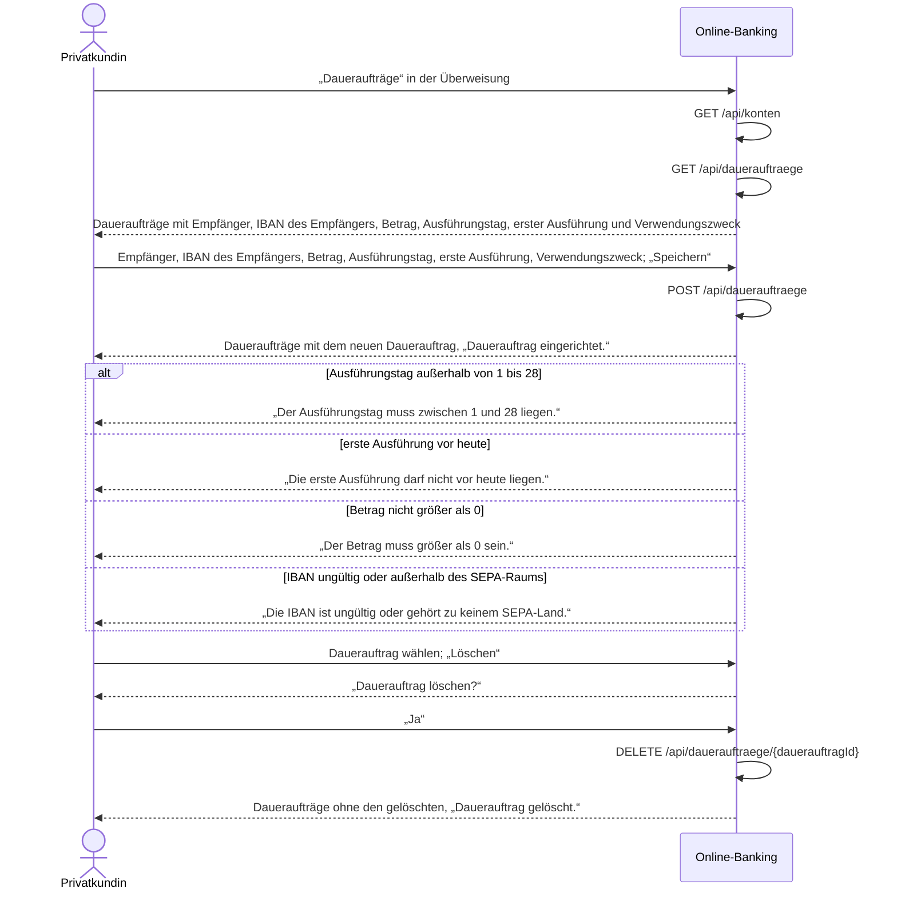

# Use Case: Daueraufträge verwalten

## Überblick

**Use Case ID:** UC-006  
**Name:** Daueraufträge verwalten  
**Bereich:** Überweisung  
**Primärakteur:** Privatkundin  
**Ziel:** Die Kundin richtet vom Girokonto einen monatlichen Dauerauftrag an einen Empfänger im SEPA-Raum ein, sieht ihre Daueraufträge mit Betrag, Ausführungstag, erster Ausführung und Verwendungszweck in einer Liste und löscht einen Dauerauftrag, damit regelmäßige Zahlungen ohne monatliche Überweisung festgelegt sind.  
**Ziele:** Z-8  
**Anforderungen:** NFR-001

## Vorbedingungen

- Die Kundin ist angemeldet, es gibt eine gültige Sitzung (NFR-001).
- Die Kundin hat ein Girokonto; es ist das Auftraggeberkonto des Dauerauftrags.

## Standardablauf

1. Die Kundin wählt in der Überweisung „Daueraufträge“.
2. Das System zeigt das Girokonto der Kundin als Auftraggeberkonto und die Daueraufträge der angemeldeten Kundin (BR-0031) mit Empfänger, IBAN des Empfängers, Betrag in Euro, Ausführungstag im Monat, erster Ausführung und Verwendungszweck, den kleinsten Ausführungstag zuerst, bei gleichem Tag nach Empfänger aufsteigend.
3. Die Kundin gibt Empfänger, IBAN des Empfängers, Betrag in Euro, Ausführungstag im Monat, erste Ausführung und Verwendungszweck ein und wählt „Speichern“.
4. Das System prüft in dieser Reihenfolge: zuerst Pflicht und Format von Empfänger, IBAN des Empfängers (BR-0003), Betrag (BR-0029), Ausführungstag im Monat (BR-0027), erste Ausführung (BR-0028) und Verwendungszweck, dann, dass das Auftraggeberkonto ein Girokonto der Kundin ist (403); bei einer Abweichung speichert es keinen Dauerauftrag, lässt die bestehenden unverändert und zeigt die Meldung im Formular.
5. Das System speichert den Dauerauftrag und zeigt die Daueraufträge mit dem neuen Dauerauftrag und der Meldung „Dauerauftrag eingerichtet.“.
6. Die Kundin sieht den Dauerauftrag in der Liste; Saldo und Umsätze des Girokontos bleiben unverändert, weil der Dienst nichts ausführt.

## Alternativabläufe

### A1: IBAN ungültig oder außerhalb des SEPA-Raums

**Auslöser:** Die IBAN des Empfängers hat keine gültige Prüfziffer, weniger als 15 oder mehr als 34 Stellen oder ihr Länderkennzeichen steht nicht in der SEPA-Länderliste (BR-0003). (Schritt 4).  
**Ablauf:**

1. Das System speichert keinen Dauerauftrag und zeigt „Die IBAN ist ungültig oder gehört zu keinem SEPA-Land.“; die bisherigen Eingaben bleiben stehen.
2. Die Kundin korrigiert die IBAN; der Ablauf geht bei Schritt 3 weiter, oder sie bricht ab.

### A2: Ausführungstag außerhalb von 1 bis 28

**Auslöser:** Der Ausführungstag im Monat ist kleiner als 1 oder größer als 28 (BR-0027). (Schritt 4).  
**Ablauf:**

1. Das System speichert keinen Dauerauftrag und zeigt „Der Ausführungstag muss zwischen 1 und 28 liegen.“; die bisherigen Eingaben bleiben stehen.
2. Die Kundin ändert den Ausführungstag; der Ablauf geht bei Schritt 3 weiter, oder sie bricht ab.

### A3: Erste Ausführung vor heute

**Auslöser:** Die erste Ausführung liegt vor dem Tag, an dem die Kundin den Dauerauftrag einrichtet (BR-0028). (Schritt 4).  
**Ablauf:**

1. Das System speichert keinen Dauerauftrag und zeigt „Die erste Ausführung darf nicht vor heute liegen.“; die bisherigen Eingaben bleiben stehen.
2. Die Kundin wählt ein späteres Datum; der Ablauf geht bei Schritt 3 weiter, oder sie bricht ab.

### A4: Betrag nicht größer als 0

**Auslöser:** Der Betrag ist 0 oder negativ (BR-0029); gegen den verfügbaren Betrag des Girokontos prüft das System ihn nicht. (Schritt 4).  
**Ablauf:**

1. Das System speichert keinen Dauerauftrag und zeigt „Der Betrag muss größer als 0 sein.“; die bisherigen Eingaben bleiben stehen.
2. Die Kundin ändert den Betrag; der Ablauf geht bei Schritt 3 weiter, oder sie bricht ab.

### A5: Pflichtangabe fehlt

**Auslöser:** Empfänger, Betrag, Ausführungstag im Monat, erste Ausführung oder Verwendungszweck ist leer (400). (Schritt 4).  
**Ablauf:**

1. Das System speichert keinen Dauerauftrag und zeigt „Bitte füllen Sie alle Pflichtfelder aus.“; die bisherigen Eingaben bleiben stehen.
2. Die Kundin ergänzt die fehlende Angabe; der Ablauf geht bei Schritt 3 weiter, oder sie bricht ab.

### A6: Dauerauftrag löschen

**Auslöser:** Die Kundin wählt unter „Dauerauftrag löschen“ einen Dauerauftrag und wählt „Löschen“. (Schritt 5).  
**Ablauf:**

1. Das System löscht den Dauerauftrag nicht sofort, sondern fragt mit „Dauerauftrag löschen?“ nach.
2. Bestätigt die Kundin die Abfrage, löscht das System den Dauerauftrag endgültig; eine noch nicht gebuchte Ausführung unterbleibt, auch wenn sie auf den heutigen Tag fällt (BR-0030), Saldo und Umsätze des Girokontos bleiben unverändert, und das System zeigt die verbleibenden Daueraufträge mit der Meldung „Dauerauftrag gelöscht.“.
3. Bricht die Kundin die Abfrage ab, bleibt der Dauerauftrag unverändert und das System zeigt die Daueraufträge ohne Meldung.

### A7: Keine gültige Sitzung

**Auslöser:** Es gibt keine gültige Sitzung. (Schritt 1).  
**Ablauf:**

1. Das System leitet auf die Anmeldeseite um.
2. Die Kundin meldet sich an; danach beginnt der Standardablauf erneut, oder sie bricht ab.

## Sequenzdiagramm

## Nachbedingungen

### Erfolg

- Der Dauerauftrag ist gespeichert oder gelöscht; die Liste zeigt die Daueraufträge der Kundin mit Empfänger, IBAN des Empfängers, Betrag in Euro, Ausführungstag im Monat, erster Ausführung und Verwendungszweck.
- Ein gespeicherter Dauerauftrag ändert weder den Saldo des Girokontos noch dessen Umsätze; der Dienst führt ihn in dieser Ausbaustufe nicht aus und bucht nichts.
- Ein gelöschter Dauerauftrag steht nicht mehr in der Liste und wird nicht mehr ausgeführt (BR-0030).

### Fehlschlag

- Kein Dauerauftrag gespeichert oder gelöscht; die bestehenden Daueraufträge bleiben unverändert.
- Die Kundin sieht die Meldung zum Grund und bleibt bei den Daueraufträgen.

## Geschäftsregeln

### BR-0027: Ausführungstag im Monat

Der Ausführungstag ist eine ganze Zahl von 1 bis 28, damit er in jedem Monat existiert; auf Wochenende und Feiertage nimmt das System keine Rücksicht. Ist er kleiner als 1 oder größer als 28, speichert das System den Dauerauftrag nicht, antwortet mit 400 und zeigt „Der Ausführungstag muss zwischen 1 und 28 liegen.“.

### BR-0028: Erste Ausführung

Die erste Ausführung ist ein Datum ab dem Tag, an dem die Kundin den Dauerauftrag einrichtet; sie ist frei wählbar und darf vom Ausführungstag abweichen, der Dienst bucht in dieser Ausbaustufe nichts. Liegt sie vor dem heutigen Tag, speichert das System den Dauerauftrag nicht, antwortet mit 422 und zeigt „Die erste Ausführung darf nicht vor heute liegen.“.

### BR-0029: Betrag des Dauerauftrags

Der Betrag ist größer als 0 und in Euro auf Cent gerundet (ADR-005). Beim Einrichten prüft das System ihn nicht gegen den verfügbaren Betrag des Girokontos, und es gibt keine Obergrenze außer der des Feldes. Ist er nicht größer als 0, speichert das System den Dauerauftrag nicht, antwortet mit 422 und zeigt „Der Betrag muss größer als 0 sein.“.

### BR-0030: Löschen wirkt sofort

Ein gelöschter Dauerauftrag wird nicht mehr ausgeführt; eine noch nicht gebuchte Ausführung unterbleibt, auch wenn sie auf den Tag des Löschens fällt. Das Löschen ändert weder Saldo noch Umsätze; bereits gebuchte Ausführungen bleiben unberührt. Solange der Dienst nichts ausführt, zeigt sich die Wirkung darin, dass der Dauerauftrag nicht mehr in der Liste steht und eine weitere Löschung mit 404 abgewiesen wird.

### BR-0031: Daueraufträge der angemeldeten Kundin

Der Dienst liefert und löscht nur Daueraufträge der angemeldeten Kundin; das Auftraggeberkonto eines neuen Dauerauftrags ist ein Girokonto der Kundin, sonst antwortet er mit 403. Eine fremde oder unbekannte Dauerauftrags-Kennung beantwortet er mit 404, ohne gültige Sitzung mit 401.

## Weitere Prüfungen

- **WP-1** (Unit-Test): WP-1: Ausführungstag 1 bis 28, erste Ausführung nicht vor heute und Betrag größer als 0 prüft der Dienst unabhängig von der Oberfläche (ADR-004); nach einem Tag ohne Ausführung bleibt die Regel gültig.
- **WP-2** (Unit-Test): WP-2: Der Dienst liefert und löscht nur Daueraufträge der angemeldeten Kundin und weist ein fremdes Auftraggeberkonto mit 403, eine fremde oder unbekannte Kennung mit 404 und einen Aufruf ohne Sitzung mit 401 ab (BR-0031).
- **WP-3** (Unit-Test): WP-3 (greift mit der Story zur Ausführung): Ein gelöschter Dauerauftrag wird bei einer fälligen Ausführung nicht mehr berücksichtigt, auch nicht am Tag des Löschens (BR-0030).

## Notizen

Einrichten, Anzeigen und Löschen; der Dienst führt nichts aus und bucht nichts, deshalb bleiben Saldo und Umsätze unverändert. Die Daueraufträge liegen wie die Konten nur im Speicher und gehören zum Ausgangsstand von POST /api/test/reset (ADR-002); der Ausgangsstand führt für keine Kundin einen Dauerauftrag, damit die Liste zu Beginn leer ist. Die Prüfungen liegen doppelt in Oberfläche und Dienst (ADR-004), maßgeblich ist der Dienst.
