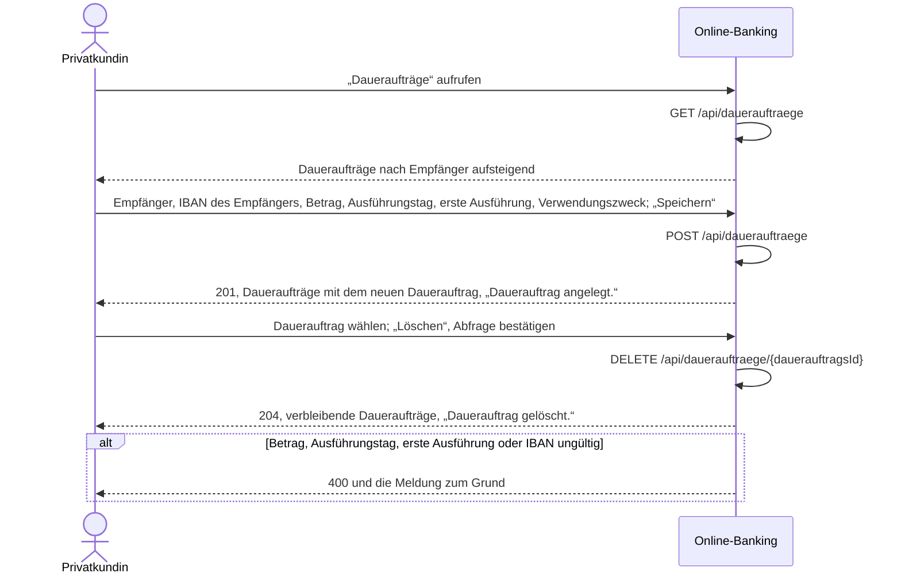

# Use Case: Daueraufträge verwalten

## Überblick

**Use Case ID:** UC-007  
**Name:** Daueraufträge verwalten  
**Bereich:** Dauerauftrag  
**Primärakteur:** Privatkundin  
**Ziel:** Die Kundin richtet vom Girokonto einen monatlichen Dauerauftrag an einen Empfänger im SEPA-Raum mit Betrag, Ausführungstag im Monat, erster Ausführung und optional Verwendungszweck ein, sieht ihre Daueraufträge in einer Liste und löscht einen Dauerauftrag, damit regelmäßige Zahlungen ohne neue Erfassung feststehen.  
**Ziele:** Z-8  
**Anforderungen:** NFR-001

## Vorbedingungen

- Die Kundin ist angemeldet, es gibt eine gültige Sitzung (NFR-001).

## Standardablauf

1. Die Kundin wählt „Daueraufträge“.
2. Das System zeigt die Daueraufträge der Kundin mit Empfänger, IBAN des Empfängers, Betrag in Euro, Ausführungstag im Monat, erster Ausführung und Verwendungszweck, nach Empfänger aufsteigend (BR-0037), und das Formular für einen neuen Dauerauftrag.
3. Die Kundin gibt Empfänger, IBAN des Empfängers, Betrag in Euro, Ausführungstag im Monat, erste Ausführung und bei Bedarf einen Verwendungszweck ein und wählt „Speichern“.
4. Das System prüft die Eingaben nach BR-0032 bis BR-0036 und BR-0039 und zeigt bei einer Abweichung die Meldung im Formular; den Betrag prüft es nicht gegen den verfügbaren Betrag des Girokontos.
5. Das System legt den Dauerauftrag an, der Dienst antwortet mit 201, und das System zeigt die Daueraufträge mit dem neuen Dauerauftrag und der Meldung „Dauerauftrag angelegt.“.
6. Die Kundin wählt unter „Dauerauftrag löschen“ einen Dauerauftrag und wählt „Löschen“ (A6).
7. Die Kundin liest Betrag, Ausführungstag und erste Ausführung ihrer Daueraufträge ab.

## Alternativabläufe

### A1: Nicht angemeldet

**Auslöser:** Es gibt keine gültige Sitzung. (Schritt 1).  
**Ablauf:**

1. Das System leitet auf die Anmeldeseite um.
2. Die Kundin meldet sich an; danach beginnt der Standardablauf erneut, oder sie bricht ab.

### A2: Betrag ungültig

**Auslöser:** Der Betrag fehlt oder ist nicht größer als 0 Euro (BR-0033). (Schritt 4).  
**Ablauf:**

1. Das System legt keinen Dauerauftrag an, lässt die bestehenden unverändert und zeigt „Der Betrag muss größer als 0 Euro sein.“; die bisherigen Eingaben bleiben stehen.
2. Die Kundin korrigiert den Betrag; der Ablauf geht bei Schritt 4 weiter, oder sie bricht ab.

### A3: Ausführungstag ungültig

**Auslöser:** Der Ausführungstag im Monat fehlt oder liegt außerhalb von 1 bis 28 (BR-0034). (Schritt 4).  
**Ablauf:**

1. Das System legt keinen Dauerauftrag an und zeigt „Der Ausführungstag im Monat liegt zwischen 1 und 28.“.
2. Die Kundin korrigiert den Ausführungstag; der Ablauf geht bei Schritt 4 weiter, oder sie bricht ab.

### A4: Erste Ausführung in der Vergangenheit

**Auslöser:** Die erste Ausführung liegt vor dem heutigen Tag (BR-0035). (Schritt 4).  
**Ablauf:**

1. Das System legt keinen Dauerauftrag an und zeigt „Die erste Ausführung darf nicht vor heute liegen.“.
2. Die Kundin wählt ein späteres Datum; der Ablauf geht bei Schritt 4 weiter, oder sie bricht ab.

### A5: IBAN ungültig oder außerhalb des SEPA-Raums

**Auslöser:** Die IBAN des Empfängers erfüllt BR-0003 nicht (BR-0036). (Schritt 4).  
**Ablauf:**

1. Das System legt keinen Dauerauftrag an und zeigt „Die IBAN ist ungültig oder gehört zu keinem SEPA-Land.“.
2. Die Kundin korrigiert die IBAN; der Ablauf geht bei Schritt 4 weiter, oder sie bricht ab.

### A6: Dauerauftrag löschen

**Auslöser:** Die Kundin wählt unter „Dauerauftrag löschen“ einen Dauerauftrag und wählt „Löschen“. (Schritt 6).  
**Ablauf:**

1. Das System löscht den Dauerauftrag nicht sofort, sondern fragt mit „Dauerauftrag löschen?“ nach.
2. Bestätigt die Kundin die Abfrage, löscht das System den Dauerauftrag endgültig, der Dienst antwortet mit 204 und das System zeigt die verbleibenden Daueraufträge mit der Meldung „Dauerauftrag gelöscht.“.
3. Bricht die Kundin die Abfrage ab, bleibt der Dauerauftrag unverändert und das System zeigt die Daueraufträge ohne Meldung.

### A7: Noch kein Dauerauftrag

**Auslöser:** Die Kundin hat keinen Dauerauftrag. (Schritt 2).  
**Ablauf:**

1. Das System zeigt den Hinweis „Sie haben noch keinen Dauerauftrag.“ und keine Zeile.
2. Das Formular für einen neuen Dauerauftrag zeigt es trotzdem.

## Sequenzdiagramm

## Nachbedingungen

### Erfolg

- Der Dauerauftrag ist angelegt oder gelöscht; die Dauerauftragsliste zeigt die Daueraufträge der Kundin mit Empfänger, IBAN des Empfängers, Betrag in Euro, Ausführungstag im Monat und erster Ausführung.

### Fehlschlag

- Kein Dauerauftrag angelegt oder gelöscht; die Kundin sieht die Meldung zum Grund und bleibt bei den Daueraufträgen.

## Geschäftsregeln

### BR-0032: Auftraggeberkonto des Dauerauftrags

Der Dauerauftrag geht immer vom Girokonto der angemeldeten Kundin; ein anderes Konto nimmt der Dienst nicht an. Das Girokonto zeigt das System im Formular als Auftraggeberkonto an; die Kundin wählt es nicht aus.

### BR-0033: Betrag des Dauerauftrags

Der Betrag ist Pflicht, größer als 0 Euro und wird wie jeder Geldbetrag als Zahl in Euro auf Cent gerundet gespeichert und angezeigt (ADR-005). Beim Einrichten prüft der Dienst den Betrag nicht gegen den verfügbaren Betrag des Girokontos und nicht gegen eine Höchstzahl an Daueraufträgen. Fehlt der Betrag oder ist er nicht größer als 0 Euro, antwortet der Dienst mit 400, legt keinen Dauerauftrag an und das System zeigt „Der Betrag muss größer als 0 Euro sein.“.

### BR-0034: Ausführungstag im Monat

Der Ausführungstag im Monat ist Pflicht, eine ganze Zahl und liegt zwischen 1 und 28, damit jeder Monat diesen Tag hat. Fällt der Tag auf ein Wochenende oder einen Feiertag, verschiebt das System den Termin nicht. Liegt der Ausführungstag außerhalb von 1 bis 28, antwortet der Dienst mit 400, legt keinen Dauerauftrag an und das System zeigt „Der Ausführungstag im Monat liegt zwischen 1 und 28.“.

### BR-0035: Erste Ausführung des Dauerauftrags

Die erste Ausführung ist Pflicht und ist ein Datum, das nicht vor dem heutigen Tag liegt; der heutige Tag ist zulässig. Liegt sie davor, antwortet der Dienst mit 400, legt keinen Dauerauftrag an und das System zeigt „Die erste Ausführung darf nicht vor heute liegen.“.

### BR-0036: IBAN des Empfängers beim Dauerauftrag

Die IBAN des Empfängers erfüllt BR-0003: 15 bis 34 Stellen, gültige Prüfziffer nach ISO 7064 MOD 97-10 und ein Länderkennzeichen aus der im Dienst hinterlegten SEPA-Länderliste. Sonst antwortet der Dienst mit 400, legt keinen Dauerauftrag an und das System zeigt dieselbe Meldung wie BR-0003: „Die IBAN ist ungültig oder gehört zu keinem SEPA-Land.“.

### BR-0037: Daueraufträge der angemeldeten Kundin

Der Dienst liefert und löscht nur Daueraufträge der angemeldeten Kundin. Die Liste zeigt die Daueraufträge der Kundin nach Empfänger aufsteigend. Eine fremde oder unbekannte Dauerauftrags-Kennung beantwortet der Dienst mit 404, ohne gültige Sitzung mit 401.

### BR-0038: Dauerauftrag löschen

Das System löscht einen Dauerauftrag erst nach der Sicherheitsabfrage „Dauerauftrag löschen?“ und dann endgültig; der Dienst antwortet mit 204 und das System zeigt die verbleibenden Daueraufträge mit der Meldung „Dauerauftrag gelöscht.“. Nach dem Löschen erfasst der Dienst für diesen Dauerauftrag keinen Termin mehr; da der Dienst in dieser Story nichts ausführt, entstehen dabei keine Umsätze und keine Saldoänderungen. Ohne gültige Sitzung antwortet der Dienst mit 401, bei fremder oder unbekannter Kennung mit 404, und der Dauerauftrag bleibt bestehen.

### BR-0039: Verwendungszweck des Dauerauftrags

Der Verwendungszweck ist optional und höchstens 140 Zeichen lang. Ist er leer oder enthält er nur Leerzeichen, gilt er als nicht angegeben: der Dienst speichert keinen Wert, das Feld verwendungszweck fehlt in der Antwort und in der Liste, und es entsteht kein Fehler.

## Weitere Prüfungen

- **WP-1** (Unit-Test): WP-1: Bei der Anlage prüft der Dienst, dass der Betrag größer als 0 Euro ist, der Ausführungstag zwischen 1 und 28 liegt, die erste Ausführung nicht vor heute liegt und die IBAN BR-0003 erfüllt; jede Abweichung antwortet mit 400 und legt nichts an.
- **WP-2** (Unit-Test): WP-2: Der Dienst liefert und löscht nur Daueraufträge der angemeldeten Kundin; eine fremde oder unbekannte Dauerauftrags-Kennung beantwortet er mit 404, ohne gültige Sitzung mit 401 (BR-0037).
- **WP-3** (Unit-Test): WP-3: Der Dienst führt keinen Dauerauftrag aus: Aufrufe von Dauerauftragsliste, Finanzstatus und Umsätzen erzeugen keine Buchung, keinen Umsatz und keine Saldoänderung.

## Notizen

Ein Dauerauftrag ist monatlich wiederkehrend, wird aber in dieser Story nicht ausgeführt: der Dienst bucht nichts, erzeugt keinen Umsatz und ändert keinen Saldo. Wer einen Dauerauftrag ändern will, löscht ihn und legt ihn neu an. Die Daueraufträge liegen wie die Konten und Empfängervorlagen nur im Speicher und gehören zum Ausgangsstand von POST /api/test/reset (ADR-002).
