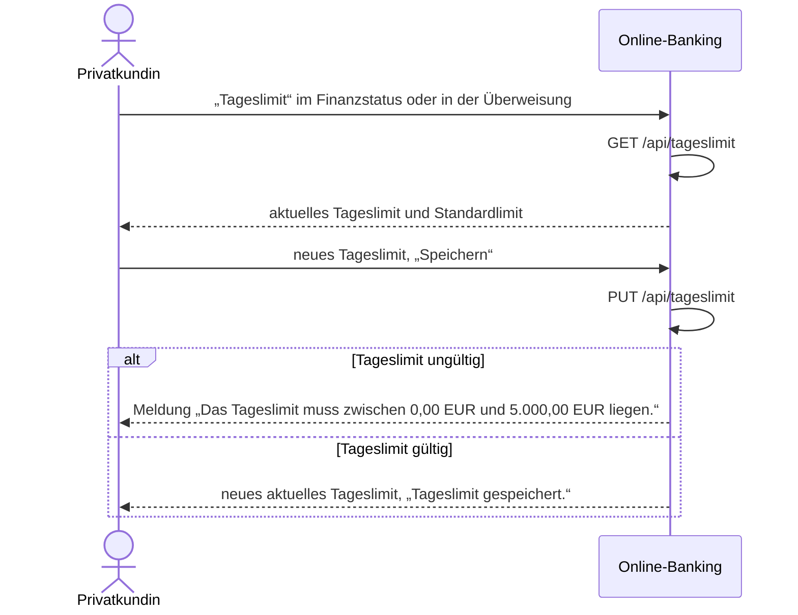

# Use Case: Tageslimit für Überweisungen festlegen

## Überblick

**Use Case ID:** UC-015  
**Name:** Tageslimit für Überweisungen festlegen  
**Bereich:** Überweisung  
**Primärakteur:** Privatkundin  
**Ziel:** Die Kundin senkt ihr Tageslimit für Überweisungen und hebt es später wieder bis zum Standardlimit an, damit sie ihre Überweisungen je Kalendertag selbst begrenzt.  
**Ziele:** Z-5  
**Anforderungen:** NFR-001

## Vorbedingungen

- Die Kundin ist angemeldet, es gibt eine gültige Sitzung (NFR-001).

## Standardablauf

1. Die Kundin wählt im Finanzstatus oder in der Überweisung „Tageslimit“.
2. Das System zeigt das aktuelle Tageslimit und das Standardlimit der Kundin (BR-0070).
3. Die Kundin gibt im Feld „Neues Tageslimit in Euro“ ein neues Tageslimit ein, niedriger oder höher als das aktuelle, und wählt „Speichern“.
4. Das System prüft das Feld „Neues Tageslimit in Euro“ nach dem Datenmodell (Kunde.tageslimit) und zeigt bei einer Abweichung die Meldung im Formular.
5. Das System speichert das Tageslimit der Kundin, das ab der nächsten Überweisung gilt (BR-0070), und zeigt das neue aktuelle Tageslimit mit der Meldung „Tageslimit gespeichert.“.

## Alternativabläufe

### A1: Neues Tageslimit ungültig

**Auslöser:** Das Feld „Neues Tageslimit in Euro“ ist leer, keine Zahl, kleiner als 0,00 EUR, größer als das Standardlimit oder hat mehr als zwei Nachkommastellen (Kunde.tageslimit). (Schritt 4).  
**Ablauf:**

1. Der Dienst antwortet mit Status 400; das System speichert nichts, lässt das aktuelle Tageslimit unverändert und zeigt „Das Tageslimit muss zwischen 0,00 EUR und 5.000,00 EUR liegen.“ im Formular.
2. Die Kundin korrigiert das Tageslimit; der Ablauf geht bei Schritt 3 weiter, oder sie wechselt zu einer anderen Seite.

### A2: Keine gültige Sitzung

**Auslöser:** Es gibt keine gültige Sitzung. (Schritt 1).  
**Ablauf:**

1. Das System leitet auf die Anmeldeseite um; der Dienst beantwortet GET und PUT /api/tageslimit mit Status 401.
2. Die Kundin meldet sich an; danach beginnt der Standardablauf erneut, oder sie bricht ab.

## Sequenzdiagramm

## Nachbedingungen

### Erfolg

- Das Tageslimit der Kundin ist gespeichert und gilt für ihre folgenden Überweisungen.
- Das System zeigt das neue aktuelle Tageslimit und die Meldung „Tageslimit gespeichert.“.

### Fehlschlag

- Das Tageslimit ist unverändert; die Kundin sieht die Meldung zum Grund und bleibt beim Tageslimit.

## Geschäftsregeln

### BR-0070: Tageslimit der Kundin

Jede Kundin hat ein Tageslimit für Überweisungen je Kalendertag. Es beträgt anfangs das Standardlimit von 5.000,00 EUR, das für alle Kundinnen gleich ist, und gilt für die Kundin insgesamt, nicht je Konto oder Empfänger. Das Limit 0,00 EUR sperrt alle Überweisungen der Kundin. Das gesetzte Limit ersetzt die feste Grenze von 5.000,00 EUR der Tageslimit-Prüfung bei der Überweisung (PK-12), gilt ab der nächsten Überweisung und wird gegen den Tagesumsatz des laufenden Kalendertags gemessen, auch gegen Überweisungen, die vor der Änderung ausgeführt wurden. Es bleibt gespeichert, bis die Kundin es ändert; im Testbetrieb setzt der Reset es auf das Standardlimit zurück. Der Dienst liest und ändert nur das Tageslimit der angemeldeten Kundin aus der Sitzung, eine Kennung im Aufruf gibt es nicht. Bei der Überweisung (UC-002) prüft der Dienst beim Bestätigen: Der Betrag zusammen mit den am laufenden Kalendertag ausgeführten Überweisungen der Kundin übersteigt das Tageslimit nicht; der Kalendertag ist der UTC-Tag des Ausführungszeitpunkts (erfasstAm), der Vergleich läuft über Cent (ADR-005), und eine Summe genau in Höhe des Limits ist zulässig. Sonst führt das System den Auftrag nicht aus, bucht keinen Umsatz, lässt den Saldo unverändert und zeigt „Mit dieser Überweisung würde Ihr Tageslimit überschritten.“; der Dienst antwortet mit Status 422. Das Limit 0,00 EUR gilt als gesetztes Limit: Jede Überweisung wird abgelehnt. Abgelehnte Aufträge zählen nicht zu den Ausgängen des Tages; eine wiederholte Bestätigung eines bereits ausgeführten Auftrags (BR-0005) wird nicht erneut geprüft.

## Notizen

Die Tageslimit-Prüfung bei der Überweisung stammt aus PK-12; dieser Use Case setzt nur das Limit, gegen das sie prüft. Das Tageslimit liegt wie die Konten nur im Speicher und gehört zum Ausgangsstand von POST /api/test/reset (ADR-002). Nicht Teil dieses Use Cases: Limit über dem Standardlimit, Freigabe per TAN oder zweitem Faktor, Benachrichtigung, Historie der Änderungen, befristetes Limit mit automatischem Zurücksetzen, Verwaltung des Standardlimits durch die Bank, Limit je Konto oder Empfänger.
