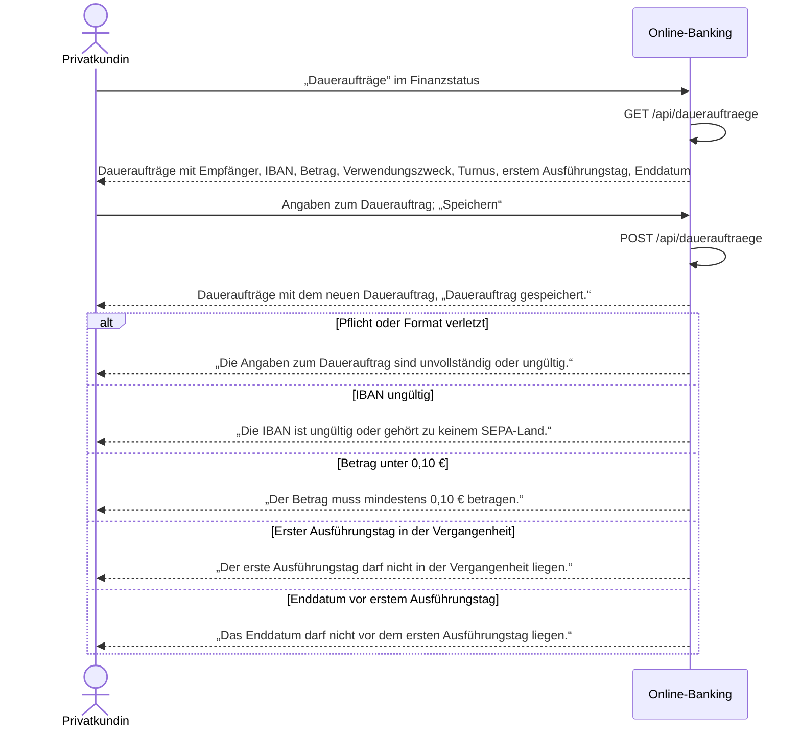

# Use Case: Daueraufträge vom Girokonto verwalten

## Überblick

**Use Case ID:** UC-016  
**Name:** Daueraufträge vom Girokonto verwalten  
**Bereich:** Dauerauftrag  
**Primärakteur:** Privatkundin  
**Ziel:** Die Kundin legt wiederkehrende Zahlungen von ihrem Girokonto als Dauerauftrag mit Empfänger, IBAN, Betrag, Verwendungszweck, Turnus (monatlich, vierteljährlich, jährlich), erstem Ausführungstag und optionalem Enddatum an, sieht sie in einer Liste, ändert und löscht sie, damit sie wiederkehrende Zahlungen einmal einrichtet und selbst pflegt.  
**Ziele:** Z-8  
**Anforderungen:** NFR-001

## Vorbedingungen

- Die Kundin ist angemeldet, es gibt eine gültige Sitzung (NFR-001).
- Die Kundin hat im Finanzstatus „Daueraufträge“ gewählt.

## Standardablauf

1. Die Kundin wählt im Finanzstatus „Daueraufträge“.
2. Das System zeigt die Daueraufträge der Kundin vom Girokonto (BR-0078) mit Empfänger, IBAN, Betrag, Verwendungszweck, Turnus, erstem Ausführungstag und Enddatum, nach erstem Ausführungstag aufsteigend, bei gleichem Tag nach Empfänger aufsteigend.
3. Die Kundin gibt Empfänger, IBAN des Empfängers, Betrag in Euro, Verwendungszweck, Turnus, ersten Ausführungstag und bei Bedarf ein Enddatum ein und wählt „Speichern“.
4. System prüft in dieser Reihenfolge: zuerst die Feldregeln nach dem Datenmodell von Dauerauftrag und die IBAN (BR-0003; 400), dann den ersten Ausführungstag und das Enddatum (BR-0077; 422); bei einer Abweichung speichert es den Dauerauftrag nicht, lässt die bestehenden unverändert und zeigt die Meldung im Formular. Die Oberfläche wählt die Meldung nach der Ursache der Abweichung (A1 bis A5), nicht allein nach dem Status: ein 400 zeigt je nach Ursache die Meldung aus A1, A2 oder A3, ein 422 die Meldung aus A4 oder A5; die Zuordnung nach ADR-004 (400 zur IBAN, 422 zum Betrag) gilt für Daueraufträge nicht.
5. Das System speichert den Dauerauftrag mit dem Girokonto der Kundin als Auftraggeberkonto (BR-0007) und zeigt die Daueraufträge mit dem neuen Dauerauftrag und der Meldung „Dauerauftrag gespeichert.“.

## Alternativabläufe

### A1: Feldregel verletzt

**Auslöser:** Eine Eingabe verletzt eine Feldregel von Dauerauftrag im Datenmodell; ausgenommen IBAN und Betrag (A2, A3). (Schritt 4).  
**Ablauf:**

1. Das System speichert den Dauerauftrag nicht, lässt die bestehenden unverändert und zeigt „Die Angaben zum Dauerauftrag sind unvollständig oder ungültig.“; die bisherigen Eingaben bleiben stehen.
2. Die Kundin korrigiert die Eingabe; der Ablauf geht bei Schritt 3 weiter, oder sie bricht ab.

### A2: IBAN ungültig oder außerhalb des SEPA-Raums

**Auslöser:** Die IBAN des Empfängers (Feld IBAN des Empfängers oder Neue IBAN des Empfängers) hat weniger als 15 oder mehr als 34 Stellen, keine gültige Prüfziffer oder ihr Länderkennzeichen steht nicht in der SEPA-Länderliste (BR-0003). (Schritt 4).  
**Ablauf:**

1. Das System speichert den Dauerauftrag nicht und zeigt „Die IBAN ist ungültig oder gehört zu keinem SEPA-Land.“.
2. Die Kundin korrigiert die IBAN; der Ablauf geht bei Schritt 3 weiter, oder sie bricht ab.

### A3: Betrag verletzt die Feldregel

**Auslöser:** Der Betrag (Feld Betrag in Euro oder Neuer Betrag in Euro) verletzt die Feldregel von Dauerauftrag.betrag im Datenmodell, auch wenn er fehlt oder keine Zahl ist. (Schritt 4).  
**Ablauf:**

1. Das System speichert den Dauerauftrag nicht und zeigt „Der Betrag muss mindestens 0,10 € betragen.“ im Formular; gegen den verfügbaren Betrag des Girokontos prüft es nicht.
2. Die Kundin ändert den Betrag; der Ablauf geht bei Schritt 3 weiter, oder sie bricht ab.

### A4: Erster Ausführungstag liegt in der Vergangenheit

**Auslöser:** Der erste Ausführungstag liegt vor heute (BR-0077). (Schritt 4).  
**Ablauf:**

1. Das System speichert den Dauerauftrag nicht, lässt die bestehenden unverändert und zeigt „Der erste Ausführungstag darf nicht in der Vergangenheit liegen.“; der Dienst antwortet mit 422.
2. Die Kundin ändert den ersten Ausführungstag; der Ablauf geht bei Schritt 3 weiter, oder sie bricht ab.

### A5: Enddatum liegt vor dem ersten Ausführungstag

**Auslöser:** Die Kundin hat ein Enddatum angegeben, das vor dem ersten Ausführungstag liegt; der erste Ausführungstag ist in Ordnung (BR-0077). (Schritt 4).  
**Ablauf:**

1. Das System speichert den Dauerauftrag nicht, lässt die bestehenden unverändert und zeigt „Das Enddatum darf nicht vor dem ersten Ausführungstag liegen.“; der Dienst antwortet mit 422.
2. Die Kundin ändert das Enddatum oder lässt es leer; der Ablauf geht bei Schritt 3 weiter, oder sie bricht ab.

### A6: Dauerauftrag ändern

**Auslöser:** Die Kundin wählt unter „Dauerauftrag ändern“ einen Dauerauftrag aus der Auswahl, die je Dauerauftrag Empfänger, Betrag, Turnus und ersten Ausführungstag nennt, ändert Angaben (Empfänger, IBAN, Betrag, Verwendungszweck, Turnus, erster Ausführungstag, Enddatum) und wählt „Änderung speichern“. (Schritt 5).  
**Ablauf:**

1. Mit der Wahl des Dauerauftrags übernimmt das System dessen gespeicherte Angaben in die Felder der Änderung; die Auswahl führt die Kennung des gewählten Dauerauftrags mit.
2. Das System prüft wie in Schritt 4: Pflicht und Format und die IBAN (400), dann BR-0077 (422); den ersten Ausführungstag prüft es nur dann gegen heute, wenn er vom gespeicherten Wert abweicht, das Enddatum immer gegen den dann geltenden ersten Ausführungstag. Bei einer Abweichung bleibt der Dauerauftrag unverändert und das System zeigt die Meldung aus A1 bis A5. Eine fremde oder unbekannte Kennung beantwortet der Dienst mit 404 (BR-0078).
3. Sonst ersetzt das System die Angaben des Dauerauftrags durch die Eingabe der Kundin und zeigt die Daueraufträge mit der Meldung „Dauerauftrag geändert.“.

### A7: Dauerauftrag löschen

**Auslöser:** Die Kundin wählt unter „Dauerauftrag löschen“ einen Dauerauftrag aus der Auswahl, die je Dauerauftrag Empfänger, Betrag, Turnus und ersten Ausführungstag nennt, und wählt „Löschen“. (Schritt 5).  
**Ablauf:**

1. Das System löscht den Dauerauftrag nicht sofort, sondern fragt mit „Dauerauftrag löschen?“ nach.
2. Bestätigt die Kundin mit „Ja“, löscht das System den Dauerauftrag mit der mitgeführten Kennung endgültig und zeigt die verbleibenden Daueraufträge mit der Meldung „Dauerauftrag gelöscht.“. Eine fremde oder unbekannte Kennung beantwortet der Dienst mit 404 (BR-0078).

### A8: Keine gültige Sitzung

**Auslöser:** Es gibt keine gültige Sitzung, beim Einstieg oder während Speichern, Ändern oder Löschen. (Schritt 1).  
**Ablauf:**

1. Das System leitet auf die Anmeldeseite um; ein API-Aufruf ohne Sitzung wird mit 401 beantwortet (BR-0078). Nicht gespeicherte Eingaben und ein nicht ausgeführtes Speichern, Ändern oder Löschen gehen verloren.
2. Die Kundin meldet sich an; danach beginnt der Standardablauf erneut, oder sie bricht ab.

### A9: Sicherheitsabfrage abgebrochen

**Auslöser:** Die Kundin wählt in der Sicherheitsabfrage zum Löschen „Nein“. (Schritt 5).  
**Ablauf:**

1. Das System löscht den Dauerauftrag nicht, lässt ihn unverändert und zeigt die Daueraufträge ohne Meldung.

### A10: Dauerauftrag nicht mehr vorhanden

**Auslöser:** Beim Ändern (A6) oder Löschen (A7) beantwortet der Dienst die Kennung mit 404, zum Beispiel weil der Dauerauftrag in einem anderen Fenster schon gelöscht wurde. (Schritt 5).  
**Ablauf:**

1. Das System ändert oder löscht nichts und zeigt „Der Dauerauftrag ist nicht mehr vorhanden.“ zusammen mit der aktuellen Liste der Daueraufträge.
2. Die Kundin wählt einen vorhandenen Dauerauftrag oder bricht ab.

## Sequenzdiagramm

## Nachbedingungen

### Erfolg

- Der Dauerauftrag ist zum Girokonto der Kundin gespeichert, geändert oder gelöscht und steht in der Liste der Daueraufträge, soweit er nicht gelöscht ist.

### Fehlschlag

- Kein Dauerauftrag gespeichert, geändert oder gelöscht; die Kundin sieht die Meldung zum Grund und bleibt bei den Daueraufträgen.

## Geschäftsregeln

### BR-0077: Erster Ausführungstag und Enddatum eines Dauerauftrags

Der erste Ausführungstag liegt nicht vor heute; heute ist der aktuelle Kalendertag in UTC. Das Enddatum, wenn angegeben, liegt nicht vor dem ersten Ausführungstag; es darf ihm gleich sein. Der Dienst prüft zuerst den ersten Ausführungstag, dann das Enddatum und antwortet bei einer Abweichung mit 422: „Der erste Ausführungstag darf nicht in der Vergangenheit liegen.“ beziehungsweise „Das Enddatum darf nicht vor dem ersten Ausführungstag liegen.“; der Dauerauftrag wird nicht gespeichert und die bestehenden bleiben unverändert. Beim Ändern gilt die Prüfung des ersten Ausführungstags gegen heute nur, wenn die Kundin ihn gegenüber dem gespeicherten Wert ändert; bleibt er unverändert, kann sie Betrag, Verwendungszweck, Turnus, Empfänger oder Enddatum trotz vergangenem ersten Ausführungstag ändern. Das Enddatum wird beim Ändern immer gegen den dann geltenden ersten Ausführungstag geprüft.

### BR-0078: Daueraufträge der angemeldeten Kundin

Der Dienst liefert, ändert und löscht nur Daueraufträge der angemeldeten Kundin. Eine fremde oder unbekannte Dauerauftrags-Kennung beantwortet er mit 404, ohne gültige Sitzung mit 401. Prüfart für 404 und 401 der Operationen ist die Unit-Prüfung WP-1; die Maske ohne Sitzung prüft ein Szenario.

## Weitere Prüfungen

- **WP-1** (Unit-Test): Der Dienst liefert, ändert und löscht nur Daueraufträge der angemeldeten Kundin; eine fremde oder unbekannte Kennung beantwortet er mit 404, ohne gültige Sitzung mit 401 (BR-0078).
- **WP-2** (Unit-Test): Prüfreihenfolge beim Anlegen und Ändern: Pflicht und Format (400) vor erstem Ausführungstag und Enddatum (422); beim Ändern wird der erste Ausführungstag nur bei Abweichung vom gespeicherten Wert gegen heute geprüft (BR-0077).

## Notizen

Der Use Case verwaltet nur die Daueraufträge; sie werden nicht ausgeführt, Saldo und Umsätze des Girokontos bleiben unverändert, und es gibt keine Deckungsprüfung. Aufbau und Meldungen folgen UC-004. Zwei Daueraufträge mit allen gleichen Angaben sind gleichwertig; die Auswahl zum Ändern und Löschen führt die Kennung des gewählten Eintrags mit. Die Daueraufträge liegen wie die Konten nur im Speicher und gehören zum Ausgangsstand von POST /api/test/reset (ADR-002): lena.hoffmann hat keinen, jonas.weber einen Dauerauftrag „Hausverwaltung Weber“ an DE89 3704 0044 0532 0130 00 über 650,00 € mit Verwendungszweck „Miete“, monatlich, mit erstem Ausführungstag 30 Tage vor dem Zurücksetzen und ohne Enddatum, damit die Änderung bei vergangenem ersten Ausführungstag prüfbar ist. Herkunft: Story PK-52.
