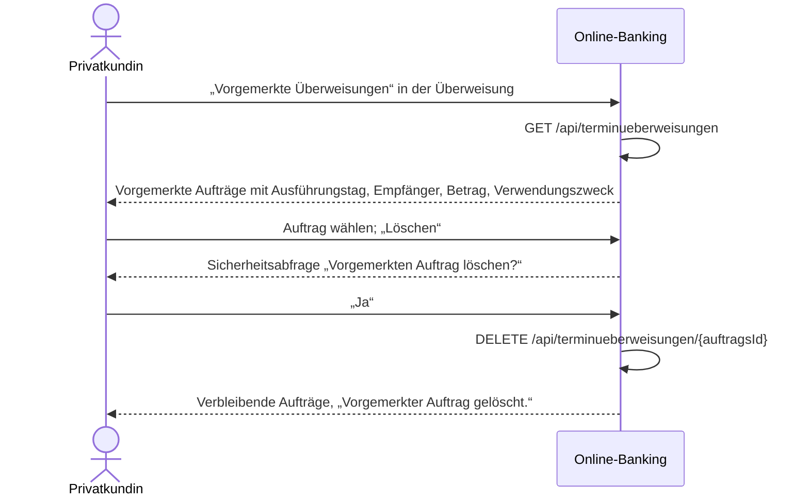
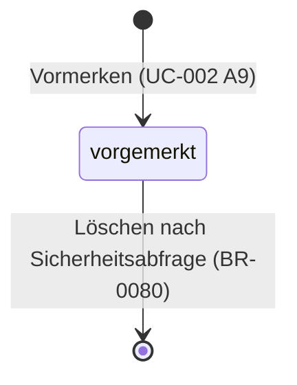

# Use Case: Vorgemerkte Überweisungen verwalten

## Überblick

**Use Case ID:** UC-017  
**Name:** Vorgemerkte Überweisungen verwalten  
**Bereich:** Überweisung  
**Primärakteur:** Privatkundin  
**Ziel:** Die Kundin sieht ihre vorgemerkten Terminüberweisungen mit Ausführungstag, Empfänger, Betrag und Verwendungszweck und löscht einen vorgemerkten Auftrag vor der Ausführung, damit er nicht ausgeführt wird.  
**Ziele:** Z-8  
**Anforderungen:** NFR-001

## Vorbedingungen

- Die Kundin ist angemeldet, es gibt eine gültige Sitzung (NFR-001).

## Standardablauf

1. Die Kundin wählt in der Überweisung „Vorgemerkte Überweisungen“.
2. Das System zeigt die vorgemerkten Aufträge der Kundin (BR-0080, GET /api/terminueberweisungen) mit Ausführungstag, Empfänger, IBAN des Empfängers, Betrag in Euro und Verwendungszweck, nach Ausführungstag aufsteigend, bei gleichem Tag der früher vorgemerkte zuerst.
3. Die Kundin wählt unter „Auftrag löschen“ einen Auftrag und wählt „Löschen“.
4. Das System löscht den Auftrag nicht sofort, sondern fragt mit „Vorgemerkten Auftrag löschen?“ nach.
5. Die Kundin bestätigt die Abfrage mit „Ja“.
6. Das System löscht den Auftrag endgültig (BR-0080, DELETE /api/terminueberweisungen/{auftragsId}); er wird nicht ausgeführt und es entsteht kein Umsatz. Das System zeigt die verbleibenden Aufträge mit der Meldung „Vorgemerkter Auftrag gelöscht.“.

## Alternativabläufe

### A1: Keine vorgemerkten Aufträge

**Auslöser:** Die Kundin hat keinen vorgemerkten Auftrag. (Schritt 2).  
**Ablauf:**

1. Das System zeigt statt der Liste „Sie haben keine vorgemerkten Überweisungen.“; zum Löschen gibt es nichts.

### A2: Löschen abbrechen

**Auslöser:** Die Kundin wählt bei der Sicherheitsabfrage „Nein“. (Schritt 5).  
**Ablauf:**

1. Der Auftrag bleibt unverändert vorgemerkt und das System zeigt die vorgemerkten Aufträge ohne Meldung.

### A3: Keine gültige Sitzung

**Auslöser:** Es gibt keine gültige Sitzung. (Schritt 1).  
**Ablauf:**

1. Das System leitet auf die Anmeldeseite um.
2. Die Kundin meldet sich an; danach beginnt der Standardablauf erneut, oder sie bricht ab.

## Sequenzdiagramm

## Zustandsdiagramm

## Nachbedingungen

### Erfolg

- Die Kundin sieht ihre vorgemerkten Aufträge; ein gelöschter Auftrag steht nicht mehr in der Liste und wird nicht ausgeführt.

### Fehlschlag

- Kein Auftrag gelöscht; die Kundin sieht die unveränderte Liste.

## Geschäftsregeln

### BR-0080: Vorgemerkte Aufträge der angemeldeten Kundin

Der Dienst liefert und löscht nur Aufträge mit Status vorgemerkt der angemeldeten Kundin aus der Sitzung. Eine unbekannte, fremde oder bereits ausgeführte Auftrags-Kennung beantwortet er beim Löschen mit 404, ohne gültige Sitzung mit 401. Ein vorgemerkter Auftrag lässt sich löschen, solange sein Status vorgemerkt ist; gelöscht ist er endgültig, verschwindet aus der Liste und wird nicht ausgeführt.

## Weitere Prüfungen

- **WP-1** (Unit-Test): Der Dienst liefert und löscht nur vorgemerkte Aufträge der angemeldeten Kundin; eine fremde, unbekannte oder ausgeführte Auftrags-Kennung beantwortet er mit 404, ohne gültige Sitzung mit 401 (BR-0080, A3).

## Notizen

Neu in PK-53. Angezeigt und gelöscht werden nur Aufträge mit Status vorgemerkt; die Ausführung am Ausführungstag ist nicht Teil dieser Story, ein Auftrag bleibt daher vorgemerkt, bis die Kundin ihn löscht. Die vorgemerkten Aufträge liegen wie die Konten nur im Speicher und gehören zum Ausgangsstand beider Resets (ADR-002); der Ausgangsstand führt keine vorgemerkten Aufträge.
