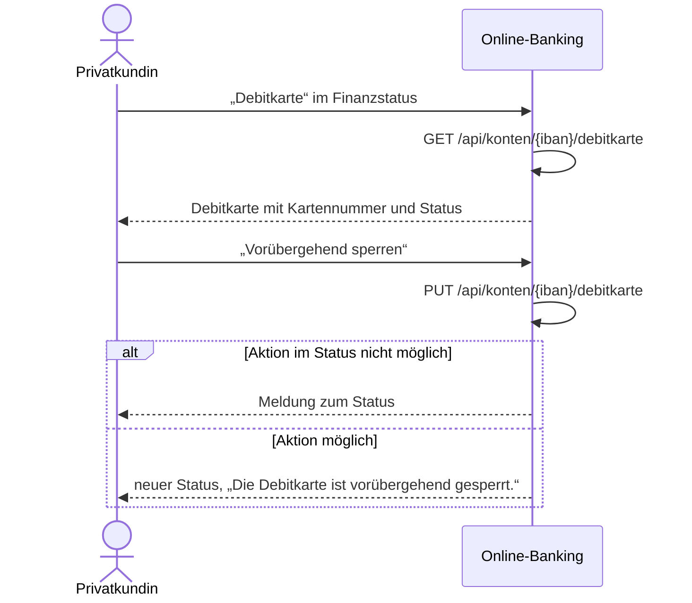

# Use Case: Debitkarte sperren und entsperren

## Überblick

**Use Case ID:** UC-018  
**Name:** Debitkarte sperren und entsperren  
**Bereich:** Debitkarte  
**Primärakteur:** Privatkundin  
**Ziel:** Die Kundin sperrt die Debitkarte zu ihrem Girokonto vorübergehend und entsperrt sie wieder oder sperrt sie bei Verlust oder Diebstahl endgültig, damit niemand die Karte missbraucht.  
**Ziele:** Z-8  
**Anforderungen:** NFR-001

## Vorbedingungen

- Die Kundin ist angemeldet, es gibt eine gültige Sitzung (NFR-001).
- Das Girokonto der Kundin hat eine Debitkarte.

## Standardablauf

1. Die Kundin wählt im Finanzstatus beim Girokonto „Debitkarte“.
2. Das System zeigt die Debitkarte des Girokontos (BR-0082) mit maskierter Kartennummer und Status, bei endgültiger Sperre auch mit dem Sperrgrund.
3. Die Kundin wählt „Vorübergehend sperren“.
4. Das System prüft den Statuswechsel (BR-0081; bei einer Abweichung 409), setzt den Status auf „vorübergehend gesperrt“ und zeigt die Debitkarte mit der Meldung „Die Debitkarte ist vorübergehend gesperrt.“.

## Alternativabläufe

### A1: Debitkarte entsperren

**Auslöser:** Die Kundin wählt statt „Vorübergehend sperren“ die Aktion „Entsperren“. (Schritt 3).  
**Ablauf:**

1. Das System prüft den Statuswechsel (BR-0081); ist die Debitkarte vorübergehend gesperrt, setzt es den Status auf „aktiv“ und zeigt die Debitkarte mit der Meldung „Die Debitkarte ist wieder aktiv.“.
2. Ist die Aktion im Status nicht möglich, geht der Ablauf bei A4 weiter.

### A2: Debitkarte endgültig sperren

**Auslöser:** Die Kundin meldet Verlust oder Diebstahl, wählt unter „Endgültig sperren“ einen Sperrgrund („Verlust“ oder „Diebstahl“) und wählt „Endgültig sperren“. (Schritt 3).  
**Ablauf:**

1. Das System ändert noch nichts, fragt mit „Debitkarte endgültig sperren?“ nach und bietet „Bestätigen“ und „Abbrechen“ an.
2. Bestätigt die Kundin mit „Bestätigen“, prüft der Dienst den Sperrgrund nach dem Datenmodell (Debitkarte.sperrgrund; Abweichung siehe A3) und danach den Statuswechsel (BR-0081), setzt den Status auf „endgültig gesperrt“, speichert den Sperrgrund und das System zeigt die Debitkarte mit dem Sperrgrund und der Meldung „Die Debitkarte ist endgültig gesperrt. Grund: Verlust.“ beziehungsweise „Grund: Diebstahl.“; die Karte lässt sich danach nicht mehr entsperren.
3. Wählt die Kundin „Abbrechen“, bricht sie die endgültige Sperre ab: die Debitkarte bleibt unverändert und das System zeigt sie ohne Meldung.

### A3: Sperrgrund oder Status ungültig

**Auslöser:** Die Kundin hat bei der endgültigen Sperre keinen Sperrgrund gewählt (die Auswahl hat eine leere Vorauswahl) und bestätigt, oder der Sperrgrund ist bei Zielstatus endgültig gesperrt weder „Verlust“ noch „Diebstahl“ (Debitkarte.sperrgrund; bei anderem Zielstatus wird ein Sperrgrund ignoriert), oder der Zielstatus im Aufruf ist keiner der drei Status (Debitkarte.status). (Schritt 4).  
**Ablauf:**

1. Der Dienst antwortet nach der Bestätigung mit 400; das System sperrt die Karte nicht, lässt den Status unverändert und zeigt „Bitte wählen Sie den Sperrgrund Verlust oder Diebstahl.“ im Formular.
2. Die Kundin wählt einen Sperrgrund; der Ablauf geht bei A2 weiter, oder sie wechselt zu einer anderen Seite.

### A4: Aktion im Status nicht möglich

**Auslöser:** Die gewählte Aktion ist im aktuellen Status der Debitkarte nach BR-0081 nicht zulässig, etwa Entsperren einer endgültig gesperrten Karte oder Sperren einer schon gesperrten Karte. (Schritt 4).  
**Ablauf:**

1. Der Dienst antwortet mit 409; das System ändert nichts, der Status bleibt unverändert, auch wenn das Ziel der Aktion schon erreicht ist, und es zeigt die Meldung zum Status: „Die Debitkarte ist bereits vorübergehend gesperrt.“, „Die Debitkarte ist endgültig gesperrt und lässt sich nicht vorübergehend sperren.“, „Die Debitkarte ist nicht gesperrt.“, „Die Debitkarte ist endgültig gesperrt und lässt sich nicht entsperren.“ oder „Die Debitkarte ist bereits endgültig gesperrt.“.
2. Die Kundin wählt eine andere Aktion oder wechselt zu einer anderen Seite.

### A5: Konto ohne Debitkarte

**Auslöser:** Die IBAN gehört nicht zu einem Girokonto der angemeldeten Kundin mit Debitkarte, etwa bei einer Kreditkarte, einer fremden oder unbekannten IBAN (BR-0082). (Schritt 2).  
**Ablauf:**

1. Der Dienst antwortet mit 404; das System zeigt „Zu diesem Konto gibt es keine Debitkarte.“ und keine Aktionen.
2. Die Kundin wechselt zum Finanzstatus.

### A6: Keine gültige Sitzung

**Auslöser:** Es gibt keine gültige Sitzung. (Schritt 1).  
**Ablauf:**

1. Das System leitet auf die Anmeldeseite um; der Dienst beantwortet GET und PUT /api/konten/{iban}/debitkarte mit Status 401.
2. Die Kundin meldet sich an; danach beginnt der Standardablauf erneut, oder sie bricht ab.

## Sequenzdiagramm

## Nachbedingungen

### Erfolg

- Die Debitkarte hat den neuen Status (aktiv, vorübergehend gesperrt oder endgültig gesperrt); bei endgültiger Sperre ist der Sperrgrund gespeichert.
- Die Kundin sieht den neuen Status und die Meldung zur Aktion.

### Fehlschlag

- Der Status der Debitkarte ist unverändert; die Kundin sieht die Meldung zum Grund und bleibt bei der Debitkarte.

## Geschäftsregeln

### BR-0081: Zulässige Statuswechsel der Debitkarte

Die Debitkarte hat den Status aktiv, vorübergehend gesperrt oder endgültig gesperrt. Zulässig sind: Sperren von aktiv zu vorübergehend gesperrt, Entsperren von vorübergehend gesperrt zu aktiv und endgültig Sperren von aktiv oder vorübergehend gesperrt zu endgültig gesperrt mit einem Sperrgrund (Debitkarte.sperrgrund). Endgültig gesperrt bleibt gesperrt und ist nie wieder änderbar. Jede andere Aktion lehnt der Dienst mit 409 ab, auch wenn das Ziel schon erreicht ist (Sperren einer schon vorübergehend gesperrten Karte): der Status bleibt unverändert und die Meldung nennt den Status, nämlich „Die Debitkarte ist bereits vorübergehend gesperrt.“, „Die Debitkarte ist endgültig gesperrt und lässt sich nicht vorübergehend sperren.“, „Die Debitkarte ist nicht gesperrt.“ (Entsperren einer aktiven Karte), „Die Debitkarte ist endgültig gesperrt und lässt sich nicht entsperren.“ oder „Die Debitkarte ist bereits endgültig gesperrt.“. Ein Sperrgrund, der bei Zielstatus aktiv oder vorübergehend gesperrt mitgeschickt wird, bleibt ohne Wirkung: der Dienst ignoriert ihn und speichert ihn nicht, die Antwort ist 200 oder bei unzulässigem Wechsel 409, und eine Debitkarte ohne endgültige Sperre hat keinen Sperrgrund. Bei einer endgültig gesperrten Karte (409) bleibt der gespeicherte Sperrgrund unverändert erhalten. Der Dienst prüft in dieser Reihenfolge: Sitzung (401), Konto (404, BR-0082), Format von Zielstatus und, nur bei Zielstatus endgültig gesperrt, des Sperrgrunds (400), zuletzt den Statuswechsel (409).

### BR-0082: Debitkarte nur zum Girokonto der Kundin

Der Dienst liefert und ändert die Debitkarte nur zu einer IBAN, die zum Girokonto der angemeldeten Kundin gehört und eine Debitkarte hat. Eine Kreditkarte, eine fremde oder unbekannte IBAN beantwortet er mit 404 und die Seite zeigt „Zu diesem Konto gibt es keine Debitkarte.“, ohne gültige Sitzung mit 401.

## Weitere Prüfungen

- **WP-1** (Unit-Test): Alle zulässigen Statuswechsel und je Status alle unzulässigen Aktionen mit ihrer Meldung und unverändertem Status (BR-0081).

## Notizen

Die Debitkarte liegt wie die Konten nur im Speicher und gehört zum Ausgangsstand von POST /api/test/reset (ADR-002): lena.hoffmann führt die Karte „**** 4821“, jonas.weber „**** 7305“, beide mit Status aktiv und ohne Sperrgrund. Die Maske bietet die Aktionen immer an; ob sie im Status möglich ist, entscheidet der Dienst. Die Auswahl des Sperrgrunds hat eine leere Vorauswahl und die Maske prüft sie nicht vorab, damit die Prüfung und Meldung des Dienstes (400) erreichbar bleibt. Die Operation setzt den Zielstatus: Sperren ist Zielstatus vorübergehend gesperrt, Entsperren Zielstatus aktiv, endgültig Sperren Zielstatus endgültig gesperrt mit Sperrgrund. Ein Sperrgrund bei einem anderen Zielstatus als endgültig gesperrt wird ignoriert und nicht gespeichert (BR-0081). Nicht Teil dieses Use Cases: Ersatzkarte, Benachrichtigung, automatische Entsperrung, Sperre durch Bank oder Support, Auswirkung auf Zahlungen und Überweisungen, Kartenlimits, Sperrhistorie.
