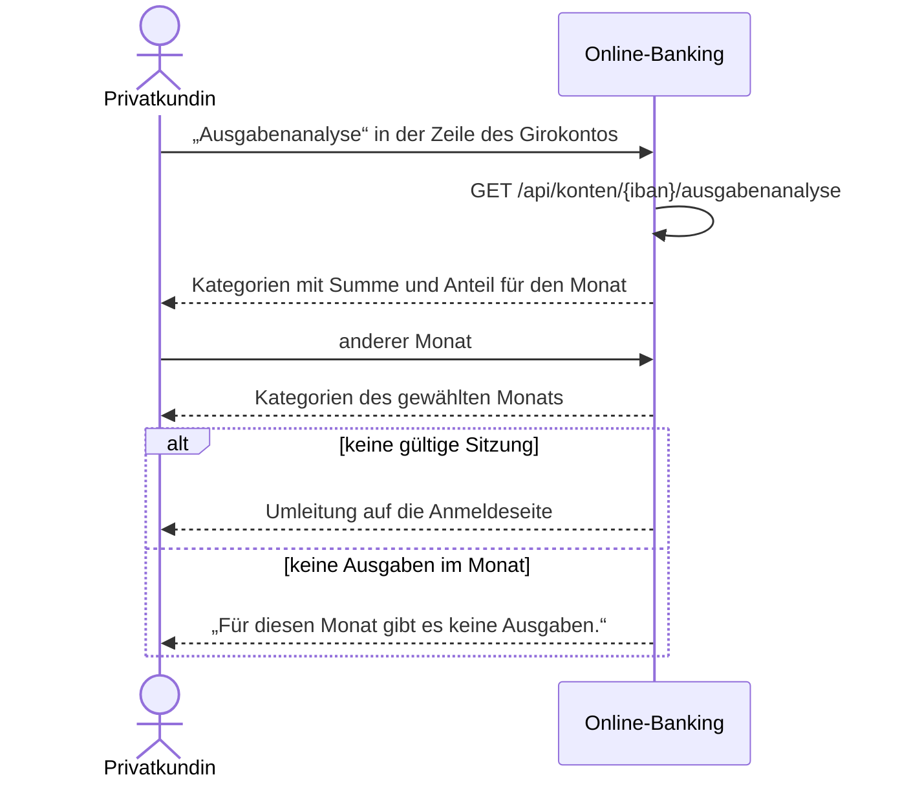

# Use Case: Ausgabenanalyse des Girokontos anzeigen

## Überblick

**Use Case ID:** UC-019  
**Name:** Ausgabenanalyse des Girokontos anzeigen  
**Bereich:** Finanzstatus  
**Primärakteur:** Privatkundin  
**Ziel:** Die Kundin sieht die Ausgaben ihres Girokontos in einem von ihr gewählten Monat nach Kategorien gruppiert, je Kategorie mit Summe und Anteil an den Gesamtausgaben.  
**Ziele:** Z-8  
**Anforderungen:** NFR-001, C-001

## Vorbedingungen

- Die Kundin ist angemeldet, es gibt eine gültige Sitzung (NFR-001).
- Die Kundin hat im Finanzstatus in der Zeile des Girokontos oder in den Umsätzen „Ausgabenanalyse“ gewählt.

## Standardablauf

1. Die Kundin wählt im Finanzstatus in der Zeile des Girokontos oder in den Umsätzen „Ausgabenanalyse“.
2. Das System prüft zuerst den Monat (Ausgabenanalyse.monat), dann dass die IBAN zu einem Konto der Kundin gehört und zuletzt dass es das Girokonto ist (BR-0084), und liest das Konto der Kundin und seine Umsätze (Demo-Daten, C-001).
3. Das System zeigt Kontoname und IBAN des Kontos und das Feld Monat, vorbelegt mit dem laufenden Monat.
4. Das System wählt die Ausgänge des Monats (BR-0009), gruppiert sie nach Kategorie und bildet je Kategorie Summe und Anteil sowie die Gesamtausgaben (BR-0083).
5. Das System zeigt die Gesamtausgaben und die Kategorien in einer Tabelle mit Kategorie, Summe in Euro und Anteil in Prozent.
6. Die Kundin wählt einen anderen Monat.
7. Das System zeigt die Ausgaben des gewählten Monats nach Kategorien wie in den Schritten 4 und 5.
8. Die Kundin liest Summe und Anteil der Kategorien ab.

## Alternativabläufe

### A1: Nicht angemeldet

**Auslöser:** Es gibt keine gültige Sitzung. (Schritt 1).  
**Ablauf:**

1. Das System leitet auf die Anmeldeseite um.
2. Die Kundin meldet sich an; danach beginnt der Standardablauf erneut, oder sie bricht ab.

### A2: Keine Ausgaben im Monat

**Auslöser:** Das Girokonto hat im gewählten Monat keinen Ausgang (BR-0083). (Schritt 5).  
**Ablauf:**

1. Das System zeigt den Hinweis „Für diesen Monat gibt es keine Ausgaben.“ und keine Zeile.

### A3: Konto nicht gefunden

**Auslöser:** Der Monat ist gültig, aber die IBAN gehört zu keinem Konto der angemeldeten Kundin (BR-0084). (Schritt 2).  
**Ablauf:**

1. Das System zeigt die Meldung „Das Konto wurde nicht gefunden.“ und keine Kategorien.

### A4: Konto ist kein Girokonto

**Auslöser:** Der Monat ist gültig und die IBAN gehört zu einer Kreditkarte der Kundin (BR-0084). (Schritt 2).  
**Ablauf:**

1. Das System zeigt die Meldung „Die Ausgabenanalyse gibt es nur für das Girokonto.“ und keine Kategorien.

### A5: Monat ungültig

**Auslöser:** Der Monat fehlt oder entspricht nicht den Feldregeln von Ausgabenanalyse.monat (Format JJJJ-MM, Monat 01 bis 12). Das System prüft den Monat vor dem Konto (BR-0084). (Schritt 2).  
**Ablauf:**

1. Das System zeigt die Meldung „Der Monat ist ungültig: erwartet JJJJ-MM.“ statt der Tabelle und keine Kategorien.
2. Einen Hinweis nach A2 zeigt das System nicht.
3. Trifft zugleich A3 oder A4 zu, zeigt das System nur diese Meldung zum Monat.

## Sequenzdiagramm

## Nachbedingungen

### Erfolg

- Die Ausgaben des gewählten Monats sind je Kategorie mit Summe und Anteil sichtbar, zusammen mit den Gesamtausgaben.
- Die Summen der Kategorien ergeben die Gesamtausgaben des Monats.

### Fehlschlag

- Ohne gültige Sitzung wurden keine Auswertungen gezeigt; die Anmeldeseite ist zu sehen.

## Geschäftsregeln

### BR-0083: Gruppierung, Summe und Anteil der Ausgaben je Kategorie

Die Ausgabenanalyse eines Monats berücksichtigt die Ausgänge des Girokontos (BR-0009), deren Buchungstag im gewählten Monat liegt, erster und letzter Tag eingeschlossen; Eingänge zählen nicht. Sie rechnet aus allen Umsätzen des Kontos; die Grenze von 200 Umsätzen je Konto im Testbetrieb gilt nur für die Umsatzliste und den Export, nicht für die Ausgabenanalyse, sodass Summe, Anteil und Gesamtausgaben für jeden Monat vollständig sind. Sie gruppiert diese Ausgänge nach der Kategorie des Umsatzes, und nur Kategorien mit mindestens einem Ausgang erscheinen. Die Summe einer Kategorie ist die Summe der Beträge ihrer Ausgänge als positive Zahl in Euro, auf Cent gerundet (ADR-005); die Gesamtausgaben sind die Summe der Kategoriesummen. Der Anteil einer Kategorie ist ihre Summe geteilt durch die Gesamtausgaben mal 100, kaufmännisch auf eine Nachkommastelle gerundet, ohne Ausgleich auf 100 %. Die Kategorien stehen mit der größten Summe zuerst, bei gleicher Summe alphabetisch nach Kategorie. Hat der Monat keinen Ausgang, liefert der Dienst eine leere Kategorienliste mit den Gesamtausgaben 0 und die Seite zeigt den Hinweis nach A2.

### BR-0084: Ausgabenanalyse nur für das Girokonto der Kundin

Die Ausgabenanalyse liefert der Dienst nur zu einer IBAN, die zu einem Konto der angemeldeten Kundin gehört; sonst antwortet er mit 404 und dem Feld fehler „Das Konto wurde nicht gefunden.“ und liefert keine Kategorien; die Seite zeigt diese Meldung. Außerdem gibt es die Ausgabenanalyse nur zu einem Konto der Art Girokonto. Gehört die IBAN zu einer Kreditkarte der angemeldeten Kundin, antwortet der Dienst mit 422 und dem Feld fehler „Die Ausgabenanalyse gibt es nur für das Girokonto.“ und liefert keine Kategorien; die Seite zeigt diese Meldung. Bei mehreren zutreffenden Fällen gilt die Reihenfolge: zuerst der Monat (400), dann das Konto (404), dann die Kreditkarte (422).

## Notizen

Die Kategorie trägt der Umsatz (Entität Umsatz): Die Demo-Umsätze bringen sie fest mit, der Umsatz einer neuen Überweisung erhält „Sonstiges“ (BR-0012). Kategorien ändern oder zuordnen kann die Kundin nicht. Muster für Aufbau, Monatsgrenzen und Meldungen sind UC-003, BR-0010 und BR-0011.
