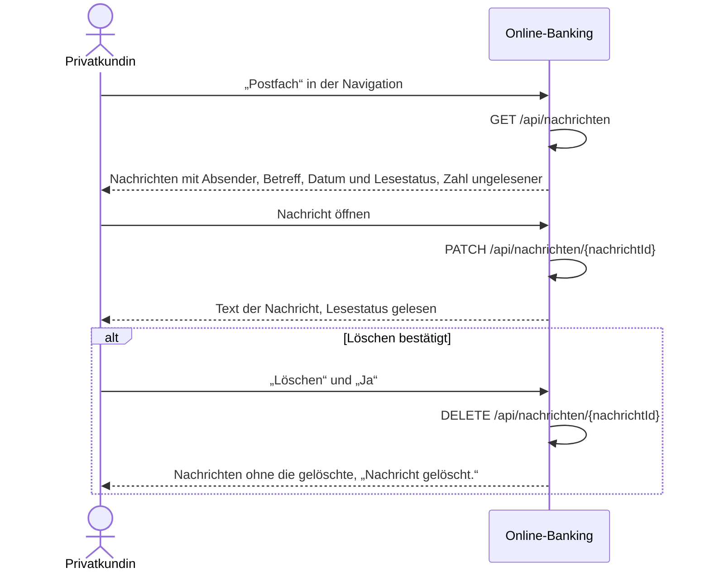

# Use Case: Postfach der Bank lesen und verwalten

## Überblick

**Use Case ID:** UC-020  
**Name:** Postfach der Bank lesen und verwalten  
**Bereich:** Postfach  
**Primärakteur:** Privatkundin  
**Ziel:** Die Kundin liest die Nachrichten der Bank an sie, löscht Nachrichten, die sie nicht mehr braucht, und sieht in der Navigation, wie viele Nachrichten ungelesen sind, damit sie keine Nachricht der Bank übersieht.  
**Ziele:** Z-8  
**Anforderungen:** NFR-001

## Vorbedingungen

- Die Kundin ist angemeldet, es gibt eine gültige Sitzung (NFR-001).

## Standardablauf

1. Die Kundin sieht in der Navigation jeder angemeldeten Seite den Eintrag „Postfach“, bei ungelesenen Nachrichten mit ihrer Zahl (BR-0086), und wählt ihn.
2. Das System zeigt die Nachrichten der Kundin (BR-0085) mit Absender, Betreff, Datum und Lesestatus, nach Datum absteigend (neueste zuerst), und die Zahl der ungelesenen Nachrichten (BR-0086).
3. Die Kundin öffnet eine Nachricht.
4. Das System zeigt den Text der Nachricht, setzt ihren Lesestatus auf gelesen (BR-0087) und zeigt die Liste und die Zahl in der Navigation neu (BR-0086).

## Alternativabläufe

### A1: Nachricht löschen

**Auslöser:** Die Kundin wählt unter „Nachricht löschen“ eine Nachricht und wählt „Löschen“. (Schritt 2).  
**Ablauf:**

1. Das System löscht die Nachricht nicht sofort, sondern fragt mit „Nachricht löschen?“ nach.
2. Bestätigt die Kundin die Abfrage, löscht das System die Nachricht endgültig aus dem Postfach der Kundin (BR-0085) und zeigt die verbleibenden Nachrichten mit der Meldung „Nachricht gelöscht.“; war die Nachricht ungelesen, sinkt die Zahl ungelesener Nachrichten (BR-0086).

### A2: Löschen abgebrochen

**Auslöser:** Die Kundin bricht die Abfrage „Nachricht löschen?“ ab. (Schritt 2).  
**Ablauf:**

1. Das System lässt die Nachricht und ihren Lesestatus unverändert und zeigt die Nachrichten ohne Meldung.

### A3: Keine gültige Sitzung

**Auslöser:** Es gibt keine gültige Sitzung; GET, PATCH und DELETE unter /api/nachrichten antworten mit 401 (BR-0085). (Schritt 1).  
**Ablauf:**

1. Das System leitet auf die Anmeldeseite um.
2. Die Kundin meldet sich an; danach beginnt der Standardablauf erneut, oder sie bricht ab.

### A4: Nachricht nicht vorhanden

**Auslöser:** Die Kennung der gewählten Nachricht ist unbekannt oder gehört einer anderen Kundin, etwa weil die Nachricht inzwischen gelöscht ist; PATCH und DELETE antworten mit 404 (BR-0085). (Schritt 3).  
**Ablauf:**

1. Das System ändert nichts und zeigt das Postfach mit der aktuellen Liste und Zahl neu.
2. Die Kundin wählt eine andere Nachricht; der Ablauf geht bei Schritt 3 weiter, oder sie bricht ab.

### A5: Formatfehler der Nachrichten-Kennung

**Auslöser:** Die Kennung der Nachricht verletzt die Feldregeln des Datenmodells (Nachricht.nachrichtId); PATCH und DELETE antworten mit 400. (Schritt 3).  
**Ablauf:**

1. Das System ändert nichts und zeigt das Postfach mit der aktuellen Liste und Zahl neu.
2. Die Kundin wählt eine andere Nachricht; der Ablauf geht bei Schritt 3 weiter, oder sie bricht ab.

### A6: Keine Nachrichten

**Auslöser:** Die Kundin hat keine Nachricht (mehr), etwa nach dem Löschen der letzten. (Schritt 2).  
**Ablauf:**

1. Das System zeigt statt der Tabelle den Hinweis „Keine Nachrichten.“ und die Zahl ungelesener Nachrichten 0; die Navigation zeigt den Eintrag „Postfach“ ohne Zahl (BR-0086).
2. Die Auswahllisten „Nachricht zum Öffnen“ und „Nachricht zum Löschen“ sind leer, „Öffnen“ und „Löschen“ sind nicht auswählbar, ein vorher angezeigter Text der Nachricht wird geleert; die Kundin verlässt das Postfach über die Navigation.

## Sequenzdiagramm

## Nachbedingungen

### Erfolg

- Die geöffnete Nachricht hat den Lesestatus gelesen, eine bestätigt gelöschte Nachricht ist aus dem Postfach entfernt, und die Zahl ungelesener Nachrichten in der Navigation stimmt mit dem Postfach überein.

### Fehlschlag

- Keine Nachricht ist als gelesen markiert oder gelöscht; die Kundin bleibt im Postfach.

## Geschäftsregeln

### BR-0085: Nachrichten der angemeldeten Kundin

Der Dienst liefert, markiert als gelesen und löscht nur Nachrichten der angemeldeten Kundin. Eine fremde oder unbekannte Nachrichten-Kennung beantwortet er mit 404, ohne gültige Sitzung mit 401.

### BR-0086: Zahl ungelesener Nachrichten

Als ungelesen zählt jede Nachricht der angemeldeten Kundin mit Lesestatus false; gelöschte Nachrichten zählen nicht. Der Dienst nennt die Zahl als anzahlUngelesen in der Antwort auf GET /api/nachrichten. Die Zahl sinkt beim Öffnen und beim Löschen einer ungelesenen Nachricht.

### BR-0087: Lesestatus beim Öffnen

Eine Nachricht gilt als gelesen, sobald die Kundin sie öffnet: der Dienst setzt den Lesestatus auf true und speichert ihn. Eine eigene Aktion zum Markieren gibt es nicht, ein Zurücksetzen auf ungelesen auch nicht. Öffnet die Kundin eine gelesene Nachricht erneut, bleibt der Lesestatus true, die Zahl ungelesener Nachrichten unverändert und der Dienst antwortet mit 200.

## Weitere Prüfungen

- **WP-1** (Unit-Test): Der Dienst liefert, markiert und löscht nur Nachrichten der angemeldeten Kundin; eine fremde oder unbekannte Nachrichten-Kennung beantwortet er mit 404, ohne gültige Sitzung mit 401 (BR-0085).

## Notizen

Die Nachrichten sind Demo-Daten (C-001); das Erzeugen durch die Bank ist nicht Teil dieses Use Case. Sie liegen wie die Konten nur im Speicher und gehören zum Ausgangsstand von POST /api/test/reset (ADR-002): lena.hoffmann hat drei Nachrichten (17.11.2026 „Ihre Kreditkartenabrechnung liegt vor“ ungelesen, 12.11.2026 „Neue Sicherheitshinweise zum Online-Banking“ ungelesen, 02.11.2026 „Ihr Kontoauszug für Oktober“ gelesen), jonas.weber eine gelesene (10.11.2026 „Willkommen im Postfach“). Der Text von „Neue Sicherheitshinweise zum Online-Banking“ lautet „Bitte geben Sie Ihre PIN niemals an Dritte weiter. Die Bank fragt sie nie per E-Mail oder Telefon ab.“, der Text von „Ihr Kontoauszug für Oktober“ lautet „Ihr Kontoauszug für Oktober liegt zum Abruf bereit.“ Die Oberfläche ruft beim Öffnen PATCH auf; die Navigation holt die Zahl über GET /api/nachrichten.
