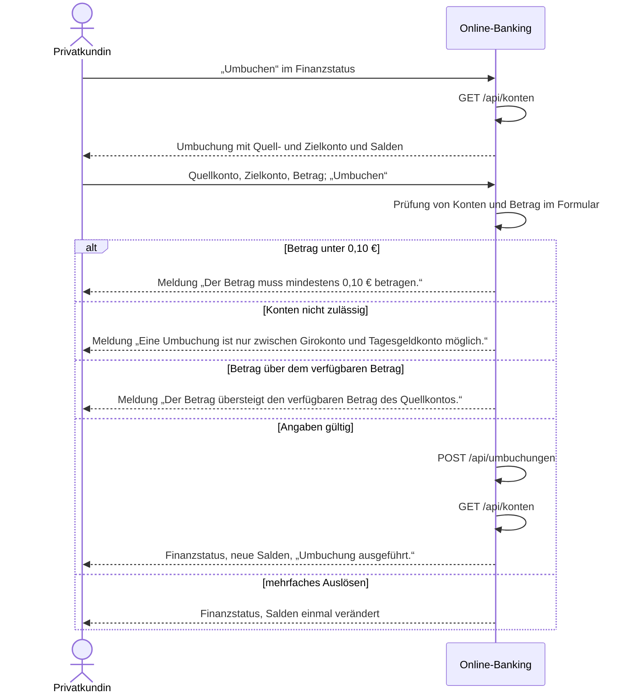

# Use Case: Umbuchung zwischen eigenen Konten

## Überblick

**Use Case ID:** UC-021  
**Name:** Umbuchung zwischen eigenen Konten  
**Bereich:** Überweisung  
**Primärakteur:** Privatkundin  
**Ziel:** Die Kundin bucht einen Betrag zwischen ihrem Girokonto und ihrem Tagesgeldkonto in beide Richtungen sofort um, ohne IBAN-Eingabe und ohne TAN, und sieht danach die neuen Salden und die Meldung „Umbuchung ausgeführt.“.  
**Ziele:** Z-8  
**Anforderungen:** NFR-001, NFR-002, C-001

## Vorbedingungen

- Die Kundin ist angemeldet, es gibt eine gültige Sitzung (NFR-001).
- Die Kundin hat im Finanzstatus „Umbuchen“ gewählt.

## Standardablauf

1. System zeigt die Umbuchung mit der Auswahl Quellkonto und Zielkonto, je mit Kontoname, IBAN und Saldo, das Quellkonto mit dem Girokonto und das Zielkonto mit dem Tagesgeldkonto vorbelegt, und mit dem Feld Betrag in Euro.
2. Kundin wählt bei Bedarf andere Konten, gibt den Betrag ein und wählt „Umbuchen“; es gibt keine IBAN-Eingabe und keine TAN-Abfrage (A4).
3. System prüft im Formular den Betrag (Feldregel von Umbuchung.betrag), die Konten (BR-0088) und die Betragsgrenze des Quellkontos (BR-0089) und zeigt bei einer Abweichung die Meldung im Formular der Umbuchung.
4. Der Dienst prüft beim Umbuchen in dieser Reihenfolge: die gültige Sitzung (401), die Feldregeln der Anfrage einschließlich des Mindestbetrags von Umbuchung.betrag (400), die Wiederholung (ist die auftragsId dieser Kundin schon ausgeführt, antwortet der Dienst mit 200 und der ursprünglichen Umbuchung, bucht nichts und prüft nichts weiter, BR-0092), die Zugehörigkeit beider Konten zur Kundin (403, BR-0088), die Kontenpaarung (422, BR-0088) und den Betrag gegen den aktuellen verfügbaren Betrag des Quellkontos (422, BR-0089); die erste Verletzung lehnt ab, und es wird nichts gebucht. Der Dienst nennt im Feld fehler den Fachtext dieses Use Case: bei 400 wegen des Mindestbetrags „Der Betrag muss mindestens 0,10 € betragen.“, bei 422 zu BR-0088 „Eine Umbuchung ist nur zwischen Girokonto und Tagesgeldkonto möglich.“ und zu BR-0089 „Der Betrag übersteigt den verfügbaren Betrag des Quellkontos.“. Die Oberfläche zeigt bei 400 wegen des Mindestbetrags und bei 422 diesen Text im Formular, bei jedem anderen 400 (Formatfehler von IBAN oder auftragsId) die Meldung „Die Umbuchung konnte nicht ausgeführt werden.“ (A6).
5. System führt die Umbuchung sofort und genau einmal aus: Es mindert den Saldo des Quellkontos und erhöht den Saldo des Zielkontos um den Betrag (BR-0091, BR-0092).
6. System legt auf beiden Konten einen Umsatz an (BR-0090).
7. System zeigt den Finanzstatus mit den neuen Salden und der Meldung „Umbuchung ausgeführt.“.
8. Kundin sieht die Umbuchung als neuesten Umsatz in den Umsätzen beider Konten (BR-0090).

## Alternativabläufe

### A1: Betrag unter dem Mindestbetrag

**Auslöser:** Der Betrag verletzt die Feldregel von Umbuchung.betrag im Datenmodell (mindestens 0,10 €). (Schritt 3).  
**Ablauf:**

1. Das System bucht nicht um und zeigt die Meldung „Der Betrag muss mindestens 0,10 € betragen.“ im Formular.
2. Lehnt der Dienst den Betrag beim Umbuchen wegen der Feldregel von Umbuchung.betrag mit 400 ab (Schritt 4), zeigt das System die Meldung im Formular mit den bisherigen Eingaben und gibt den Knopf „Umbuchen“ wieder frei.
3. Die Kundin ändert den Betrag; der Ablauf geht bei Schritt 2 weiter.

### A2: Betrag über dem verfügbaren Betrag des Quellkontos

**Auslöser:** Der Betrag übersteigt den verfügbaren Betrag des Quellkontos (BR-0089). (Schritt 3).  
**Ablauf:**

1. Das System bucht nicht um und zeigt die Meldung „Der Betrag übersteigt den verfügbaren Betrag des Quellkontos.“ im Formular.
2. Lehnt der Dienst den Betrag beim Umbuchen mit 422 ab (Schritt 4), zeigt das System die Meldung im Formular mit den bisherigen Eingaben und gibt den Knopf „Umbuchen“ wieder frei.
3. Die Kundin ändert den Betrag; der Ablauf geht bei Schritt 2 weiter.

### A3: Konten nicht zulässig

**Auslöser:** Quell- und Zielkonto sind dasselbe Konto oder nicht ein Girokonto und ein Tagesgeldkonto (BR-0088). (Schritt 3).  
**Ablauf:**

1. Das System bucht nicht um und zeigt die Meldung „Eine Umbuchung ist nur zwischen Girokonto und Tagesgeldkonto möglich.“ im Formular.
2. Lehnt der Dienst die Konten beim Umbuchen mit 422 ab (Schritt 4), zeigt das System die Meldung im Formular mit den bisherigen Eingaben und gibt den Knopf „Umbuchen“ wieder frei.
3. Die Kundin ändert die Konten; der Ablauf geht bei Schritt 2 weiter.

### A4: Mehrfaches Auslösen

**Auslöser:** Die Kundin wählt „Umbuchen“ für dieselbe Umbuchung mehrfach, etwa durch einen Doppelklick. (Schritt 2).  
**Ablauf:**

1. Das System bucht nur einmal um; weitere Anfragen mit derselben Auftrags-Kennung buchen nicht erneut (BR-0092).
2. Der Dienst erkennt die Wiederholung vor den Prüfungen von Konten und Betrag und antwortet mit 200, auch wenn der Betrag den verfügbaren Betrag des Quellkontos nach der ersten Umbuchung übersteigen würde.
3. Die Kundin sieht den Finanzstatus mit den einmal veränderten Salden und der Meldung „Umbuchung ausgeführt.“.

### A5: Keine gültige Sitzung

**Auslöser:** Es gibt keine gültige Sitzung. (Schritt 1).  
**Ablauf:**

1. Das System leitet auf die Anmeldeseite um.
2. Die Kundin meldet sich an; danach beginnt der Standardablauf erneut, oder sie bricht ab.

### A6: Umbuchung abgelehnt

**Auslöser:** Der Dienst lehnt das Quell- oder Zielkonto ab, weil es nicht zur Kundin gehört (403, BR-0088), lehnt mit 400 wegen einer anderen Feldregel als Umbuchung.betrag ab oder antwortet mit einem Fehler außerhalb von 400, 401 und 422. (Schritt 4).  
**Ablauf:**

1. Das System bucht nicht um, zeigt die Meldung „Die Umbuchung konnte nicht ausgeführt werden.“ im Formular mit den bisherigen Eingaben und gibt den Knopf „Umbuchen“ wieder frei.
2. Antwortet der Dienst stattdessen mit 401, leitet das System auf die Anmeldeseite um (A5); es wird nichts gebucht.

## Sequenzdiagramm

## Nachbedingungen

### Erfolg

- Die Umbuchung ist genau einmal ausgeführt; der Saldo des Quellkontos ist um den Betrag gemindert, der des Zielkontos um den Betrag erhöht, das Gesamtvermögen unverändert.
- Der Finanzstatus zeigt die neuen Salden und die Meldung „Umbuchung ausgeführt.“.
- Die Umbuchung steht als neuester Umsatz in den Umsätzen beider Konten.

### Fehlschlag

- Nichts umgebucht, beide Salden unverändert; die Kundin sieht die Meldung zum Grund und bleibt bei der Umbuchung.

## Geschäftsregeln

### BR-0088: Umbuchung nur zwischen verschiedenen eigenen Konten

Quell- und Zielkonto der Umbuchung gehören zur angemeldeten Kundin; sonst bucht das System nicht um (403). Sie sind zwei verschiedene Konten, ein Girokonto und ein Tagesgeldkonto der Kundin, in beide Richtungen; sonst bucht das System nicht um (422) und zeigt „Eine Umbuchung ist nur zwischen Girokonto und Tagesgeldkonto möglich.“.

### BR-0089: Betragsgrenze des Quellkontos

Der Betrag übersteigt den verfügbaren Betrag des Quellkontos nicht: beim Girokonto Saldo plus Dispositionsrahmen (BR-0002, wie BR-0004), beim Tagesgeldkonto der Saldo, da es keinen Dispositionsrahmen hat. Sonst bucht das System nicht um (422) und zeigt „Der Betrag übersteigt den verfügbaren Betrag des Quellkontos.“.

### BR-0090: Umsatz einer Umbuchung

Mit der Ausführung entsteht auf jedem der beiden Konten genau ein Umsatz: Buchungstag ist der Tag der Ausführung, gebuchtAm der Ausführungszeitpunkt als Zeitpunkt in UTC (erfasstAm der Umbuchung), Gegenpartei der Kontoname des anderen Kontos, Verwendungszweck „Umbuchung“, Saldo danach der neue Saldo des jeweiligen Kontos. Der Betrag ist auf dem Quellkonto ein Ausgang (negativ), auf dem Zielkonto ein Eingang (positiv). Eine weitere Anfrage derselben Auftrags-Kennung erzeugt keinen weiteren Umsatz (BR-0092).

### BR-0091: Saldo nach der Umbuchung

Nach der Ausführung ist der Saldo des Quellkontos um den Betrag gemindert und der Saldo des Zielkontos um den Betrag erhöht; beides geschieht zusammen oder gar nicht. Das Gesamtvermögen des Finanzstatus bleibt unverändert (BR-0001).

### BR-0092: Genau einmalige Ausführung der Umbuchung

Eine Umbuchung wird genau einmal ausgeführt. Die Seite sperrt den Knopf „Umbuchen“ während des Absendens, gibt je Umbuchung eine Auftrags-Kennung mit und vergibt nach jeder Ablehnung eine neue Auftrags-Kennung; eine wiederholte Anfrage derselben Kennung derselben Kundin ändert die Salden nicht erneut.

## Notizen

Sofortige Umbuchung ohne TAN und ohne Zwischenbestätigung. Das Tageslimit (UC-015) gilt für Überweisungen, nicht für diese Umbuchung. Terminierte und wiederkehrende Umbuchungen, Umbuchungen zu fremden Konten, Benachrichtigungen und Storno sind nicht Teil dieser Story. Das Tagesgeldkonto ist ein Demo-Konto (C-001).
