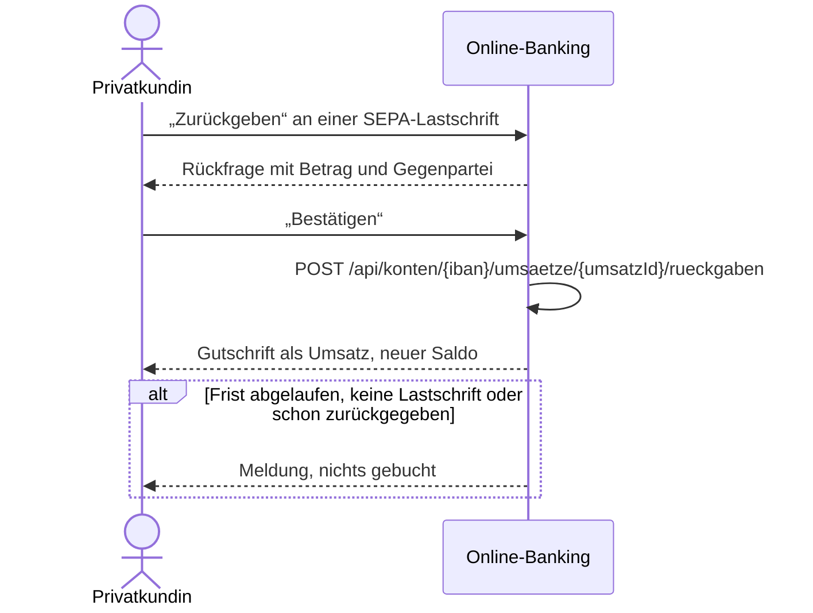

# Use Case: Lastschrift zurückgeben

## Überblick

**Use Case ID:** UC-022  
**Name:** Lastschrift zurückgeben  
**Bereich:** Finanzstatus  
**Primärakteur:** Privatkundin  
**Ziel:** Die Kundin gibt eine SEPA-Lastschrift aus den Umsätzen ihres Girokontos innerhalb von 8 Wochen nach der Belastung zurück, der Betrag wird ihrem Girokonto wieder gutgeschrieben und die Gutschrift erscheint als Umsatz mit Saldo danach.  
**Ziele:** Z-14  
**Anforderungen:** NFR-001, C-001

## Vorbedingungen

- Die Kundin ist angemeldet, es gibt eine gültige Sitzung (NFR-001).
- Die Kundin hat die Umsätze ihres Girokontos geöffnet (UC-003) und sieht dort eine SEPA-Lastschrift, die noch nicht zurückgegeben ist.

## Standardablauf

1. Die Kundin wählt in der Zeile einer SEPA-Lastschrift der Umsätze „Zurückgeben“; die Aktion führt die umsatzId der Zeile mit.
2. Das System zeigt die Rückfrage „Lastschrift über {Betrag in Euro ohne Vorzeichen, z. B. 29,90 €} von {Gegenpartei} zurückgeben? Die Rückgabe lässt sich nicht rückgängig machen.“ mit „Bestätigen“ und „Abbrechen“.
3. Die Kundin wählt „Bestätigen“.
4. Das System sperrt „Bestätigen“, bis der Dienst antwortet, und ruft POST /api/konten/{iban}/umsaetze/{umsatzId}/rueckgaben mit der IBAN des Kontos und der umsatzId der gewählten Zeile auf.
5. Das System prüft, dass der Umsatz zu einem Konto der Kundin gehört (BR-0011), eine SEPA-Lastschrift ist, noch nicht zurückgegeben wurde (BR-0094) und die Rückgabefrist von 8 Wochen nicht abgelaufen ist (BR-0093).
6. Das System schreibt den Betrag dem Girokonto gut, legt den Umsatz der Gutschrift an und kennzeichnet die Lastschrift als zurückgegeben (BR-0095).
7. Das System lädt die Umsätze neu, zeigt die Gutschrift als neuesten Umsatz und die Meldung „Lastschrift zurückgegeben: {Betrag} gutgeschrieben, neuer Saldo {Saldo}.“, beide in Euro.

## Alternativabläufe

### A1: Rückfrage abgebrochen

**Auslöser:** Die Kundin wählt in der Rückfrage „Abbrechen“. (Schritt 3).  
**Ablauf:**

1. Das System schließt die Rückfrage und bucht nichts; die Lastschrift zeigt weiter „Zurückgeben“.

### A2: Konto oder Umsatz nicht gefunden

**Auslöser:** Die IBAN gehört zu keinem Konto der Kundin (BR-0011) oder das Konto hat keinen Umsatz mit dieser umsatzId (BR-0094); der Dienst antwortet mit 404. (Schritt 5).  
**Ablauf:**

1. Das System schließt die Rückfrage, lädt die Umsätze neu und zeigt bei fremder IBAN die Meldung „Das Konto wurde nicht gefunden.“, sonst „Der Umsatz wurde nicht gefunden.“; es bucht nichts.

### A3: Keine SEPA-Lastschrift

**Auslöser:** Der Umsatz ist keine SEPA-Lastschrift (BR-0094); der Dienst antwortet mit 422. (Schritt 5).  
**Ablauf:**

1. Das System schließt die Rückfrage, lädt die Umsätze neu und zeigt die Meldung „Dieser Umsatz ist keine SEPA-Lastschrift.“; es bucht nichts.

### A4: Schon zurückgegeben

**Auslöser:** Die Lastschrift ist bereits zurückgegeben (BR-0094), etwa weil die Kundin die Rückgabe ein zweites Mal bestätigt; der Dienst antwortet mit 422. (Schritt 5).  
**Ablauf:**

1. Das System schließt die Rückfrage, lädt die Umsätze neu und zeigt die Meldung „Die Lastschrift wurde bereits zurückgegeben.“; es bucht nichts, und die Zeile der Lastschrift zeigt „Zurückgegeben“.

### A5: Rückgabefrist abgelaufen

**Auslöser:** Der Buchungstag der Lastschrift liegt mehr als 56 Tage zurück (BR-0093); der Dienst antwortet mit 422. (Schritt 5).  
**Ablauf:**

1. Das System schließt die Rückfrage, lädt die Umsätze neu und zeigt die Meldung „Die Rückgabefrist von 8 Wochen ist abgelaufen.“; es bucht nichts, und die Zeile der Lastschrift zeigt weiter „Zurückgeben“.

### A6: Nicht angemeldet

**Auslöser:** Beim Bestätigen gibt es keine gültige Sitzung (NFR-001); der Dienst antwortet mit 401. (Schritt 4).  
**Ablauf:**

1. Das System bucht nichts und leitet auf die Anmeldeseite um.
2. Die Kundin meldet sich an; danach beginnt der Standardablauf erneut, oder sie bricht ab.

### A7: umsatzId verletzt die Feldbedingung

**Auslöser:** Die umsatzId verletzt die Feldbedingung des Datenmodells (Entität Umsatz, umsatzId); der Dienst antwortet mit 400 (Formatfehler). (Schritt 4).  
**Ablauf:**

1. Das System schließt die Rückfrage, lädt die Umsätze neu und zeigt die Meldung aus dem Feld fehler der Antwort; es bucht nichts.

## Sequenzdiagramm

## Nachbedingungen

### Erfolg

- Der Betrag der Lastschrift ist dem Girokonto gutgeschrieben, der Saldo des Girokontos ist um den Betrag erhöht; das Gesamtvermögen folgt daraus nach BR-0001.
- Die Gutschrift ist als Umsatz mit Saldo danach sichtbar, die Lastschrift ist als zurückgegeben gekennzeichnet und lässt sich nicht erneut zurückgeben.

### Fehlschlag

- Bei jeder Ablehnung und beim Abbruch sind Saldo und Umsätze unverändert.

## Geschäftsregeln

### BR-0093: Rückgabefrist von 8 Wochen

Eine SEPA-Lastschrift lässt sich nur zurückgeben, wenn seit ihrem Buchungstag höchstens 56 Tage (8 Wochen) vergangen sind; der Buchungstag zählt als Tag 0, gemessen wird gegen den heutigen Kalendertag in UTC. Liegt der Buchungstag länger zurück, antwortet der Dienst mit 422 und dem Feld fehler „Die Rückgabefrist von 8 Wochen ist abgelaufen.“ und bucht nichts; die Seite zeigt diese Meldung. Maßgeblich ist die Prüfung des Dienstes (ADR-004).

### BR-0094: Nur SEPA-Lastschriften des Girokontos und nur einmal zurückgebbar

Zurückgeben lässt sich nur ein Umsatz mit sepaLastschrift true; nur das Girokonto trägt SEPA-Lastschriften, jeder andere Umsatz, auch jeder Umsatz der Kreditkarte, ist keine. Sonst antwortet der Dienst mit 422 und dem Feld fehler „Dieser Umsatz ist keine SEPA-Lastschrift.“. Ist zurueckgegeben schon true, antwortet er mit 422 und „Die Lastschrift wurde bereits zurückgegeben.“; eine wiederholte Bestätigung bucht nicht erneut und erzeugt keinen weiteren Umsatz. Gehört zur umsatzId kein Umsatz des Kontos, antwortet der Dienst mit 404 und „Der Umsatz wurde nicht gefunden.“. Reihenfolge der Prüfungen: Konto (404, BR-0011), Umsatz (404), Lastschrift (422), schon zurückgegeben (422), Frist (422, BR-0093).

### BR-0095: Gutschrift und Umsatz einer Rückgabe

Mit der Rückgabe entsteht genau ein Umsatz auf dem Girokonto: Buchungstag ist der heutige Tag, gebuchtAm der Zeitpunkt der Rückgabe in UTC, Gegenpartei die der Lastschrift, Verwendungszweck der feste Text „Rückgabe Lastschrift“, Betrag der Betrag der Lastschrift als Eingang (positiv, BR-0009) und Saldo danach der um diesen Betrag erhöhte Saldo des Girokontos; der neue Umsatz ist keine SEPA-Lastschrift und nicht zurückgegeben. Die Lastschrift selbst trägt danach zurueckgegeben true und bleibt unverändert sichtbar. Das Gesamtvermögen folgt aus dem neuen Saldo nach BR-0001, die Reihenfolge der Umsätze nach BR-0008, Beträge sind auf Cent gerundet (ADR-005).

## Notizen

Die Rückgabe wird in den Umsätzen des Girokontos ausgelöst (UC-003). Die Rückbuchung beim Einreicher gibt es nicht (C-001). Der Ausgangsstand trägt zwei Demo-Lastschriften mit Buchungstag relativ zum Tag des Resets, eine in der Frist und eine darüber hinaus.
