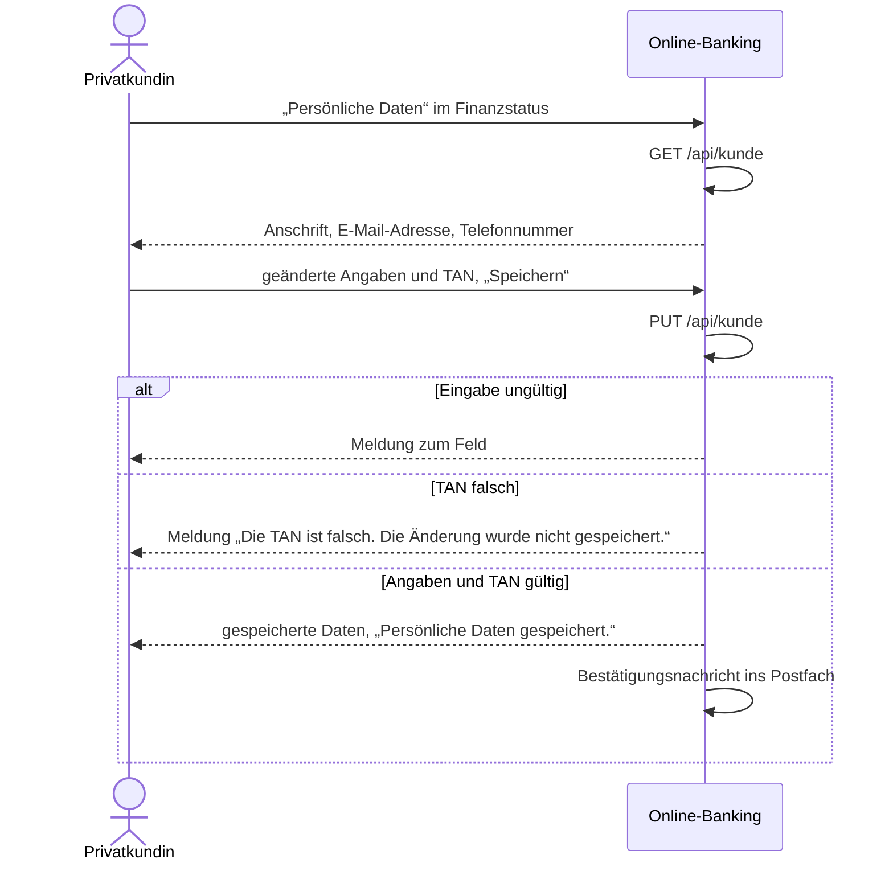

# Use Case: Persönliche Daten anzeigen und ändern

## Überblick

**Use Case ID:** UC-023  
**Name:** Persönliche Daten anzeigen und ändern  
**Bereich:** Kundendaten  
**Primärakteur:** Privatkundin  
**Ziel:** Die Kundin sieht ihre Anschrift, E-Mail-Adresse und Telefonnummer und ändert sie selbst, bestätigt jede Änderung mit einer TAN (Mock) und erhält eine Bestätigungsnachricht im Postfach, damit ihre Kontaktdaten bei der Bank aktuell sind.  
**Ziele:** Z-8  
**Anforderungen:** NFR-001

## Vorbedingungen

- Die Kundin ist angemeldet, es gibt eine gültige Sitzung (NFR-001).

## Standardablauf

1. Die Kundin wählt im Finanzstatus „Persönliche Daten“.
2. Das System zeigt Straße und Hausnummer, Postleitzahl, Ort, E-Mail-Adresse und Telefonnummer der Kundin (Kunde).
3. Die Kundin ändert eine oder mehrere Angaben, gibt im Feld „TAN“ die TAN ein und wählt „Speichern“.
4. Das System entfernt führende und folgende Leerzeichen von Straße, Ort, E-Mail-Adresse und Telefonnummer und prüft die Felder dann nach dem Datenmodell (Kunde.strasse, Kunde.postleitzahl, Kunde.ort, Kunde.email, Kunde.telefonnummer, Kunde.tan) und zeigt bei einer Abweichung die Meldung im Formular; danach prüft der Dienst die TAN (BR-0096).
5. Das System speichert die Angaben am Kunden, legt für die geänderten Angaben eine Bestätigungsnachricht im Postfach der Kundin an (BR-0097) und zeigt die gespeicherten Daten mit der Meldung „Persönliche Daten gespeichert.“.

## Alternativabläufe

### A1: Eingabe ungültig

**Auslöser:** Eine Angabe verletzt nach dem Entfernen der Randleerzeichen ihre Feldregel im Datenmodell: Straße oder Ort sind leer (auch nur Leerzeichen) oder zu lang, die Postleitzahl hat nicht genau 5 Ziffern, E-Mail-Adresse oder Telefonnummer verletzen Muster oder Länge, oder die TAN hat nicht genau 6 Ziffern (Kunde.strasse, Kunde.postleitzahl, Kunde.ort, Kunde.email, Kunde.telefonnummer, Kunde.tan). (Schritt 4).  
**Ablauf:**

1. Der Dienst antwortet mit Status 400; das System speichert nichts, legt keine Nachricht an und zeigt die Meldung zum Feld im Formular: „Bitte geben Sie Straße und Hausnummer an.“, „Die Straße darf höchstens 100 Zeichen lang sein.“, „Die Postleitzahl muss aus 5 Ziffern bestehen.“, „Bitte geben Sie den Ort an.“, „Der Ort darf höchstens 60 Zeichen lang sein.“, „Die E-Mail-Adresse ist ungültig.“, „Die Telefonnummer ist ungültig.“ oder „Die TAN muss aus 6 Ziffern bestehen.“.
2. Die Kundin korrigiert die Eingabe; der Ablauf geht bei Schritt 3 weiter, oder sie wechselt zu einer anderen Seite.

### A2: TAN falsch

**Auslöser:** Die TAN hat 6 Ziffern, ist aber nicht die TAN (Mock) nach BR-0096. (Schritt 4).  
**Ablauf:**

1. Der Dienst antwortet mit Status 422; das System speichert nichts, legt keine Nachricht an, lässt die gespeicherten Daten unverändert und zeigt „Die TAN ist falsch. Die Änderung wurde nicht gespeichert.“ im Formular.
2. Die Kundin gibt die TAN erneut ein; der Ablauf geht bei Schritt 3 weiter, oder sie wechselt zu einer anderen Seite.

### A3: Keine gültige Sitzung

**Auslöser:** Es gibt keine gültige Sitzung. (Schritt 1).  
**Ablauf:**

1. Das System leitet auf die Anmeldeseite um; der Dienst beantwortet GET und PUT /api/kunde mit Status 401.
2. Die Kundin meldet sich an; danach beginnt der Standardablauf erneut, oder sie bricht ab.

### A4: Keine Angabe geändert

**Auslöser:** Die Eingaben stimmen nach dem Entfernen der Randleerzeichen genau, auch in der Groß-/Kleinschreibung, mit den gespeicherten Angaben überein und die TAN ist richtig. (Schritt 5).  
**Ablauf:**

1. Das System ändert nichts, legt keine Nachricht im Postfach an (BR-0097) und zeigt die Daten mit der Meldung „Persönliche Daten gespeichert.“.

## Sequenzdiagramm

## Nachbedingungen

### Erfolg

- Die neuen Angaben stehen am Kunden und werden bei der nächsten Anzeige gezeigt.
- Das Postfach der Kundin enthält eine Bestätigungsnachricht, die nennt, welche Angaben geändert wurden.
- Das System zeigt die Meldung „Persönliche Daten gespeichert.“.

### Fehlschlag

- Die gespeicherten Angaben sind unverändert, das Postfach hat keine neue Nachricht; die Kundin sieht die Meldung zum Grund und bleibt bei den persönlichen Daten.

## Geschäftsregeln

### BR-0096: TAN-Bestätigung (Mock) einer Datenänderung

Jede Änderung der persönlichen Daten gilt nur mit der richtigen TAN. Als TAN (Mock) gilt für alle Kundinnen und alle Änderungen die feste TAN 123456; es gibt keinen Versand, keine Ablauffrist und keine Sperre nach falscher Eingabe. Der Dienst prüft die TAN erst, wenn alle Felder die Feldregeln des Datenmodells einhalten. Ist die TAN nicht 123456, speichert der Dienst nichts, legt keine Nachricht an und antwortet mit Status 422 und „Die TAN ist falsch. Die Änderung wurde nicht gespeichert.“.

### BR-0097: Bestätigungsnachricht im Postfach

Nach jeder gespeicherten Änderung, die mindestens eine Angabe ändert, legt der Dienst genau eine Nachricht im Postfach der angemeldeten Kundin an (Nachricht, Datenmodell Nachricht): Absender „Aventa Bank“, Betreff „Ihre persönlichen Daten wurden geändert“, versendetAm der Tag der Änderung, ungelesen. Der Text nennt je geänderter Angabe einen Satz, in dieser Reihenfolge: „Ihre Anschrift wurde geändert.“, „Ihre E-Mail-Adresse wurde geändert.“, „Ihre Telefonnummer wurde geändert.“; Werte nennt er nicht. Die Anschrift gilt als geändert, wenn Straße, Postleitzahl oder Ort abweichen. Verglichen wird mit den gespeicherten Angaben nach dem Entfernen der Randleerzeichen (Datenmodell Kunde) genau, auch in der Groß-/Kleinschreibung; eine reine Schreibweisenänderung der E-Mail-Adresse ist eine Änderung und löst die Nachricht aus. Bei unveränderten Angaben oder abgewiesener Änderung entsteht keine Nachricht. Der Dienst liest und ändert nur die Daten der angemeldeten Kundin aus der Sitzung, eine Kennung im Aufruf gibt es nicht.

## Notizen

Muster: UC-015 für Anzeigen und Ändern eines Kundenwerts, Maske tageslimit für Aufbau und Meldungen. Die Anschrift ist strukturiert (Straße mit Hausnummer, Postleitzahl, Ort) und nur für Deutschland. Die persönlichen Daten und das Postfach liegen nur im Speicher und gehören zum Ausgangsstand der Resets (ADR-002): Lena Hoffmann hat Lindenallee 12, 50667, Köln, lena.hoffmann@example.org, +49 221 1234567; Jonas Weber hat Hauptstraße 5, 80331, München, jonas.weber@example.org, +49 89 7654321; die Lastkunden lasttest-nnn haben Teststraße 1, 10115, Berlin, lasttest-nnn@example.org, +49 30 1234567; das Postfach ist nach jedem Reset leer. Die Nachricht ist nur im Testbetrieb über GET /api/test/postfachnachrichten prüfbar; Lesen und Löschen im Postfach gehören zu PK-57. Nicht Teil dieses Use Cases: Änderung von Name, Kennung oder PIN, echte TAN-Verfahren, Benachrichtigung per E-Mail oder SMS, Historie der Änderungen, Prüfung der neuen E-Mail-Adresse oder Telefonnummer, Anschriften außerhalb Deutschlands.
