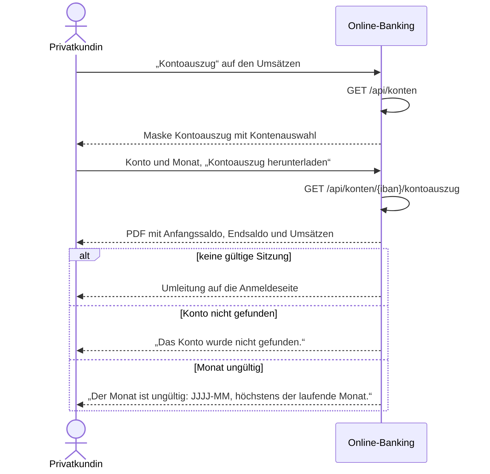

# Use Case: Kontoauszug als PDF herunterladen

## Überblick

**Use Case ID:** UC-024  
**Name:** Kontoauszug als PDF herunterladen  
**Bereich:** Finanzstatus  
**Primärakteur:** Privatkundin  
**Ziel:** Die Kundin wählt eines ihrer Konten und einen Monat und lädt den Kontoauszug als PDF herunter, mit Anfangssaldo, Endsaldo und allen Umsätzen des Monats; ein Monat ohne Umsätze ergibt einen leeren Auszug mit Saldo.  
**Ziele:** Z-8  
**Anforderungen:** NFR-001, C-001

## Vorbedingungen

- Die Kundin ist angemeldet, es gibt eine gültige Sitzung (NFR-001).

## Standardablauf

1. Die Kundin wählt auf den Umsätzen eines Kontos „Kontoauszug“ oder ruft die Maske Kontoauszug direkt mit der IBAN in der Adresse auf.
2. Das System zeigt die Maske Kontoauszug mit den Konten der Kundin zur Auswahl (GET /api/konten) und wählt das Konto vor, dessen IBAN die Adresse nennt.
3. Die Kundin wählt Konto und Monat und wählt „Kontoauszug herunterladen“.
4. Das System prüft zuerst das Konto (BR-0011) und dann den Monat (Feldregeln von Kontoauszug.monat), liest die Umsätze des Kontos mit Buchungstag im Monat (Demo-Daten, C-001), ordnet sie mit dem neuesten zuerst (BR-0008) und ermittelt Anfangs- und Endsaldo (BR-0098).
5. Das System erzeugt das PDF mit Kontoname, IBAN, Monat, Anfangssaldo, Endsaldo und allen Umsätzen des Monats mit Buchungstag, Gegenpartei, Verwendungszweck, Betrag und Saldo danach in Euro und liefert es zum Download (GET /api/konten/{iban}/kontoauszug).
6. Die Kundin lädt die Datei herunter und liest Salden und Umsätze ab.

## Alternativabläufe

### A1: Nicht angemeldet

**Auslöser:** Es gibt keine gültige Sitzung, beim Öffnen der Maske (Schritt 1) oder weil sie bis zum Herunterladen abgelaufen ist (Schritt 3, Antwort 401). (Schritt 1).  
**Ablauf:**

1. Das System leitet auf die Anmeldeseite um und liefert keine Datei; ein Abruf der Operation ohne Sitzung wird mit 401 beantwortet.
2. Die Kundin meldet sich an; danach beginnt der Standardablauf erneut, oder sie bricht ab.

### A2: Monat ohne Umsätze

**Auslöser:** Das Konto hat im gewählten Monat keine Umsätze. (Schritt 5).  
**Ablauf:**

1. Das System erzeugt einen leeren Auszug ohne Umsatzzeile, der Anfangssaldo und Endsaldo zeigt (BR-0098).
2. Der Ablauf geht mit Schritt 6 weiter.

### A3: Konto nicht gefunden

**Auslöser:** Die IBAN, mit der die Kundin den Auszug abruft, gehört zu keinem Konto der angemeldeten Kundin (BR-0011). (Schritt 4).  
**Ablauf:**

1. Das System zeigt den Hinweis „Das Konto wurde nicht gefunden.“ und liefert keine Datei; die Operation antwortet mit 404, ohne den Monat zu prüfen.

### A4: Monat ungültig

**Auslöser:** Das Konto gehört der Kundin, aber der Monat verletzt die Feldregeln von Kontoauszug.monat, etwa Format oder ein Monat nach dem laufenden. (Schritt 4).  
**Ablauf:**

1. Das System zeigt die Meldung „Der Monat ist ungültig: JJJJ-MM, höchstens der laufende Monat.“ und liefert keine Datei; die Operation antwortet mit 400.

### A5: Kontoauszug fehlgeschlagen

**Auslöser:** Der Dienst antwortet mit einem anderen Fehler als in A1, A3 und A4, etwa weil das PDF nicht erzeugt werden kann, oder ist nicht erreichbar. (Schritt 5).  
**Ablauf:**

1. Das System liefert keine Datei und zeigt die Meldung „Der Kontoauszug ist fehlgeschlagen. Bitte versuchen Sie es später erneut.“.

## Sequenzdiagramm

## Nachbedingungen

### Erfolg

- Die Kundin hat den Kontoauszug des gewählten Kontos und Monats als PDF mit Anfangssaldo, Endsaldo und allen Umsätzen des Monats, den neuesten zuerst.
- Es wurde nichts gespeichert; Konten, Salden und Umsätze sind unverändert.

### Fehlschlag

- Ohne gültige Sitzung wurde kein Auszug geliefert; die Anmeldeseite ist zu sehen.
- Bei unbekanntem Konto oder ungültigem Monat wurde keine Datei geliefert.

## Geschäftsregeln

### BR-0098: Inhalt und Salden des Kontoauszugs

Der Kontoauszug eines Kontos und Kalendermonats enthält alle Umsätze des Kontos, deren Buchungstag im Monat liegt (erster bis letzter Tag, beide eingeschlossen), neueste zuerst nach BR-0008; der Endsaldo steht oben bei der ersten Zeile. Der Endsaldo ist der Saldo danach des neuesten Umsatzes des Monats. Der Anfangssaldo ist der Saldo danach des neuesten Umsatzes vor dem Monatsersten; gibt es keinen, ist es der Saldo vor dem ersten Umsatz des Kontos (Saldo danach minus Betrag dieses Umsatzes), bei einem Konto ganz ohne Umsätze der Kontosaldo. Hat das Konto im Monat keine Umsätze, ist der Auszug leer und Anfangssaldo und Endsaldo sind gleich: der Saldo am Monatsende nach derselben Ableitung, für Monate vor dem ersten Umsatz also der Saldo vor dem ersten Umsatz. Der laufende Monat zeigt den Zwischenstand bis heute, sein Endsaldo ist der aktuelle Saldo. Beträge in Euro, auf Cent gerundet (ADR-005).

## Notizen

Der Demo-Bestand beginnt am 28.01.2026; für frühere Monate gilt der Saldo vor dem ersten Umsatz (BR-0098). Nennt die Adresse eine IBAN, die zu keinem Konto der Kundin gehört, behält die Maske sie als Auswahl; die Operation lehnt sie beim Herunterladen ab (A3). Das PDF wird beim Abruf im Dienst erzeugt und nicht abgelegt (ADR-008).
