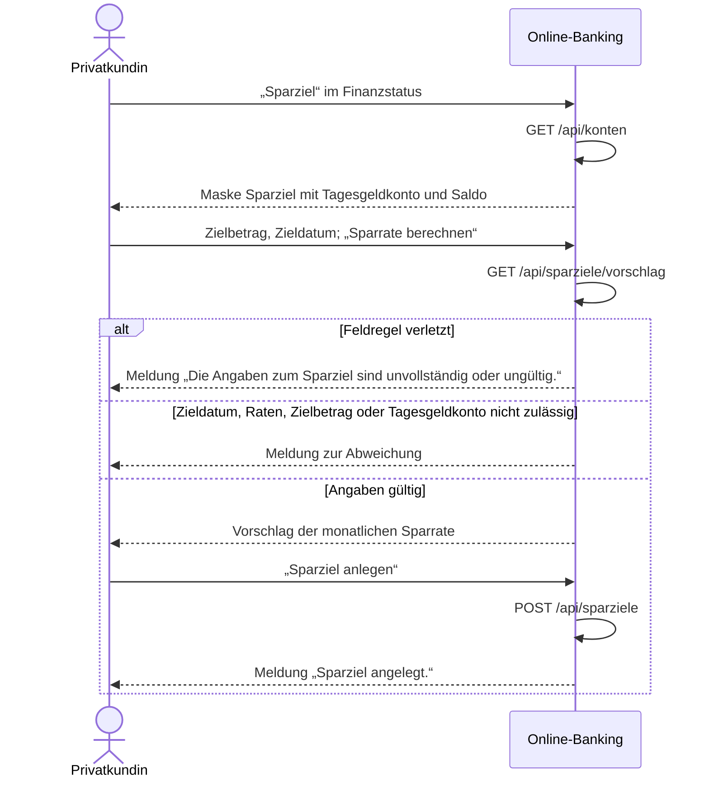

# Use Case: Sparziel mit monatlicher Sparrate anlegen

## Überblick

**Use Case ID:** UC-025  
**Name:** Sparziel mit monatlicher Sparrate anlegen  
**Bereich:** Sparziel  
**Primärakteur:** Privatkundin  
**Ziel:** Die Kundin legt für ihr Tagesgeldkonto ein Sparziel mit Zielbetrag und Zieldatum an, sieht die vom System vorgeschlagene monatliche Sparrate und lässt dafür einen Dauerauftrag vom Girokonto auf das Tagesgeldkonto einrichten, damit sie das Ziel bis zum Zieldatum erreicht.  
**Ziele:** Z-17  
**Anforderungen:** NFR-001, NFR-006, C-001

## Vorbedingungen

- Die Kundin ist angemeldet, es gibt eine gültige Sitzung (NFR-001, NFR-006).
- Die Kundin hat im Finanzstatus „Sparziel“ gewählt.

## Standardablauf

1. Die Kundin wählt im Finanzstatus „Sparziel“.
2. System zeigt die Maske Sparziel mit dem Tagesgeldkonto der Kundin (Kontoname, IBAN, Saldo) und den Feldern Zielbetrag in Euro und Zieldatum; hat die Kundin kein Tagesgeldkonto, zeigt es statt dessen die Meldung „Sie haben kein Tagesgeldkonto.“ (A5).
3. Die Kundin gibt Zielbetrag und Zieldatum ein und wählt „Sparrate berechnen“.
4. System prüft in dieser Reihenfolge: die Feldregeln nach dem Datenmodell von Sparziel (400), das Tagesgeldkonto der Kundin (422, BR-0103), dann Zieldatum, Zahl der Raten und Zielbetrag (422, BR-0102); bei einer Abweichung zeigt es die Meldung aus A1 bis A5, sonst berechnet es die monatliche Sparrate nach BR-0101 und zeigt sie als Vorschlag mit Anzahl der Raten, erstem Ausführungstag und Enddatum. Der Dienst nennt bei 400 und 422 im Feld fehler genau den Text aus A1 bis A5, die Oberfläche zeigt ihn unverändert.
5. Die Kundin prüft den Vorschlag und wählt „Sparziel anlegen“; die Maske zeigt den Vorschlag und „Sparziel anlegen“ erst nach „Sparrate berechnen“ und blendet beides aus, sobald die Kundin Zielbetrag oder Zieldatum ändert, bis sie erneut berechnet.
6. System prüft wie in Schritt 4 erneut (der Dienst ist maßgeblich, ADR-004), berechnet die Sparrate neu (hat sich der Saldo seit dem Vorschlag geändert, gilt die neu berechnete Sparrate) und legt Sparziel und Dauerauftrag zusammen an (BR-0103), den Dauerauftrag mit der IBAN des Tagesgeldkontos ohne IBAN-Prüfung nach BR-0003; bei einer Abweichung legt es nichts an.
7. System zeigt die Meldung „Sparziel angelegt.“ mit Sparrate, erstem Ausführungstag und Enddatum aus der Antwort des Dienstes; die Kundin sieht den neuen Dauerauftrag danach in den Daueraufträgen (UC-016).

## Alternativabläufe

### A1: Feldregel verletzt

**Auslöser:** Zielbetrag oder Zieldatum verletzt eine Feldregel von Sparziel im Datenmodell (fehlt, keine Zahl, unter dem Mindestbetrag, mehr als zwei Nachkommastellen, kein Datum); der Dienst antwortet mit 400. (Schritt 4).  
**Ablauf:**

1. Das System berechnet und legt nichts an und zeigt „Die Angaben zum Sparziel sind unvollständig oder ungültig.“; die bisherigen Eingaben bleiben stehen.
2. Die Kundin korrigiert die Eingabe; der Ablauf geht bei Schritt 3 weiter, oder sie bricht ab.

### A2: Zieldatum nicht in der Zukunft

**Auslöser:** Das Zieldatum liegt nicht nach heute (BR-0102). (Schritt 4).  
**Ablauf:**

1. Das System berechnet und legt nichts an und zeigt „Das Zieldatum muss in der Zukunft liegen.“; der Dienst antwortet mit 422.
2. Die Kundin ändert das Zieldatum; der Ablauf geht bei Schritt 3 weiter, oder sie bricht ab.

### A3: Bis zum Zieldatum fällt keine Rate an

**Auslöser:** Das Zieldatum liegt in der Zukunft, aber vor dem ersten Ausführungstag, sodass die Zahl der Raten 0 ist (BR-0102). (Schritt 4).  
**Ablauf:**

1. Das System berechnet und legt nichts an und zeigt „Bis zum Zieldatum fällt keine monatliche Rate an.“; der Dienst antwortet mit 422.
2. Die Kundin wählt ein späteres Zieldatum; der Ablauf geht bei Schritt 3 weiter, oder sie bricht ab.

### A4: Zielbetrag nicht über dem Saldo

**Auslöser:** Der Zielbetrag liegt nicht über dem Saldo des Tagesgeldkontos (BR-0102). (Schritt 4).  
**Ablauf:**

1. Das System berechnet und legt nichts an und zeigt „Der Zielbetrag muss über dem Saldo des Tagesgeldkontos liegen.“; der Dienst antwortet mit 422.
2. Die Kundin erhöht den Zielbetrag; der Ablauf geht bei Schritt 3 weiter, oder sie bricht ab.

### A5: Kein Tagesgeldkonto

**Auslöser:** Die Kundin hat kein Tagesgeldkonto (BR-0103). (Schritt 2).  
**Ablauf:**

1. Das System zeigt statt Kontotabelle und Formular die Meldung „Sie haben kein Tagesgeldkonto.“; ruft jemand Berechnung oder Anlegen trotzdem auf, antwortet der Dienst mit 422 und diesem Text, und es wird nichts angelegt.
2. Die Kundin verlässt die Maske.

### A6: Sparrate unter dem Mindestbetrag

**Auslöser:** Die nach BR-0101 berechnete Sparrate liegt unter dem Mindestbetrag eines Dauerauftrags von 0,10 €. (Schritt 4).  
**Ablauf:**

1. Das System schlägt 0,10 € als Sparrate vor; der Ablauf geht bei Schritt 5 weiter, das Sparziel wird mit 0,10 € angelegt.

### A7: Keine gültige Sitzung

**Auslöser:** Es gibt keine gültige Sitzung, beim Einstieg, bei der Berechnung oder beim Anlegen. (Schritt 1).  
**Ablauf:**

1. Das System leitet auf die Anmeldeseite um; ein API-Aufruf ohne Sitzung wird mit 401 beantwortet. Nicht gespeicherte Eingaben gehen verloren, es wird nichts angelegt.
2. Die Kundin meldet sich an; danach beginnt der Standardablauf erneut, oder sie bricht ab.

### A8: „Sparziel anlegen“ wird mehrfach ausgelöst

**Auslöser:** Die Kundin löst „Sparziel anlegen“ mehrfach aus, durch Doppelklick oder durch einen späteren Aufruf mit gleichem Zielbetrag und Zieldatum (BR-0103). (Schritt 6).  
**Ablauf:**

1. Die Oberfläche sperrt „Sparziel anlegen“ ab dem Auslösen bis zur Antwort des Dienstes; ein Doppelklick sendet nur einen Aufruf.
2. Erreicht den Dienst ein weiterer Aufruf, erkennt er keine Wiederholung: Jeder Aufruf legt ein eigenes Sparziel mit eigenem Dauerauftrag an und antwortet mit 201; eine Auftrags-Kennung wie bei Überweisung und Umbuchung gibt es nicht.

## Sequenzdiagramm

## Nachbedingungen

### Erfolg

- Das Sparziel ist mit Tagesgeldkonto, Zielbetrag, Zieldatum, Sparrate und Verweis auf den Dauerauftrag gespeichert.
- Der Dauerauftrag vom Girokonto auf das Tagesgeldkonto ist angelegt und steht in den Daueraufträgen der Kundin.
- Salden und Umsätze beider Konten sind unverändert.

### Fehlschlag

- Weder Sparziel noch Dauerauftrag angelegt; die Kundin sieht die Meldung zum Grund und bleibt bei der Maske Sparziel.

## Geschäftsregeln

### BR-0101: Berechnung der monatlichen Sparrate

Anlagetag ist heute, der aktuelle Kalendertag in UTC (wie BR-0077). Die Ausführungstage sind der gleiche Kalendertag des Folgemonats und jeder weitere Monat danach (Anlagetag plus 1, 2, 3 … Monate; hat ein Monat den Tag nicht, gilt sein letzter Tag). Der erste Ausführungstag ist der Anlagetag plus 1 Monat, das Enddatum des Dauerauftrags ist das Zieldatum. Die Zahl der Raten ist die Zahl der Ausführungstage bis einschließlich Zieldatum. Die Sparrate ist (Zielbetrag minus aktueller Saldo des Tagesgeldkontos) geteilt durch die Zahl der Raten, auf volle Cent aufgerundet; Zinsen bleiben unberücksichtigt. Liegt der Wert unter 0,10 €, ist die Sparrate 0,10 € und das Sparziel wird angelegt.

### BR-0102: Gültigkeit von Zielbetrag und Zieldatum eines Sparziels

Der Dienst prüft nach den Feldregeln in dieser Reihenfolge und lehnt bei der ersten Abweichung mit 422 ab, ohne etwas anzulegen: Das Zieldatum liegt nach heute („Das Zieldatum muss in der Zukunft liegen.“); die Zahl der Raten nach BR-0101 ist mindestens 1 („Bis zum Zieldatum fällt keine monatliche Rate an.“); der Zielbetrag liegt über dem aktuellen Saldo des Tagesgeldkontos („Der Zielbetrag muss über dem Saldo des Tagesgeldkontos liegen.“). Eine Obergrenze für das Zieldatum gibt es nicht.

### BR-0103: Sparziel mit Dauerauftrag für das Tagesgeldkonto der Kundin

Das Sparziel gehört zum Tagesgeldkonto der angemeldeten Kundin; hat sie keines, legt der Dienst nichts an (422, „Sie haben kein Tagesgeldkonto.“). Beim Anlegen entsteht in einem Schritt mit dem Sparziel ein Dauerauftrag mit Auftraggeberkonto Girokonto der Kundin (BR-0007), Empfänger Kontoname des Tagesgeldkontos, IBAN des Empfängers die IBAN des Tagesgeldkontos, Betrag die Sparrate nach BR-0101, Verwendungszweck „Sparrate Sparziel“, Turnus monatlich, erstem Ausführungstag und Enddatum nach BR-0101; beides geschieht zusammen oder gar nicht. Die IBAN stammt aus dem eigenen Kontobestand und wird ohne IBAN-Prüfung nach BR-0003 übernommen; ein Sparziel scheitert nie an der IBAN-Prüfung. Das Sparziel verweist auf den Dauerauftrag. Für dasselbe Tagesgeldkonto sind mehrere Sparziele zulässig, es gibt keine Prüfung und keine Höchstzahl; jeder Aufruf, auch mit gleichem Zielbetrag und Zieldatum, legt ein eigenes Sparziel mit eigenem Dauerauftrag an (201). Eine Prüfung gegen den verfügbaren Betrag des Girokontos gibt es nicht, wie bei jedem Dauerauftrag (UC-016).

## Weitere Prüfungen

- **WP-1** (Unit-Test): Der Dienst berechnet, legt an und liefert Sparziele nur für die angemeldete Kundin und ihr Tagesgeldkonto; ohne gültige Sitzung antwortet er mit 401 (NFR-006). Prüfreihenfolge: Sitzung (401), Feldregeln (400), Tagesgeldkonto (422), Zieldatum, Raten, Zielbetrag (422).

## Notizen

Aufbau und Meldungen folgen UC-016 (Dauerauftrag) und UC-021 (Girokonto und Tagesgeldkonto). Der Dauerauftrag wird wie jeder Dauerauftrag nur verwaltet und nicht ausgeführt (UC-016); Salden und Umsätze bleiben unverändert, daher geht in die Berechnung nur der Saldo zum Zeitpunkt der Berechnung ein. Sparziele liegen wie die Konten nur im Speicher und gehören zum Ausgangsstand von POST /api/test/reset (ADR-002): kein Sparziel, auch nicht für lena.hoffmann und jonas.weber. Nicht Teil dieser Story: Ändern und Löschen eines Sparziels, Anzeige mit Fortschritt, Benachrichtigungen, Anpassen der Sparrate, Zinsen. Beschluss PK-72: erster Ausführungstag am gleichen Kalendertag des Folgemonats, Enddatum gleich Zieldatum, mehrere Sparziele je Tagesgeldkonto zulässig, keine Obergrenze für das Zieldatum, Sparrate mindestens 0,10 €. Beschluss PK-72 zum Monatsende: Die Raten zählen nach BR-0101 immer nach „Anlagetag plus n Monate“. Bei einer Anlage am 29., 30. oder 31. kann das von den Ausführungstagen des monatlichen Dauerauftrags abweichen. Beispiel: Anlage am 31.01., Zieldatum 30.03.: BR-0101 zählt 1 Rate (28.02.; der 31.03. liegt nach dem Zieldatum), ein Dauerauftrag mit erstem Ausführungstag 28.02. und Enddatum 30.03. hätte 2 Ausführungstage (28.02., 28.03.). Die Abweichung wird in Kauf genommen: Der Dauerauftrag wird nicht ausgeführt, es gibt keinen Abgleich und keine eigene Meldung. Beschluss PK-72 (Klärung): Die IBAN des Tagesgeldkontos wird ohne IBAN-Prüfung nach BR-0003 als Empfänger-IBAN übernommen; jeder Aufruf von POST /api/sparziele legt ein eigenes Sparziel mit eigenem Dauerauftrag an (201), nur die Oberfläche sperrt „Sparziel anlegen“ nach dem Auslösen (wie „Umbuchen“). Herkunft: Story PK-72.
