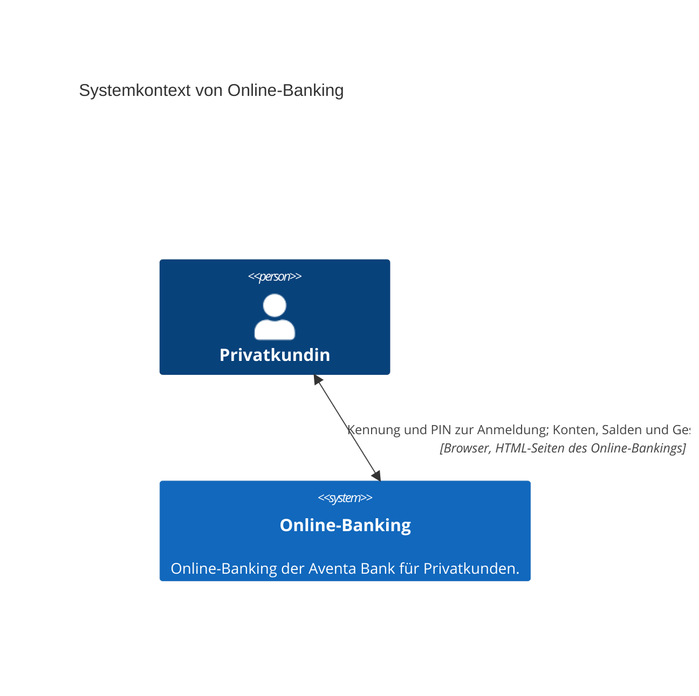

# Vision: Online-Banking

## Zweck

Online-Banking der Aventa Bank für Privatkunden. Die Kundin meldet sich mit Kennung und PIN an, sieht auf dem Finanzstatus alle ihre Konten mit Saldo und ihr Gesamtvermögen, sieht zu jedem Konto die Umsätze, analysiert die Ausgaben ihres Girokontos eines Monats nach Kategorien, überweist von ihrem Girokonto, bucht Geld zwischen Girokonto und Tagesgeldkonto um, verwaltet Daueraufträge vom Girokonto, sperrt ihre Debitkarte vorübergehend oder endgültig und liest die Nachrichten der Bank in ihrem Postfach.

## Stakeholder

| ID | Stakeholder | Interesse |
|---|---|---|
| STK-1 | Privatkundin | sieht ihre Konten, Salden, Umsätze und ihr Gesamtvermögen ohne Filiale ein und überweist selbst. |

## Ziele

| ID | Ziel | Messgröße | Zielwert |
|---|---|---|---|
| Z-1 | Alle Konten und Salden auf einen Blick | Anteil der Konten der Kundin, die der Finanzstatus mit Kontoname, IBAN und Saldo in Euro zeigt | 100 % |
| Z-2 | Gesamtvermögen als Summe der Salden | Anteil der Finanzstatus-Aufrufe, in denen das angezeigte Gesamtvermögen der Summe der angezeigten Salden entspricht | 100 % |
| Z-3 | Verfügbarer Betrag des Girokontos sichtbar | Anteil der Girokonten, deren Zeile im Finanzstatus Dispositionsrahmen und verfügbaren Betrag zeigt | 100 % |
| Z-4 | Einstieg nach der Anmeldung | Anteil der Anmeldungen, nach denen der Finanzstatus erscheint | 100 % |
| Z-5 | Überweisung vom Girokonto ausführen | Anteil der bestätigten Überweisungen, die genau einmal ausgeführt werden, im neuen Saldo des Finanzstatus und als neuester Umsatz des Girokontos sichtbar sind | 100 % |
| Z-6 | Umsätze je Konto einsehen | Anteil der Umsätze eines Kontos, die die Umsatzliste mit Buchungstag, Gegenpartei, Verwendungszweck, Betrag und Saldo danach zeigt, den neuesten zuerst | 100 % |
| Z-7 | Empfänger aus Vorlage statt Neueingabe | Anteil der Überweisungen mit gewählter Empfängervorlage, bei denen das System Empfänger und IBAN des Empfängers unverändert aus der Vorlage übernimmt und den Verwendungszweck nur übernimmt, wenn die Vorlage einen hat | 100 % |
| Z-8 | Lastschrift zurückgeben | Anteil der bestätigten Rückgaben einer SEPA-Lastschrift innerhalb der Frist von 8 Wochen, deren Betrag genau einmal gutgeschrieben wird und als Umsatz mit Saldo danach sichtbar ist | 100 % |
| Z-13 | Umbuchung zwischen eigenen Konten | Anteil der Umbuchungen, die genau einmal ausgeführt werden und in den neuen Salden beider Konten und als Umsatz beider Konten sichtbar sind | 100 % |
| Z-9 | Ausgaben des Girokontos nach Kategorien verstehen | Anteil der Aufrufe der Ausgabenanalyse eines Monats, in denen die angezeigten Kategoriesummen zusammen den Ausgängen des Girokontos in diesem Monat entsprechen | 100 % |
| Z-8 | Debitkarte selbst sperren und entsperren | Anteil der Sperr-, Entsperr- und Endgültig-Sperren-Aktionen der Kundin am Girokonto, nach denen die Debitkarte-Maske den neuen Status zeigt | 100 % |
| Z-11 | Vorgemerkte Überweisungen im Blick | Anteil der vorgemerkten Terminüberweisungen, die die Kundin mit Ausführungstag, Empfänger, Betrag und Verwendungszweck in der Liste sieht und vor der Ausführung löschen kann | 100 % |
| Z-10 | Nachrichten der Bank im Postfach lesen | Anteil der ungelesenen Nachrichten, bei denen nach dem Öffnen der Lesestatus gelesen ist und die Zahl ungelesener Nachrichten in der Navigation um eins sinkt | 100 % |
| Z-12 | Daueraufträge vom Girokonto verwalten | Anteil der angelegten Daueraufträge, die die Maske Daueraufträge mit Empfänger, IBAN, Betrag, Verwendungszweck, Turnus, erstem Ausführungstag und ggf. Enddatum zeigt und die die Kundin ändern und löschen kann | 100 % |

## Abgrenzung

- Überweisung: einmalige Überweisung vom Girokonto, sofort oder als Terminüberweisung mit Ausführungstag ab morgen bis 365 Tage voraus; eine Terminüberweisung wird nur vorgemerkt, angezeigt und gelöscht, die Ausführung am Ausführungstag, das Ändern eines vorgemerkten Auftrags folgen später.
- Daueraufträge: nur Anlegen, Anzeigen, Ändern und Löschen mit den Turnus-Arten monatlich, vierteljährlich und jährlich; die automatische Ausführung zum Fälligkeitstermin mit Umsatzbuchung, die Prüfung von Deckung, Dispositionsrahmen und Tageslimit, Benachrichtigungen, Aussetzen, weitere Turnus-Arten, das Anlegen aus einer Empfängervorlage, die Anzeige ausgeführter Daueraufträge in den Umsätzen und eine Höchstzahl je Kundin folgen später.
- Kernbanksystem: Die Konten liefert der Dienst als Demo-Daten (C-001); eine Anbindung an eine Kernbank gibt es nicht.
- Konten anlegen, ändern oder schließen.
- Umsätze: nur die im Dienst erfassten Buchungen (C-001); Eingänge von Dritten, Beleg-Download und Storno von Umsätzen folgen später; ausgenommen vom Storno ist die Rückgabe einer SEPA-Lastschrift des Girokontos innerhalb von 8 Wochen ohne Rückgabegrund und ohne Abwicklung mit dem Einreicher; der Export der Umsätze eines Kontos als CSV-Datei mit den Filtern der Umsatzliste ist enthalten, weitere Exportformate folgen später.
- Empfängervorlagen: ein Empfänger je Vorlage mit genau einer IBAN, kein Adressbuch mit mehreren Konten je Empfänger, kein Teilen von Vorlagen zwischen Kundinnen, kein Import und Export und keine Vorlagen aus einer Kernbank.
- Tageslimit: kein Anheben über das Standardlimit, keine Freigabe per TAN oder zweitem Faktor, keine Benachrichtigung und keine Historie der Änderungen, kein befristetes Limit, keine Verwaltung der Standardlimits durch die Bank und kein Limit je Konto oder Empfänger.
- Umbuchung: nur sofort zwischen Girokonto und Tagesgeldkonto der Kundin; keine terminierte oder wiederkehrende Umbuchung, keine Umbuchung zu fremden Konten oder per IBAN, kein Tageslimit für Umbuchungen, keine Benachrichtigung, keine Stornierung oder Änderung.
- Ausgabenanalyse: nur die Ausgaben des Girokontos eines Monats mit fest vorgegebenen Kategorien; keine Änderung oder Zuordnung der Kategorien durch die Kundin, keine eigenen Kategorien, keine Budgets und Warnungen, keine Analyse weiterer Konten oder Einnahmen, kein Monatsvergleich und Trend, kein Export.
- Debitkarte: nur Sperren, Entsperren und endgültiges Sperren durch die Kundin; keine Ersatzkarte, keine Benachrichtigung per E-Mail, SMS oder Push, keine automatische Entsperrung nach Zeit, keine Sperre durch Bank oder Support, keine Auswirkung der Sperre auf Zahlungen und Überweisungen, keine Kartenlimits und Kartenumsätze, keine Sperrhistorie.
- Postfach: nur Nachrichten der Bank an die Kundin, die sie liest und löscht; kein Erstellen oder Versenden durch die Bank, keine Antworten der Kundin, kein Zurücksetzen auf ungelesen, keine Benachrichtigung per E-Mail oder Push, keine Suche, kein Filter, kein Archiv, keine Anhänge und kein automatisches Löschen.

## Systemkontext

| Nachbar | Art | Richtung | Daten | Schnittstelle |
|---|---|---|---|---|
| Privatkundin | Person | beidseitig | Kennung und PIN zur Anmeldung; Konten, Salden und Gesamtvermögen | Browser, HTML-Seiten des Online-Bankings |

