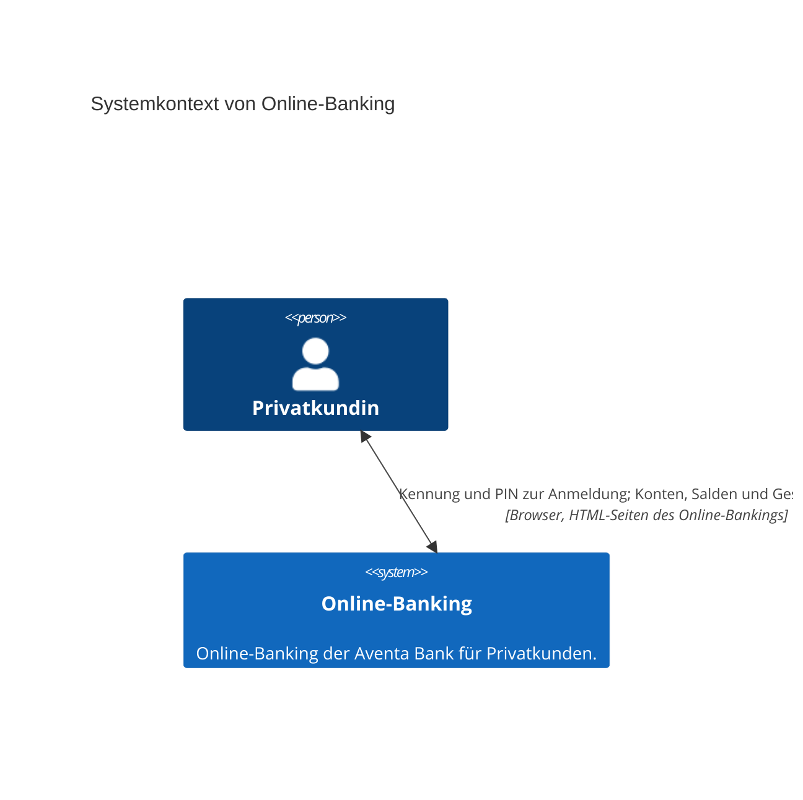

# Vision: Online-Banking

## Zweck

Online-Banking der Aventa Bank für Privatkunden. Die Kundin meldet sich mit Kennung und PIN an, sieht auf dem Finanzstatus alle ihre Konten mit Saldo und ihr Gesamtvermögen und überweist von ihrem Girokonto.

## Stakeholder

| ID | Stakeholder | Interesse |
|---|---|---|
| STK-1 | Privatkundin | sieht ihre Konten, Salden und ihr Gesamtvermögen ohne Filiale ein und überweist selbst. |

## Ziele

| ID | Ziel | Messgröße | Zielwert |
|---|---|---|---|
| Z-1 | Alle Konten und Salden auf einen Blick | Anteil der Konten der Kundin, die der Finanzstatus mit Kontoname, IBAN und Saldo in Euro zeigt | 100 % |
| Z-2 | Gesamtvermögen als Summe der Salden | Anteil der Finanzstatus-Aufrufe, in denen das angezeigte Gesamtvermögen der Summe der angezeigten Salden entspricht | 100 % |
| Z-3 | Verfügbarer Betrag des Girokontos sichtbar | Anteil der Girokonten, deren Zeile im Finanzstatus Dispositionsrahmen und verfügbaren Betrag zeigt | 100 % |
| Z-4 | Einstieg nach der Anmeldung | Anteil der Anmeldungen, nach denen der Finanzstatus erscheint | 100 % |
| Z-5 | Überweisung vom Girokonto ausführen | Anteil der bestätigten Überweisungen, die genau einmal ausgeführt werden und im neuen Saldo des Finanzstatus sichtbar sind | 100 % |
| Z-6 | Empfänger aus Vorlage statt Neueingabe | Anteil der Überweisungen mit gewählter Empfängervorlage, bei denen das System Empfänger und IBAN des Empfängers unverändert aus der Vorlage übernimmt und den Verwendungszweck nur übernimmt, wenn die Vorlage einen hat | 100 % |

## Abgrenzung

- Überweisung: nur als einmalige Überweisung vom Girokonto; Termin- und Daueraufträge folgen später.
- Kernbanksystem: Die Konten liefert der Dienst als Demo-Daten (C-001); eine Anbindung an eine Kernbank gibt es nicht.
- Konten anlegen, ändern oder schließen.
- Umsätze und Kontobewegungen zu einem Konto.
- Empfängervorlagen: ein Empfänger je Vorlage mit genau einer IBAN, kein Adressbuch mit mehreren Konten je Empfänger, kein Teilen von Vorlagen zwischen Kundinnen, kein Import und Export und keine Vorlagen aus einer Kernbank.

## Systemkontext

| Nachbar | Art | Richtung | Daten | Schnittstelle |
|---|---|---|---|---|
| Privatkundin | Person | beidseitig | Kennung und PIN zur Anmeldung; Konten, Salden und Gesamtvermögen | Browser, HTML-Seiten des Online-Bankings |

