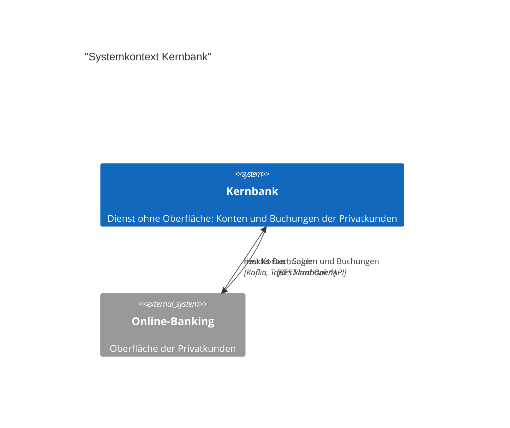

# Architektur: Kernbank

## 1. Einführung und Ziele

Aufgabe, Ziele und Stakeholder stehen in `docs/vision.md`.

## 2. Randbedingungen

Die Leitplanken des Hauses stehen in `docs/leitplanken.md`, die Randbedingungen des Systems (C-…) in `docs/requirements.md`.

## 3. Kontextabgrenzung

| Gegenüber | Richtung | Daten | Schnittstelle |
| --- | --- | --- | --- |
| Online-Banking | ausgehend | Konten, Salden und Buchungen der Privatkunden | REST unter /api laut `docs/api/openapi.yaml`; Kafka-Ereignisse in Topics mit dem Präfix `kernbank.` |

Die Kernbank hat keine Oberfläche; sie wird nur von anderen Systemen aufgerufen.

## 4. Lösungsstrategie

_Technik-Stack mit Hauptversionen und die Grundentscheidungen, die den Aufbau prägen._

## 5. Bausteinsicht

_Höchstens sieben Bausteine als C4-Diagramm (Mermaid C4Container), dazu eine Tabelle Baustein, Verantwortung, Schnittstellen, Ort; keine einzelnen Dateien._

## 6. Laufzeitsicht

_Zwei bis vier Abläufe, die Architektur zeigen, als Mermaid-Sequenzdiagramm zwischen Bausteinen und Nachbarsystemen, je Ablauf eine Überschrift._

## 7. Verteilungssicht

_Wie das System gebaut, ausgeliefert und betrieben wird: Image, Umgebungen, Infrastruktur, als C4-Diagramm (Mermaid C4Deployment)._

## 8. Querschnittliche Konzepte

_Fehlerbehandlung, Logging und Telemetrie, Sicherheit, Persistenz, Konfiguration, Zeitzonen und Formate; Testkonzept: welche Tests es gibt, wo sie liegen, wie sie laufen._

## 9. Architekturentscheidungen

Die Entscheidungen stehen einzeln unter `docs/adr/`.

## 10. Qualitätsanforderungen

Die Qualitätsanforderungen (NFR-…) stehen in `docs/requirements.md`.

## 11. Risiken und technische Schulden

_Höchstens acht Risiken mit Wirkung über einen Baustein hinaus, die schwersten zuerst: Risiko, Wirkung, Maßnahme._

## 12. Glossar

_Technische Begriffe (Tabelle Begriff, Bedeutung); Fachbegriffe stehen in der Spezifikation._
