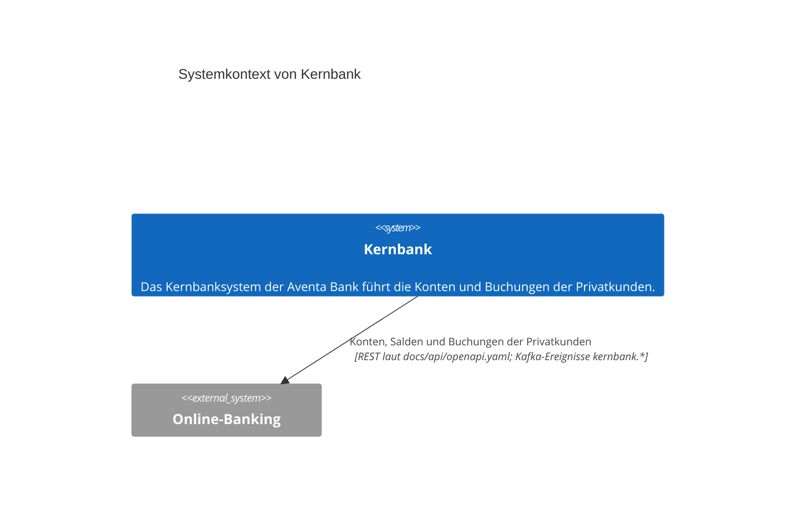

# Vision: Kernbank

## Zweck

Das Kernbanksystem der Aventa Bank führt die Konten und Buchungen der Privatkunden. Es liefert Konten, Salden und Buchungen an das Online-Banking, auf Abruf über REST und als Kafka-Ereignisse, sobald sich etwas ändert.

## Stakeholder

| ID | Stakeholder | Interesse |
|---|---|---|
| STK-1 | Online-Banking | liest Konten, Salden und Buchungen der Privatkunden und erfährt über Ereignisse von neuen Buchungen. |

## Systemkontext

| Nachbarsystem | Richtung | Daten | Schnittstelle |
|---|---|---|---|
| Online-Banking | ausgehend | Konten, Salden und Buchungen der Privatkunden | REST laut docs/api/openapi.yaml; Kafka-Ereignisse kernbank.* |

